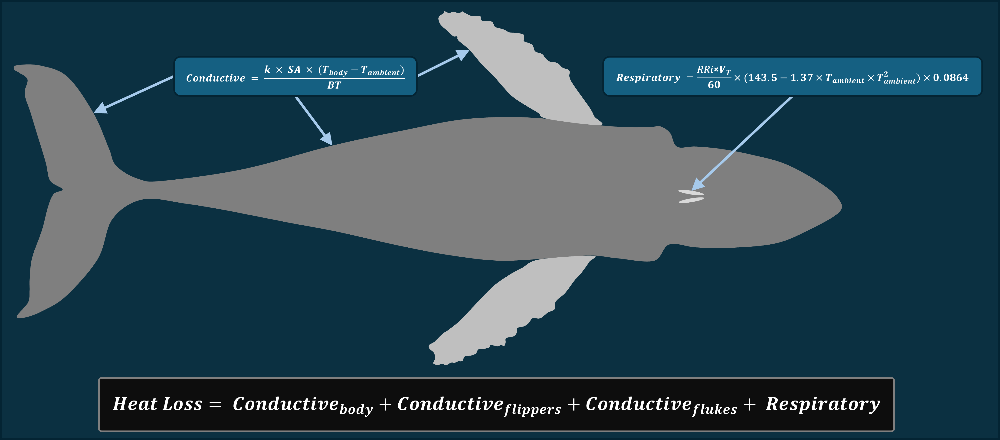

```{r setup, include=FALSE}
knitr::opts_chunk$set(echo = TRUE)
```

```{r Libraries, include=FALSE}
library(tidyverse)
library(ggplot2)
library(cowplot)
library(dplyr)
library(knitr)
library(tinytex)
library(rbbt)
library(ggspatial)
library(grid)
library(gridExtra)
library(pdftools)
library(magick)
library(PieGlyph)
library(purrr)
library(devtools)
library(patchwork)
library(flextable)
library(zoo)
library(tuneR)
library(seewave)
library(reshape2)
library(metR)
library(sf)
library(scales)
library(formatdown)
library(data.table)
library(R.matlab)
library(officer)
library(glue)
library(broom)
library(mgcv)
library(ggnewscale)

load_all()
```

```{r FUNCTION - Convert PDF to PNG, include=FALSE}
convert_pdf_to_png <- function(pdf_file, png_file, dpi = 300) {
  image <- image_read_pdf(pdf_file)
  image_write(image, path = png_file, density = dpi)
}
```

```{r FUNCTION - Linear Relationship Equation, include=FALSE}
Linear_Relationship <- function(x, y) {
  m <- lm(y ~ x)
  coef_a <- format(coef(m)[1], digits = 4)
  coef_b <- format(coef(m)[2], digits = 4)
  r2 <- format(summary(m)$r.squared, digits = 3)
  
  equation <- paste("y =", coef_a, "+", coef_b, "* x, R^2 =", r2)
  
  as.character(equation)
}

Linear_Relationship2 <- function(x, y) {
  m <- lm(y ~ x)
  coef_a <- format(coef(m)[1], digits = 4)
  coef_b <- format(coef(m)[2], digits = 4)
  
  equation <- paste("y =", coef_a, "+", coef_b, "* x")
  
  as.character(equation)
}
```

```{r FUNCTION - Heat Loss Model, include = FALSE}
heat_loss_model <- function(BodyLength, BodyMass, BodySurfaceArea, BodyBlubberThickness, FlipperSurfaceArea, FlipperChordLength, FlipperBlubberThickness, FlukeSurfaceArea, FlukeChordLength, FlukeBlubberThickness, BlubberThermalConductivity, VentilationRate, CoreBodyTemperature, WarmAmbientTemp, ColdAmbientTemp, MetabolicBetaFactor) {

  ExtremityTurnedOffTemperatureWarm = WarmAmbientTemp
  ExtremityTurnedOffTemperatureCold = ColdAmbientTemp
  TidalVolume = 0.6*0.85*(0.135*(BodyMass^0.92))
  KleiberBMR = 3.39 * (BodyMass^0.75) # in Watts
  TotalSurfaceArea = BodySurfaceArea + FlipperSurfaceArea + FlukeSurfaceArea
  
  # Log-transformed
  Log10BodyLength = log10(BodyLength)
  Log10BodySurfaceArea = log10(BodySurfaceArea)
  Log10BodyMass = log10(BodyMass)
  
  # Conductive Heat Loss Equation For Body (Glarou et al. 2025)
  WarmConductiveBodyOnlyHeatLoss = (BlubberThermalConductivity*BodySurfaceArea*(CoreBodyTemperature-WarmAmbientTemp))/BodyBlubberThickness
  WarmConductiveBodyOnlyHeatLossMassSpecific = WarmConductiveBodyOnlyHeatLoss / BodyMass
  WarmConductiveBodyOnlyHeatFluxPerArea = WarmConductiveBodyOnlyHeatLoss / BodySurfaceArea

  ColdConductiveBodyOnlyHeatLoss = (BlubberThermalConductivity*BodySurfaceArea*(CoreBodyTemperature-ColdAmbientTemp))/BodyBlubberThickness
  ColdConductiveBodyOnlyHeatLossMassSpecific = ColdConductiveBodyOnlyHeatLoss / BodyMass
  ColdConductiveBodyOnlyHeatFluxPerArea = ColdConductiveBodyOnlyHeatLoss / BodySurfaceArea

  # Conductive Heat Loss Equation for Flippers/Flukes (Glarou et al. 2025)
  WarmConductiveFlipperHeatLoss = (BlubberThermalConductivity*FlipperSurfaceArea*(CoreBodyTemperature-WarmAmbientTemp))/FlipperBlubberThickness
  WarmConductiveFlipperHeatLossMassSpecific = WarmConductiveFlipperHeatLoss / BodyMass
  WarmConductiveFlipperHeatFluxPerArea = WarmConductiveFlipperHeatLoss / FlipperSurfaceArea 
  
  WarmConductiveFlukeHeatLoss = (BlubberThermalConductivity*FlukeSurfaceArea*(CoreBodyTemperature-WarmAmbientTemp))/FlukeBlubberThickness
  WarmConductiveFlukeHeatLossMassSpecific = WarmConductiveFlukeHeatLoss / BodyMass
  WarmConductiveFlukeHeatFluxPerArea = WarmConductiveFlukeHeatLoss / FlukeSurfaceArea 
  
  WarmAppendagesConductiveHeatLoss = WarmConductiveFlipperHeatLoss + WarmConductiveFlukeHeatLoss
  WarmAppendagesConductiveHeatLossMassSpecific = WarmAppendagesConductiveHeatLoss / BodyMass
  WarmAppendagesConductiveHeatFluxPerArea = WarmAppendagesConductiveHeatLoss / (FlipperSurfaceArea + FlukeSurfaceArea)

  ColdConductiveFlipperHeatLoss = (BlubberThermalConductivity*FlipperSurfaceArea*(CoreBodyTemperature-ColdAmbientTemp))/FlipperBlubberThickness
  ColdConductiveFlipperHeatLossMassSpecific = ColdConductiveFlipperHeatLoss / BodyMass
  ColdConductiveFlipperHeatFluxPerArea = ColdConductiveFlipperHeatLoss / FlipperSurfaceArea 
  
  ColdConductiveFlukeHeatLoss = (BlubberThermalConductivity*FlukeSurfaceArea*(CoreBodyTemperature-ColdAmbientTemp))/FlukeBlubberThickness
  ColdConductiveFlukeHeatLossMassSpecific = ColdConductiveFlukeHeatLoss / BodyMass
  ColdConductiveFlukeHeatFluxPerArea = ColdConductiveFlukeHeatLoss / FlukeSurfaceArea 
  
  ColdAppendagesConductiveHeatLoss = ColdConductiveFlipperHeatLoss + ColdConductiveFlukeHeatLoss
  ColdAppendagesConductiveHeatLossMassSpecific = ColdAppendagesConductiveHeatLoss / BodyMass
  ColdAppendagesConductiveHeatFluxPerArea = ColdAppendagesConductiveHeatLoss / (FlipperSurfaceArea + FlukeSurfaceArea)
  
  # Conductive Heat Loss For Full Body + Appendages
  WarmAllConductiveHeatLoss = WarmConductiveBodyOnlyHeatLoss + WarmConductiveFlipperHeatLoss + WarmConductiveFlukeHeatLoss
  WarmAllConductiveHeatLossMassSpecific = WarmAllConductiveHeatLoss / BodyMass
  WarmAllConductiveHeatFlux = WarmAllConductiveHeatLoss / TotalSurfaceArea
  WarmAppendagesAsPercentageOfConductiveHeatLoss = WarmAppendagesConductiveHeatLoss/WarmAllConductiveHeatLoss*100
  
  ColdAllConductiveHeatLoss = ColdConductiveBodyOnlyHeatLoss + ColdConductiveFlipperHeatLoss + ColdConductiveFlukeHeatLoss
  ColdAllConductiveHeatLossMassSpecific = ColdAllConductiveHeatLoss / BodyMass
  ColdAllConductiveHeatFlux = ColdAllConductiveHeatLoss / TotalSurfaceArea
  ColdAppendagesAsPercentageOfConductiveHeatLoss = ColdAppendagesConductiveHeatLoss/ColdAllConductiveHeatLoss*100
  
  # Ventilatory Heat Loss Equation (Sumich 2021)
  WarmVentilatoryHeatLoss = (VentilationRate/60)*(143.5 - 1.37 * WarmAmbientTemp - 0.07 * (WarmAmbientTemp^2))*0.0864
  WarmVentilatoryHeatLossMassSpecific = WarmVentilatoryHeatLoss / BodyMass
  ColdVentilatoryHeatLoss = (VentilationRate/60)*(143.5 - 1.37 * ColdAmbientTemp - 0.07 * (ColdAmbientTemp^2))*0.0864
  ColdVentilatoryHeatLossMassSpecific = ColdVentilatoryHeatLoss / BodyMass
  
  # Total Heat Loss Estimation ("Open" including flippers and flukes and "Closed" without)
  WarmWindowsOpenHeatLoss = WarmConductiveBodyOnlyHeatLoss + WarmVentilatoryHeatLoss + WarmConductiveFlipperHeatLoss + WarmConductiveFlukeHeatLoss
  WarmWindowsOpenHeatLossMassSpecific = WarmWindowsOpenHeatLoss / BodyMass
  WarmWindowsClosedHeatLoss = WarmConductiveBodyOnlyHeatLoss + WarmVentilatoryHeatLoss
  WarmWindowsClosedHeatLossMassSpecific = WarmWindowsClosedHeatLoss / BodyMass

  ColdWindowsOpenHeatLoss = ColdConductiveBodyOnlyHeatLoss + ColdVentilatoryHeatLoss + ColdConductiveFlipperHeatLoss + ColdConductiveFlukeHeatLoss
  ColdWindowsOpenHeatLossMassSpecific = ColdWindowsOpenHeatLoss / BodyMass
  ColdWindowsClosedHeatLoss = ColdConductiveBodyOnlyHeatLoss + ColdVentilatoryHeatLoss
  ColdWindowsClosedHeatLossMassSpecific = ColdWindowsClosedHeatLoss / BodyMass
  
  # Basal Metabolic Rate to Heat Loss Ratios (Thermal Windows Closed and Open - including flippers and flukes)
  BMRtoWarmWindowsOpenHeatLossRatio = KleiberBMR/WarmWindowsOpenHeatLoss
  BMRtoWarmWindowsClosedHeatLossRatio = KleiberBMR/WarmWindowsClosedHeatLoss
  
  BMRtoColdWindowsOpenHeatLossRatio = KleiberBMR/ColdWindowsOpenHeatLoss
  BMRtoColdWindowsClosedHeatLossRatio = KleiberBMR/ColdWindowsClosedHeatLoss

  # Difference Between Alaska "Windows Closed" Heat Loss and BMR
  DiffBMRAlaskaHeatLossWindowsClosed = ColdWindowsClosedHeatLoss - KleiberBMR
  DiffBMRAlaskaHeatLossWindowsClosedPositiveOnly = pmax(DiffBMRAlaskaHeatLossWindowsClosed, 0)

  # Estimating Possible "Field" Metabolic Rate Sustainable Range
  WarmLowerRealisticBMRMetBetaFactor = WarmWindowsClosedHeatLoss / KleiberBMR
  WarmUpperRealisticBMRMetBetaFactor = WarmWindowsOpenHeatLoss / KleiberBMR
  ColdLowerRealisticBMRMetBetaFactor = ColdWindowsClosedHeatLoss / KleiberBMR
  ColdUpperRealisticBMRMetBetaFactor = ColdWindowsOpenHeatLoss / KleiberBMR
  
  # Lower Tcrit Value (at 1-4x Kleiber BMR)
  Tcrit1xKleiber = CoreBodyTemperature-((BodyBlubberThickness*KleiberBMR)/(BodySurfaceArea*BlubberThermalConductivity))
  Tcrit2xKleiber = CoreBodyTemperature-((BodyBlubberThickness*(KleiberBMR*2))/(BodySurfaceArea*BlubberThermalConductivity))
  Tcrit3xKleiber = CoreBodyTemperature-((BodyBlubberThickness*(KleiberBMR*3))/(BodySurfaceArea*BlubberThermalConductivity))
  Tcrit4xKleiber = CoreBodyTemperature-((BodyBlubberThickness*(KleiberBMR*4))/(BodySurfaceArea*BlubberThermalConductivity))
  
  # Return Values
  return(list(Body_Length_m = BodyLength,
              Body_Mass_kg = BodyMass,
              Body_Surface_Area_m2 = BodySurfaceArea,
              Body_Blubber_Thickness_m = BodyBlubberThickness,
              Flipper_Blubber_Thickness_m = FlipperBlubberThickness,
              Fluke_Blubber_Thickness_m = FlukeBlubberThickness,
              Total_Surface_Area_m2 = TotalSurfaceArea,
              Ventilation_Rate = VentilationRate,
              Tidal_Volume = TidalVolume,
              Blubber_Thermal_Conductivity = BlubberThermalConductivity,
              Core_Body_Temperature = CoreBodyTemperature,
              Warm_Ambient_Temperature = WarmAmbientTemp,
              Cold_Ambient_Temperature = ColdAmbientTemp,
              Metabolic_Beta_Factor = MetabolicBetaFactor,
              
              Log_10_Body_Length_m = Log10BodyLength,
              Log_10_Body_Surface_Area_m2 = Log10BodySurfaceArea,
              Log_10_Body_Mass_kg = Log10BodyMass,
              
              Warm_Conductive_Body_Only_Heat_Loss_W = WarmConductiveBodyOnlyHeatLoss,
              Warm_Conductive_Body_Only_Heat_Loss_Mass_Specific_W_Per_kg = WarmConductiveBodyOnlyHeatLossMassSpecific,
              Warm_Conductive_Body_Only_Heat_Flux_Per_m2 = WarmConductiveBodyOnlyHeatFluxPerArea,
              
              Cold_Conductive_Body_Only_Heat_Loss_W = ColdConductiveBodyOnlyHeatLoss,
              Cold_Conductive_Body_Only_Heat_Loss_Mass_Specific_W_Per_kg = ColdConductiveBodyOnlyHeatLossMassSpecific,
              Cold_Conductive_Body_Only_Heat_Flux_Per_m2 = ColdConductiveBodyOnlyHeatFluxPerArea,
              
              Warm_Conductive_Flipper_Heat_Loss_W = WarmConductiveFlipperHeatLoss,
              Warm_Conductive_Flipper_Heat_Loss_Mass_Specific_W_Per_kg = WarmConductiveFlipperHeatLossMassSpecific,
              Warm_Conductive_Flipper_Heat_Flux_Per_m2 = WarmConductiveFlipperHeatFluxPerArea,
              
              Warm_Conductive_Fluke_Heat_Loss_W = WarmConductiveFlukeHeatLoss, 
              Warm_Conductive_Fluke_Heat_Loss_Mass_Specific_W_Per_kg = WarmConductiveFlukeHeatLossMassSpecific,
              Warm_Conductive_Fluke_Heat_Flux_Per_m2 = WarmConductiveFlukeHeatFluxPerArea,
              
              Warm_Appendages_Conductive_Heat_Loss_W = WarmAppendagesConductiveHeatLoss,
              Warm_Appendages_Conductive_Heat_Loss_Mass_Specific_W_Per_kg = WarmAppendagesConductiveHeatLossMassSpecific,
              Warm_Appendages_Conductive_Heat_Flux_Per_m2 = WarmAppendagesConductiveHeatFluxPerArea,
              
              Cold_Conductive_Flipper_Heat_Loss_W = ColdConductiveFlipperHeatLoss,
              Cold_Conductive_Flipper_Heat_Loss_Mass_Specific_W_Per_kg = ColdConductiveFlipperHeatLossMassSpecific,
              Cold_Conductive_Flipper_Heat_Flux_Per_m2 = ColdConductiveFlipperHeatFluxPerArea,
              
              Cold_Conductive_Fluke_Heat_Loss_W = ColdConductiveFlukeHeatLoss,
              Cold_Conductive_Fluke_Heat_Loss_Mass_Specific_W_Per_kg = ColdConductiveFlukeHeatLossMassSpecific,
              Cold_Conductive_Fluke_Heat_Flux_Per_m2 = ColdConductiveFlukeHeatFluxPerArea,
              
              Cold_Appendages_Conductive_Heat_Loss_W = ColdAppendagesConductiveHeatLoss,
              Cold_Appendages_Conductive_Heat_Loss_Mass_Specific_W_Per_kg = ColdAppendagesConductiveHeatLossMassSpecific,
              Cold_Appendages_Conductive_Heat_Flux_Per_m2 = ColdAppendagesConductiveHeatFluxPerArea,
             
              Warm_All_Conductive_Heat_Loss_W = WarmAllConductiveHeatLoss,
              Warm_All_Conductive_Heat_Loss_Mass_Specific_W_kg = WarmAllConductiveHeatLossMassSpecific,
              Warm_All_Conductive_Heat_Flux_Per_m2 = WarmAllConductiveHeatFlux,
              Warm_Appendages_As_Percentage_Of_Conductive_Heat_Loss = WarmAppendagesAsPercentageOfConductiveHeatLoss,
              
              Cold_All_Conductive_Heat_Loss_W = ColdAllConductiveHeatLoss,
              Cold_All_Conductive_Heat_Loss_Mass_Specific_W_kg = ColdAllConductiveHeatLossMassSpecific,
              Cold_All_Conductive_Heat_Flux_Per_m2 = ColdAllConductiveHeatFlux,
              Cold_Appendages_As_Percentage_Of_Conductive_Heat_Loss = ColdAppendagesAsPercentageOfConductiveHeatLoss,
              
              Warm_Ventilatory_Heat_Loss_W = WarmVentilatoryHeatLoss,
              Warm_Ventilatory_Heat_Loss_Mass_Specific_W_kg = WarmVentilatoryHeatLossMassSpecific,
              
              Cold_Ventilatory_Heat_Loss_W = ColdVentilatoryHeatLoss,
              Cold_Ventilatory_Heat_Loss_Mass_Specific_W_kg = ColdVentilatoryHeatLossMassSpecific,
              
              Warm_Windows_Open_Heat_Loss_W = WarmWindowsOpenHeatLoss,
              Warm_Windows_Open_Heat_Loss_Mass_Specific_W_kg = WarmWindowsOpenHeatLossMassSpecific,
              Warm_Windows_Closed_Heat_Loss_W = WarmWindowsClosedHeatLoss,
              Warm_Windows_CLosed_Heat_Loss_Mass_Specific_W_kg = WarmWindowsClosedHeatLossMassSpecific,
              
              Cold_Windows_Open_Heat_Loss_W = ColdWindowsOpenHeatLoss,
              Cold_Windows_Open_Heat_Loss_Mass_Specific_W_kg = ColdWindowsOpenHeatLossMassSpecific,
              Cold_Windows_Closed_Heat_Loss_W = ColdWindowsClosedHeatLoss,
              Cold_Windows_Closed_Heat_Loss_Mass_Specific_W_kg = ColdWindowsClosedHeatLossMassSpecific,
            
              Kleiber_BMR_W = KleiberBMR,

              BMR_to_Warm_Windows_Open_Heat_Loss_Ratio = BMRtoWarmWindowsOpenHeatLossRatio,
              BMR_to_Warm_Windows_Closed_Heat_Loss_Ratio = BMRtoWarmWindowsClosedHeatLossRatio,
              BMR_to_Cold_Windows_Open_Heat_Loss_Ratio = BMRtoColdWindowsOpenHeatLossRatio,
              BMR_to_Cold_Windows_Closed_Heat_Loss_Ratio = BMRtoColdWindowsClosedHeatLossRatio,
              
              Diff_BMR_Alaska_Heat_Loss_Windows_Closed = DiffBMRAlaskaHeatLossWindowsClosed,
              Diff_BMR_Alaska_Heat_Loss_Windows_Closed_Positive_Only = DiffBMRAlaskaHeatLossWindowsClosedPositiveOnly,
              
              Warm_Lower_Realistic_BMR_Met_Beta_Factor = WarmLowerRealisticBMRMetBetaFactor,
              Warm_Upper_Realistic_BMR_Met_Beta_Factor = WarmUpperRealisticBMRMetBetaFactor,
              Cold_Lower_Realistic_BMR_Met_Beta_Factor = ColdLowerRealisticBMRMetBetaFactor,
              Cold_Upper_Realistic_BMR_Met_Beta_Factor = ColdUpperRealisticBMRMetBetaFactor,
              
              T_crit_1x_Kleiber = Tcrit1xKleiber,
              T_crit_2x_Kleiber = Tcrit2xKleiber,
              T_crit_3x_Kleiber = Tcrit3xKleiber,
              T_crit_4x_Kleiber = Tcrit4xKleiber))}
```

```{r DATA - Add Fluke/Flipper Morphometric Estimates Directly to "Morphometrics" Dataset, include = FALSE}
# Required Morphometric Regressions - Flippers and Flukes
BLvFlipperArea_model <- lm(log10(Full_Mean_Flipper_SA_m2) ~ log10(Body_Length_m), data = HumpbackHeatLoss::FlukeFlipperMetrics)
BLvFlipperChord_model <- lm(log10(Mean_Flipper_Chord_m) ~ log10(Body_Length_m), data = HumpbackHeatLoss::FlukeFlipperMetrics)
BLvFlipperBlubber_model <- lm(log10(Flipper_Blubber_Thickness_m) ~ log10(Body_Length_m), data = HumpbackHeatLoss::FlukeFlipperMetrics)

BLvFlukeArea_model <- lm(log10(Full_Mean_Fluke_SA_m2) ~ log10(Body_Length_m), data = HumpbackHeatLoss::FlukeFlipperMetrics)
BLvFlukeChord_model <- lm(log10(Mean_Fluke_Chord_Midspan_m) ~ log10(Body_Length_m), data = HumpbackHeatLoss::FlukeFlipperMetrics)
BLvFlukeBlubber_model <- lm(log10(Fluke_Blubber_Thickness_Overall_m) ~ log10(Body_Length_m), data = HumpbackHeatLoss::FlukeFlipperMetrics)

# Additional Useful Morphometric Regressions
BLvSA_model <- lm(log10(Surface_Area_m2) ~ log10(Body_Length_m), data = HumpbackHeatLoss::Morphometrics)
BLvBM_model <- lm(log10(Body_Mass_kg) ~ log10(Body_Length_m), data = HumpbackHeatLoss::Morphometrics)
BMvSA_model <- lm(log10(Body_Mass_kg) ~ log10(Surface_Area_m2), data = HumpbackHeatLoss::Morphometrics)

# Add Appendage Morphometrics to "Morphometrics" data sheet
Morphometrics <- HumpbackHeatLoss::Morphometrics %>%
  filter(!is.na(Region), !is.na(Body_Length_m), !is.na(Surface_Area_m2)) %>%
  mutate(
    Predicted_Total_Flipper_Area_m2 = 10^predict(BLvFlipperArea_model, newdata = data.frame(Body_Length_m = Body_Length_m)),
    Total_Flipper_Area_As_Percent_Of_Body = Predicted_Total_Flipper_Area_m2 / Surface_Area_m2 * 100,
    
    Predicted_Total_Fluke_Area_m2 = 10^predict(BLvFlukeArea_model, newdata = data.frame(Body_Length_m = Body_Length_m)),
    Total_Fluke_Area_As_Percent_Of_Body = Predicted_Total_Fluke_Area_m2 / Surface_Area_m2 * 100,
    
    Total_Appendage_Area_m2 = Predicted_Total_Flipper_Area_m2 + Predicted_Total_Fluke_Area_m2,
    Total_Appendage_Area_As_Percent_Of_Body = Total_Appendage_Area_m2 / Surface_Area_m2 * 100,
    Total_Appendage_Area_As_Percent_Of_Body_Plus_Appendage_Area = Total_Appendage_Area_m2 / (Surface_Area_m2 + Total_Appendage_Area_m2) * 100,
    
    Predicted_Total_Body_Plus_Appendage_Surface_Area_m2 = Predicted_Total_Flipper_Area_m2 + Predicted_Total_Fluke_Area_m2 + Surface_Area_m2,
    
    Predicted_Flipper_Chord_m = 10^predict(BLvFlipperChord_model, newdata = data.frame(Body_Length_m = Body_Length_m)), 
    Predicted_Fluke_Chord_m = 10^predict(BLvFlukeChord_model, newdata = data.frame(Body_Length_m = Body_Length_m)),
    
    Predicted_Flipper_Blubber_thickness_m = 10^predict(BLvFlipperBlubber_model, newdata = data.frame(Body_Length_m = Body_Length_m)),
    Predicted_Fluke_Blubber_thickness_m = 10^predict(BLvFlukeBlubber_model, newdata = data.frame(Body_Length_m = Body_Length_m)),
    
    Predicted_Body_Blubber_Thickness_m = (0.0119345 - (0.0003168 * Body_Length_m)) * Body_Length_m,
    
    Ventilation_Rate = -0.1475 * (Body_Length_m) + 2.36)

# helper: pretty sentence for log10(y) ~ log10(x)
scale_sentence <- function(mod, y = "y", x = "x") {
  co  <- coef(mod)
  a   <- unname(co[1])                 # intercept on log10 scale
  b   <- unname(co[2])                 # exponent
  g   <- glance(mod)
  tdy <- tidy(mod)
  ci  <- confint(mod, "log10(Body_Length_m)", level = 0.95)

  glue(
    "{y} = 10^{round(a, 3)}*{x}^{round(b, 3)} ",
    "; R^2 = {round(g$r.squared, 3)}"
  )
}

flipper_sentence <- scale_sentence(BLvFlipperArea_model, y="y", x="x")
fluke_sentence   <- scale_sentence(BLvFlukeArea_model,   y="y",   x="x")
```

```{r DATA - Create Modeled Monte-Carlo Heat Loss Dataframe, include = FALSE}
set.seed(0788)

# Helper: draw a ±10% multiplier (Uniform)
u10 <- function(n) runif(n, min = 0.9, max = 1.1)

# Helper: draw a ±25% multiplier (Uniform)
u20 <- function(n) runif(n, min = 0.70, max = 1.20)

# Helper: draw a ±25% multiplier (Uniform)
u25 <- function(n) runif(n, min = 0.75, max = 1.25)

# Helper: draw a ±50% multiplier (Uniform)
u50 <- function(n) runif(n, min = 0.50, max = 1.50)

# Parameters we will vary (BodyLength held fixed)
vary_params <- c(
  "BodyMass",
  "BodySurfaceArea",
  "BodyBlubberThicknessWatts",
  "BodyBlubberThicknessGlarou",
  "FlipperSurfaceArea",
  "FlipperChordLength",
  "FlipperBlubberThickness",
  "FlukeSurfaceArea",
  "FlukeChordLength",
  "FlukeBlubberThickness",
  "BlubberThermalConductivity",
  "VentilationRate",
  "CoreBodyTemperature",
  "WarmAmbientTemp",
  "ColdAmbientTemp",
  "MetabolicBetaFactor"
)

# Function to run MC for a single row of Morphometrics
run_mc_for_row <- function(row, n_iter = 5) {
  # Build the "most likely" input set (BodyLength fixed)
  base_inputs <- list(
    BodyLength = row[["Body_Length_m"]],
    BodyMass   = row[["Body_Mass_kg"]],
    BodySurfaceArea = row[["Surface_Area_m2"]],
    BodyBlubberThickness = row[["Predicted_Body_Blubber_Thickness_m"]],
    FlipperSurfaceArea = row[["Predicted_Total_Flipper_Area_m2"]],
    FlipperChordLength = row[["Predicted_Flipper_Chord_m"]],
    FlipperBlubberThickness = row[["Predicted_Flipper_Blubber_thickness_m"]],
    FlukeSurfaceArea   = row[["Predicted_Total_Fluke_Area_m2"]],
    FlukeChordLength   = row[["Predicted_Fluke_Chord_m"]],
    FlukeBlubberThickness = row[["Predicted_Fluke_Blubber_thickness_m"]],
    VentilationRate = row[["Ventilation_Rate"]],
    BlubberThermalConductivity = 0.2,
    CoreBodyTemperature = 36,
    WarmAmbientTemp = 25,
    ColdAmbientTemp = 5,
    MetabolicBetaFactor = 1
  )
  
  # Generate multipliers for every varied parameter
  mults <- tibble::tibble(
    iter = seq_len(n_iter),
    BodyMass = u10(n_iter),
    BodySurfaceArea = u10(n_iter),
    BodyBlubberThickness = u10(n_iter),
    FlipperSurfaceArea = u25(n_iter),
    FlipperChordLength = u10(n_iter),
    FlipperBlubberThickness = u20(n_iter),
    FlukeSurfaceArea = u25(n_iter),
    FlukeChordLength = u10(n_iter),
    FlukeBlubberThickness = u20(n_iter),
    BlubberThermalConductivity = u10(n_iter),
    VentilationRate = u50(n_iter),
    CoreBodyTemperature = u10(n_iter),
    WarmAmbientTemp = u10(n_iter),
    ColdAmbientTemp = u10(n_iter),
    MetabolicBetaFactor = u10(n_iter)
  )
  
  # For each iteration, apply multipliers (BodyLength stays fixed) and run the model
  draws <- purrr::pmap_dfr(
    .l = mults,
    .f = function(iter, ...) {
      mvec <- list(...)
      # Compose the inputs for this iteration
      inp <- base_inputs
      for (nm in vary_params) {
        inp[[nm]] <- base_inputs[[nm]] * mvec[[nm]]
      }
      # Run model
      out <- heat_loss_model(
        BodyLength = inp$BodyLength,
        BodyMass = inp$BodyMass,
        BodySurfaceArea = inp$BodySurfaceArea,
        BodyBlubberThickness = inp$BodyBlubberThickness,
        FlipperSurfaceArea = inp$FlipperSurfaceArea,
        FlipperChordLength = inp$FlipperChordLength,
        FlipperBlubberThickness = inp$FlipperBlubberThickness,
        FlukeSurfaceArea = inp$FlukeSurfaceArea,
        FlukeChordLength = inp$FlukeChordLength,
        FlukeBlubberThickness = inp$FlukeBlubberThickness,
        BlubberThermalConductivity = inp$BlubberThermalConductivity,
        VentilationRate = inp$VentilationRate,
        CoreBodyTemperature = inp$CoreBodyTemperature,
        WarmAmbientTemp = inp$WarmAmbientTemp,
        ColdAmbientTemp = inp$ColdAmbientTemp,
        MetabolicBetaFactor = inp$MetabolicBetaFactor
      )
      tibble::as_tibble(out) %>% dplyr::mutate(iter = iter)
    }
  )
  
  # Attach identifiers from the row (edit to your preferred ID cols)
  id_cols <- tibble::as_tibble(row[c("Individual_ID", "Region", "Demographic_Class", "Calf_Age_Days", "Body_Length_m", "Body_Condition")])
  draws <- draws %>%
    dplyr::mutate(
      Individual_ID = id_cols$Individual_ID,
      Region        = id_cols$Region,
      Demographic_Class = id_cols$Demographic_Class,
      Calf_Age_Days = id_cols$Calf_Age_Days,
      Body_Length_m = id_cols$Body_Length_m,
      Body_Condition = id_cols$Body_Condition
    ) %>%
    dplyr::relocate(Individual_ID, Region, Calf_Age_Days, Body_Length_m, Body_Condition, iter)

  draws
}

# Run MC per individual
MC_HeatLoss_Draws <- Morphometrics %>%
  dplyr::mutate(.row_id = dplyr::row_number()) %>%
  dplyr::group_split(.row_id) %>%
  purrr::map_dfr(~ run_mc_for_row(dplyr::slice(.x, 1))) %>%
  dplyr::mutate(dplyr::across(where(is.logical), as.numeric))

# Summaries per individual across all numeric outputs
MC_HeatLoss_Summaries <- MC_HeatLoss_Draws %>%
  dplyr::group_by(Individual_ID, Region, Demographic_Class, Calf_Age_Days, Body_Length_m, Body_Condition) %>%
  dplyr::summarise(
    dplyr::across(
      where(is.numeric) & !dplyr::matches("^iter$"),
      list(
        mean = ~ mean(.x, na.rm = TRUE),
        sd   = ~ sd(.x, na.rm = TRUE),
        p05  = ~ stats::quantile(.x, 0.05, na.rm = TRUE),
        p50  = ~ stats::quantile(.x, 0.50, na.rm = TRUE),
        p95  = ~ stats::quantile(.x, 0.95, na.rm = TRUE)
      ),
      .names = "{.col}_{.fn}"
    ),
    .groups = "drop"
  )
```

```{r DATA - Extra energy Alaska vs Hawaii over day 0–100, echo=FALSE, message=FALSE, warning=FALSE}
if (!exists("lsmr_long")) {
  lsmr_long <- MC_HeatLoss_Summaries %>%
    transmute(
      D      = Calf_Age_Days,
      BMR_W  = Kleiber_BMR_W_mean,
      Hawaii = Warm_Lower_Realistic_BMR_Met_Beta_Factor_mean,
      Alaska = Cold_Lower_Realistic_BMR_Met_Beta_Factor_mean) %>%
    pivot_longer(cols = c(Hawaii, Alaska),
                 names_to = "Environment", values_to = "LSMR_multiple") %>%
    filter(!is.na(D), !is.na(LSMR_multiple), !is.na(BMR_W)) %>%
    arrange(Environment, D) %>%
    group_by(Environment, D) %>%
    summarise(LSMR_multiple = median(LSMR_multiple, na.rm = TRUE),
      BMR_W = median(BMR_W, na.rm = TRUE),
      .groups = "drop") %>%
    mutate(LSMR_W = LSMR_multiple * BMR_W)
  }

# Split, fit GAMs for Watts
.choose_k <- function(x) pmin(12, pmax(4, floor(dplyr::n_distinct(x)/3)))

by_env <- split(lsmr_long, lsmr_long$Environment)

fit_env <- lapply(by_env, function(dat){
  k <- .choose_k(dat$D)
  m <- mgcv::gam(LSMR_W ~ s(D, k = k), data = dat, method = "REML")
  list(model = m, minD = min(dat$D), maxD = max(dat$D))
})

# Prediction grid: days 0–90
D_grid <- seq(0, 90, by = 0.1)

# Predict both curves on the same grid
preds <- tibble(D = D_grid,
                Alaska = as.numeric(predict(fit_env$Alaska$model, newdata = tibble(D = D_grid), type = "response")),
                Hawaii = as.numeric(predict(fit_env$Hawaii$model, newdata = tibble(D = D_grid), type = "response")))

# If any NAs (e.g., extreme extrapolation), fill linearly to avoid dropping points
fill_na <- function(x){
  if (all(is.na(x))) return(x)
  idx <- which(!is.na(x))
  approx(x = idx, y = x[idx], xout = seq_along(x), rule = 2)$y
}

preds$Alaska <- fill_na(preds$Alaska)
preds$Hawaii <- fill_na(preds$Hawaii)

# Trapezoid helper on an arbitrary grid
trap <- function(x, y) sum(diff(x) * (head(y, -1) + tail(y, -1)) / 2)

# Differences in Watts
preds <- preds %>%
  mutate(deltaW = Alaska - Hawaii,
         deltaW_pos = pmax(deltaW, 0))

# Integrate W over days -> W·day, then convert to Joules
Wday_signed <- trap(preds$D, preds$deltaW)
Wday_excess <- trap(preds$D, preds$deltaW_pos)

J_signed <- Wday_signed * 86400
J_excess <- Wday_excess * 86400

MJ_signed <- J_signed / 1e6
MJ_excess <- J_excess / 1e6

# Average extra power over the interval (useful sanity check)
avg_W_signed <- J_signed / (90 * 86400)
avg_W_excess <- J_excess / (90 * 86400)

# Coverage notes (warn if 0–90 goes outside observed ranges)
rng_msg <- c(
  if (0 < fit_env$Alaska$minD || 90 > fit_env$Alaska$maxD)
    sprintf("Note: Alaska fit extrapolates beyond observed [%g, %g] days.",
            fit_env$Alaska$minD, fit_env$Alaska$maxD),
  if (0 < fit_env$Hawaii$minD || 90 > fit_env$Hawaii$maxD)
    sprintf("Note: Hawaii fit extrapolates beyond observed [%g, %g] days.",
            fit_env$Hawaii$minD, fit_env$Hawaii$maxD))

# Export variables if you want to reference them in-text later
EnergyDiff_J_Signed  <- J_signed
EnergyDiff_J_Excess  <- J_excess
EnergyDiff_MJ_Signed <- MJ_signed
EnergyDiff_MJ_Excess <- MJ_excess
```

```{r TABLE - Creation of Morphometrics Table, include=FALSE}
# ---------- 1. Summarize in long format ----------
MorphSummary_long <- Morphometrics %>% 
  group_by(Demographic_Class, Region) %>% 
  summarise(
    n = n(),
    Body_Length = mean(Body_Length_m, na.rm = TRUE),
    SD_Body_Length = sd(Body_Length_m, na.rm = TRUE),
    Body_Mass = mean(Body_Mass_kg, na.rm = TRUE),
    SD_Body_Mass = sd(Body_Mass_kg, na.rm = TRUE),
    Surface_Area = mean(Surface_Area_m2, na.rm = TRUE),
    SD_Surface_Area = sd(Surface_Area_m2, na.rm = TRUE),
    Body_Condition = mean(Body_Condition, na.rm = TRUE),
    SD_Body_Condition = sd(Body_Condition, na.rm = TRUE),
    Predicted_Body_Blubber_Thickness = mean(Predicted_Body_Blubber_Thickness_m, na.rm = TRUE),
    SD_Predicted_Body_Blubber_Thickness = sd(Predicted_Body_Blubber_Thickness_m, na.rm = TRUE),
    .groups = "drop"
  ) %>%
  mutate(
    Region = factor(Region, levels = c("HI", "AK")),
    n_fmt = format(n, big.mark = ","),
    Body_Length_fmt = sprintf("%.2f ± %.2f", Body_Length, SD_Body_Length),
    Body_Mass_fmt = sprintf("%.0f ± %.0f", Body_Mass, SD_Body_Mass),
    Surface_Area_fmt = sprintf("%.2f ± %.2f", Surface_Area, SD_Surface_Area),
    Body_Condition_fmt = sprintf("%.2f ± %.2f", Body_Condition, SD_Body_Condition),
    Predicted_Body_Blubber_Thickness_fmt = sprintf("%.2f ± %.2f", Predicted_Body_Blubber_Thickness, SD_Predicted_Body_Blubber_Thickness)
  ) %>% 
  select(Demographic_Class, Region, n_fmt, Body_Length_fmt, Body_Mass_fmt, Surface_Area_fmt, Body_Condition_fmt, Predicted_Body_Blubber_Thickness_fmt)

# ---------- 2. Reshape to wide format ----------
MorphSummary_wide <- MorphSummary_long %>% 
  pivot_wider(
    names_from = Region,
    values_from = c(n_fmt, Body_Length_fmt, Body_Mass_fmt, Surface_Area_fmt, Body_Condition_fmt, Predicted_Body_Blubber_Thickness_fmt),
    names_glue = "{.value}_{Region}"
  )

# ---------- 3. Create total summary ----------
overall_summary_long <- Morphometrics %>% 
  group_by(Region) %>% 
  summarise(
    n = n(),
    Body_Length = mean(Body_Length_m, na.rm = TRUE),
    SD_Body_Length = sd(Body_Length_m, na.rm = TRUE),
    Body_Mass = mean(Body_Mass_kg, na.rm = TRUE),
    SD_Body_Mass = sd(Body_Mass_kg, na.rm = TRUE),
    Surface_Area = mean(Surface_Area_m2, na.rm = TRUE),
    SD_Surface_Area = sd(Surface_Area_m2, na.rm = TRUE),
    Body_Condition = mean(Body_Condition, na.rm = TRUE),
    SD_Body_Condition = sd(Body_Condition, na.rm = TRUE),
    Predicted_Body_Blubber_Thickness = mean(Predicted_Body_Blubber_Thickness_m, na.rm = TRUE),
    SD_Predicted_Body_Blubber_Thickness = sd(Predicted_Body_Blubber_Thickness_m, na.rm = TRUE),
    .groups = "drop"
  ) %>%
  mutate(
    Region = factor(Region, levels = c("HI", "AK")),
    Demographic_Class = "Total",
    n_fmt = format(n, big.mark = ","),
    Body_Length_fmt = sprintf("%.2f ± %.2f", Body_Length, SD_Body_Length),
    Body_Mass_fmt = sprintf("%.0f ± %.0f", Body_Mass, SD_Body_Mass),
    Surface_Area_fmt = sprintf("%.2f ± %.2f", Surface_Area, SD_Surface_Area),
    Body_Condition_fmt = sprintf("%.2f ± %.2f", Body_Condition, SD_Body_Condition),
    Predicted_Body_Blubber_Thickness_fmt = sprintf("%.2f ± %.2f", Predicted_Body_Blubber_Thickness, SD_Predicted_Body_Blubber_Thickness)
  ) %>% 
  select(Demographic_Class, Region, n_fmt, Body_Length_fmt, Body_Mass_fmt, Surface_Area_fmt, Body_Condition_fmt, Predicted_Body_Blubber_Thickness_fmt) %>%
  pivot_wider(
    names_from = Region,
    values_from = c(n_fmt, Body_Length_fmt, Body_Mass_fmt, Surface_Area_fmt, Body_Condition_fmt, Predicted_Body_Blubber_Thickness_fmt),
    names_glue = "{.value}_{Region}"
  )

# ---------- 4. Combine into one table ----------
MorphTable <- bind_rows(MorphSummary_wide, overall_summary_long) %>% 
  mutate(Demographic_Class = factor(Demographic_Class,
    levels = c("Calf", "Juvenile", "Yearling", "Lactating", "Adult", "Total")
  )) %>% 
  arrange(Demographic_Class)

# ---------- 5. Build custom header ----------
header_data <- data.frame(
  col_keys = names(MorphTable),
  group = c("Demographic Class",
            "Sample Size", "Sample Size",
            "Body Length (cm)", "Body Length (cm)",
            "Body Mass (kg)", "Body Mass (kg)",
            "Surface Area (m2)", "Surface Area (m2)",
            "Body Condition", "Body Condition",
            "Body Blubber Thickness (m)", "Body Blubber Thickness (m)"),
  labels = c("Demographic Class",
             "Alaska", "Hawaii",
             "Alaska", "Hawaii",
             "Alaska", "Hawaii",
             "Alaska", "Hawaii",
             "Alaska", "Hawaii",
             "Alaska", "Hawaii"),
  stringsAsFactors = FALSE
)

# ---------- 6. Create flextable ----------
MorphTable_ft <- flextable(MorphTable) %>%
  set_header_df(mapping = header_data, key = "col_keys") %>%
  merge_v(part = "header") %>%
  merge_h(i = 1, part = "header") %>%
  align(i = 1:2, align = "center", part = "header") %>%
  align(part = "body", align = "center") %>%
  valign(part = "all", valign = "center") %>%
  bold(part = "header") %>%
  fontsize(i = 1, size = 9, part = "header") %>%
  fontsize(i = 2, size = 8, part = "header") %>%
  fontsize(part = "body", size = 8) %>%
  width(width = 1.2) %>%
  theme_booktabs()

# ---------- 7. Export to Word in landscape ----------
Morphometrics_Table <- read_docx() %>%
  body_add_flextable(MorphTable_ft) %>%
  body_end_section_landscape()

print(Morphometrics_Table, target = "man/Morphometric_Summary_WideTable.docx")
```

```{r FIGURE - Morphometrics Regression (Body Length Vs. Surface Area), echo = FALSE, message = FALSE, warning = FALSE, results = 'hide', fig.keep = 'none', fig.align = 'center', fig.dim = c(8, 8)}
BodyResidualsData <- Morphometrics %>%
  mutate(
    logBL = log10(Body_Length_m),
    logSA = log10(Surface_Area_m2),
    predicted_logSA = predict(BLvSA_model),
    residual = logSA - predicted_logSA,
    percent_error = (10^residual - 1) * 100
  )

FlipperResidualsData <- HumpbackHeatLoss::FlukeFlipperMetrics %>%
  mutate(
    logBL = log10(Body_Length_m),
    logFlipperSA = log10(Full_Mean_Flipper_SA_m2),
    predicted_logFlipperSA = predict(BLvFlipperArea_model),
    residual = logFlipperSA - predicted_logFlipperSA,
    percent_error = (10^residual - 1) * 100
  )

FlukeResidualsData <- HumpbackHeatLoss::FlukeFlipperMetrics %>%
  mutate(
    logBL = log10(Body_Length_m),
    logFlukeSA = log10(Full_Mean_Fluke_SA_m2),
    predicted_logFlukeSA = predict(BLvFlukeArea_model),
    residual = logFlukeSA - predicted_logFlukeSA,
    percent_error = (10^residual - 1) * 100
  )

pBLvSA_log10_regression <- ggplot(Morphometrics, aes(x = Body_Length_m, y = Surface_Area_m2)) +
  geom_point(size = 3) +
  geom_smooth(method = "lm", se = FALSE, linewidth = 5, color = "gray40") +
  geom_smooth(aes(y = Surface_Area_m2 * (1 + quantile((10^(log10(Surface_Area_m2) - predict(BLvSA_model, newdata = Morphometrics)) - 1), probs = 0.05, na.rm = TRUE))),
              method = "lm", se = FALSE, linetype = "dashed", linewidth = 4, color = "darkblue") +
  geom_smooth(aes(y = Surface_Area_m2 * (1 + quantile((10^(log10(Surface_Area_m2) - predict(BLvSA_model, newdata = Morphometrics)) - 1), probs = 0.95, na.rm = TRUE))),
              method = "lm", se = FALSE, linetype = "dashed", linewidth = 4, color = "darkred") +
  scale_x_log10(expand = c(0, 0)) +
  scale_y_log10(expand = c(0, 0)) +
  annotate("text", x = min(Morphometrics$Body_Length_m, na.rm = TRUE) * 1.01,
           y = max(Morphometrics$Surface_Area_m2, na.rm = TRUE),
           label = Linear_Relationship(log10(Morphometrics$Body_Length_m), log10(Morphometrics$Surface_Area_m2)),
           hjust = 0, vjust = 1, size = 18) +
  labs(x = "Body Length (m)",
       y = bquote("Body Surface Area (m"^2*")")) +
  theme_classic(base_size = 8) +
  theme(axis.text.x = element_blank(),
        axis.text.y = element_text(size = 40),
        axis.title.x = element_blank(),
        axis.title.y = element_text(size = 32, margin = margin(t = 10, r = 0, b = 0, l = 0)),
        axis.line = element_line(color = "black", size = 1),
        legend.position = "none",
        panel.grid.minor = element_blank())

pBLvSA_residuals <- ggplot(BodyResidualsData, aes(x = percent_error)) +
  geom_density(fill = "gray70", color = "black") +
  geom_vline(xintercept = quantile(BodyResidualsData$percent_error, probs = 0.05), 
             linetype = "dashed", color = "darkblue", linewidth = 3) +
  geom_vline(xintercept = quantile(BodyResidualsData$percent_error, probs = 0.95), 
             linetype = "dashed", color = "darkred", linewidth = 3) +
  annotate("text",
           x = quantile(BodyResidualsData$percent_error, probs = 0.05),
           y = 0.06,
           label = paste0(round(quantile(BodyResidualsData$percent_error, probs = 0.05), 1), "%"),
           vjust = 2, size = 10, color = "darkblue") +
  annotate("text",
           x = quantile(BodyResidualsData$percent_error, probs = 0.95),
           y = 0.06,
           label = paste0("+", round(quantile(BodyResidualsData$percent_error, probs = 0.95), 1), "%"),
           vjust = 2, size = 10, color = "darkred") +
  scale_x_continuous(expand = c(0, 0)) +
  scale_y_continuous(expand = c(0, 0)) +
  labs(
    x = "Percent Deviation from Predicted Surface Area (%)",
    y = "Count") +
  coord_flip() +
  theme_classic(base_size = 8) +
  theme(axis.text.x = element_blank(),
        axis.text.y = element_text(size = 40),
        axis.title.x = element_blank(),
        axis.title.y = element_blank(),
        axis.line = element_line(color = "black", size = 1),
        legend.position = "none",
        panel.grid.minor = element_blank())

pBLvFlipperArea_log10_regression <- ggplot(HumpbackHeatLoss::FlukeFlipperMetrics, aes(x = Body_Length_m, y = Full_Mean_Flipper_SA_m2)) +
  geom_point(size = 6) +
  geom_smooth(method = "lm", se = FALSE, linewidth = 5, color = "gray40") +
  geom_smooth(aes(y = Full_Mean_Flipper_SA_m2 * (1 + quantile((10^(log10(Full_Mean_Flipper_SA_m2) - predict(BLvFlipperArea_model, newdata = HumpbackHeatLoss::FlukeFlipperMetrics)) - 1), probs = 0.05, na.rm = TRUE))),
              method = "lm", se = FALSE, linetype = "dashed", linewidth = 4, color = "darkblue") +
  geom_smooth(aes(y = Full_Mean_Flipper_SA_m2 * (1 + quantile((10^(log10(Full_Mean_Flipper_SA_m2) - predict(BLvFlipperArea_model, newdata = HumpbackHeatLoss::FlukeFlipperMetrics)) - 1), probs = 0.95, na.rm = TRUE))),
              method = "lm", se = FALSE, linetype = "dashed", linewidth = 4, color = "darkred") +
  scale_x_log10(expand = c(0, 0)) +
  scale_y_log10(expand = c(0, 0)) +
  annotate("text", x = min(HumpbackHeatLoss::FlukeFlipperMetrics$Body_Length_m, na.rm = TRUE) * 1.01,
           y = max(HumpbackHeatLoss::FlukeFlipperMetrics$Full_Mean_Flipper_SA_m2, na.rm = TRUE),
           label = Linear_Relationship(log10(HumpbackHeatLoss::FlukeFlipperMetrics$Body_Length_m), log10(HumpbackHeatLoss::FlukeFlipperMetrics$Full_Mean_Flipper_SA_m2)),
           hjust = 0, vjust = 1, size = 18) +
  labs(x = "Body Length (m)",
       y = bquote("Total Flipper Surface Area (m"^2*")")) +
  theme_classic(base_size = 8) +
  theme(axis.text.x = element_blank(),
        axis.text.y = element_text(size = 40),
        axis.title.x = element_blank(),
        axis.title.y = element_text(size = 32, margin = margin(t = 10, r = 0, b = 0, l = 0)),
        
        axis.line = element_line(color = "black", size = 1),
        legend.position = "none",
        panel.grid.minor = element_blank())

pBLvFlipperArea_residuals <- ggplot(FlipperResidualsData, aes(x = percent_error)) +
  geom_density(fill = "gray70", color = "black") +
  geom_vline(xintercept = quantile(FlipperResidualsData$percent_error, probs = 0.05), 
             linetype = "dashed", color = "darkblue", linewidth = 3, na.rm = TRUE) +
  geom_vline(xintercept = quantile(FlipperResidualsData$percent_error, probs = 0.95), 
             linetype = "dashed", color = "darkred", linewidth = 3, na.rm = TRUE) +
  annotate("text",
           x = quantile(FlipperResidualsData$percent_error, probs = 0.05),
           y = 0.03,
           label = paste0(round(quantile(FlipperResidualsData$percent_error, probs = 0.05), 1), "%"),
           vjust = 2, size = 10, color = "darkblue") +
  annotate("text",
           x = quantile(FlipperResidualsData$percent_error, probs = 0.95),
           y = 0.03,
           label = paste0("+", round(quantile(FlipperResidualsData$percent_error, probs = 0.95), 1), "%"),
           vjust = 2, size = 10, color = "darkred") +
  scale_x_continuous(expand = c(0, 0)) +
  scale_y_continuous(expand = c(0, 0)) +
  labs(
    x = "Percent Deviation from Predicted Flipper Surface Area (%)",
    y = "Count") +
  coord_flip() +
  theme_classic(base_size = 8) +
  theme(axis.text.x = element_blank(),
        axis.text.y = element_text(size = 40),
        axis.title.x = element_blank(),
        axis.title.y = element_blank(),
        axis.line = element_line(color = "black", size = 1),
        legend.position = "none",
        panel.grid.minor = element_blank())

pBLvFlukeArea_log10_regression <- ggplot(HumpbackHeatLoss::FlukeFlipperMetrics, aes(x = Body_Length_m, y = Full_Mean_Fluke_SA_m2)) +
  geom_point(size = 6) +
  geom_smooth(method = "lm", se = FALSE, linewidth = 5, color = "gray40") +
  geom_smooth(aes(y = Full_Mean_Fluke_SA_m2 * (1 + quantile((10^(log10(Full_Mean_Fluke_SA_m2) - predict(BLvFlukeArea_model, newdata = HumpbackHeatLoss::FlukeFlipperMetrics)) - 1), probs = 0.05, na.rm = TRUE))),
              method = "lm", se = FALSE, linetype = "dashed", linewidth = 4, color = "darkblue") +
  geom_smooth(aes(y = Full_Mean_Fluke_SA_m2 * (1 + quantile((10^(log10(Full_Mean_Fluke_SA_m2) - predict(BLvFlukeArea_model, newdata = HumpbackHeatLoss::FlukeFlipperMetrics)) - 1), probs = 0.95, na.rm = TRUE))),
              method = "lm", se = FALSE, linetype = "dashed", linewidth = 4, color = "darkred") +
  scale_x_log10(expand = c(0, 0)) +
  scale_y_log10(expand = c(0, 0)) +
  annotate("text", x = min(HumpbackHeatLoss::FlukeFlipperMetrics$Body_Length_m, na.rm = TRUE) * 1.01,
           y = max(HumpbackHeatLoss::FlukeFlipperMetrics$Full_Mean_Fluke_SA_m2, na.rm = TRUE),
           label = Linear_Relationship(log10(HumpbackHeatLoss::FlukeFlipperMetrics$Body_Length_m), log10(HumpbackHeatLoss::FlukeFlipperMetrics$Full_Mean_Fluke_SA_m2)),
           hjust = 0, vjust = 1, size = 18) +
  labs(x = "Body Length (m)",
       y = bquote("Total Fluke Surface Area (m"^2*")")) +
  theme_classic(base_size = 8) +
  theme(axis.text = element_text(size = 40),
        axis.title.x = element_text(size = 45, margin = margin(t = 10, r = 0, b = 0, l = 0)),
        axis.title.y = element_text(size = 32, margin = margin(t = 0, r = 10, b = 0, l = 0)),
        axis.line = element_line(color = "black", size = 1),
        legend.position = "none",
        panel.grid.minor = element_blank())


pBLvFlukeArea_residuals <- ggplot(FlukeResidualsData, aes(x = percent_error)) +
  geom_density(fill = "gray70", color = "black") +
  geom_vline(xintercept = quantile(FlukeResidualsData$percent_error, probs = 0.05), 
             linetype = "dashed", color = "darkblue", linewidth = 3, na.rm = TRUE) +
  geom_vline(xintercept = quantile(FlukeResidualsData$percent_error, probs = 0.95), 
             linetype = "dashed", color = "darkred", linewidth = 3, na.rm = TRUE) +
  annotate("text",
           x = quantile(FlukeResidualsData$percent_error, probs = 0.05),
           y = 0.02,
           label = paste0(round(quantile(FlukeResidualsData$percent_error, probs = 0.05), 1), "%"),
           vjust = 2, size = 10, color = "darkblue") +
  annotate("text",
           x = quantile(FlukeResidualsData$percent_error, probs = 0.95),
           y = 0.02,
           label = paste0("+", round(quantile(FlukeResidualsData$percent_error, probs = 0.95), 1), "%"),
           vjust = 2, size = 10, color = "darkred") +
  scale_x_continuous(expand = c(0, 0)) +
  scale_y_continuous(expand = c(0, 0)) +
  labs(
    x = "Percent Deviation from Predicted Fluke Surface Area (%)",
    y = "Count") +
  coord_flip() +
  theme_classic(base_size = 8) +
  theme(axis.text.x = element_blank(),
        axis.text.y = element_text(size = 40),
        axis.title.x = element_blank(),
        axis.title.y = element_blank(),
        axis.line = element_line(color = "black", size = 1),
        legend.position = "none",
        panel.grid.minor = element_blank())

row1 <- (pBLvSA_log10_regression | pBLvSA_residuals) + plot_layout(widths = c(3, 1))
row2 <- (pBLvFlipperArea_log10_regression | pBLvFlipperArea_residuals) + plot_layout(widths = c(3, 1))
row3 <- (pBLvFlukeArea_log10_regression | pBLvFlukeArea_residuals) + plot_layout(widths = c(3, 1))

pBLvSA <- row1 / row2 / row3

ggsave("figs/BodyLengthSurfaceArea.pdf", height = 720, width = 960, units = "mm", dpi = 300)

convert_pdf_to_png("figs/BodyLengthSurfaceArea.pdf", "figs/BodyLengthSurfaceArea.png", dpi = 300)
```

```{r FIGURE - Morphometrics Regression (Body Length Vs. Blubber Thickness), echo = FALSE, message = FALSE, warning = FALSE, results = 'hide', fig.keep = 'none', fig.align = 'center', fig.dim = c(8, 8)}
FlipperBlubberResidualsData <- HumpbackHeatLoss::FlukeFlipperMetrics %>%
  mutate(
    logBL = log10(Body_Length_m),
    logFlipperBT = log10(Flipper_Blubber_Thickness_m),
    predicted_logFlipperBT = predict(BLvFlipperBlubber_model),
    residual = logFlipperBT - predicted_logFlipperBT,
    percent_error = (10^residual - 1) * 100
  )

FlukeBlubberResidualsData <- HumpbackHeatLoss::FlukeFlipperMetrics %>%
  mutate(
    logBL = log10(Body_Length_m),
    logFlukeBT = log10(Fluke_Blubber_Thickness_Overall_m),
    predicted_logFlukeBT = predict(BLvFlukeBlubber_model),
    residual = logFlukeBT - predicted_logFlukeBT,
    percent_error = (10^residual - 1) * 100
  )

pBLvFlipperBlubber_log10_regression <- ggplot(HumpbackHeatLoss::FlukeFlipperMetrics, aes(x = Body_Length_m, y = Flipper_Blubber_Thickness_m)) +
  geom_point(size = 6) +
  geom_smooth(method = "lm", se = FALSE, linewidth = 5, color = "gray40") +
  geom_smooth(aes(y = Flipper_Blubber_Thickness_m * (1 + quantile((10^(log10(Flipper_Blubber_Thickness_m) - predict(BLvFlipperBlubber_model, newdata = HumpbackHeatLoss::FlukeFlipperMetrics)) - 1), probs = 0.05, na.rm = TRUE))),
              method = "lm", se = FALSE, linetype = "dashed", linewidth = 4, color = "darkblue") +
  geom_smooth(aes(y = Flipper_Blubber_Thickness_m * (1 + quantile((10^(log10(Flipper_Blubber_Thickness_m) - predict(BLvFlipperBlubber_model, newdata = HumpbackHeatLoss::FlukeFlipperMetrics)) - 1), probs = 0.95, na.rm = TRUE))),
              method = "lm", se = FALSE, linetype = "dashed", linewidth = 4, color = "darkred") +
  scale_x_log10(expand = c(0, 0)) +
  scale_y_log10(expand = c(0, 0)) +
  annotate("text", x = min(HumpbackHeatLoss::FlukeFlipperMetrics$Body_Length_m, na.rm = TRUE) * 1.01,
           y = max(HumpbackHeatLoss::FlukeFlipperMetrics$Flipper_Blubber_Thickness_m, na.rm = TRUE),
           label = Linear_Relationship(log10(HumpbackHeatLoss::FlukeFlipperMetrics$Body_Length_m), log10(HumpbackHeatLoss::FlukeFlipperMetrics$Flipper_Blubber_Thickness_m)),
           hjust = 0, vjust = 1, size = 18) +
  labs(x = "Body Length (m)",
       y = "Estimated Flipper Blubber Thickness (m)") +
  theme_classic(base_size = 8) +
  theme(axis.text.x = element_blank(),
        axis.text.y = element_text(size = 40),
        axis.title.x = element_blank(),
        axis.title.y = element_text(size = 32, margin = margin(t = 10, r = 0, b = 0, l = 0)),
        axis.line = element_line(color = "black", size = 1),
        legend.position = "none",
        panel.grid.minor = element_blank())

pBLvFlipperBlubber_residuals <- ggplot(FlipperBlubberResidualsData, aes(x = percent_error)) +
  geom_density(fill = "gray70", color = "black") +
  geom_vline(xintercept = quantile(FlipperBlubberResidualsData$percent_error, probs = 0.05), 
             linetype = "dashed", color = "darkblue", linewidth = 3, na.rm = TRUE) +
  geom_vline(xintercept = quantile(FlipperBlubberResidualsData$percent_error, probs = 0.95), 
             linetype = "dashed", color = "darkred", linewidth = 3, na.rm = TRUE) +
  annotate("text",
           x = quantile(FlipperBlubberResidualsData$percent_error, probs = 0.05),
           y = 0.03,
           label = paste0(round(quantile(FlipperBlubberResidualsData$percent_error, probs = 0.05), 1), "%"),
           vjust = 2, size = 10, color = "darkblue") +
  annotate("text",
           x = quantile(FlipperBlubberResidualsData$percent_error, probs = 0.95),
           y = 0.03,
           label = paste0("+", round(quantile(FlipperBlubberResidualsData$percent_error, probs = 0.95), 1), "%"),
           vjust = 2, size = 10, color = "darkred") +
  scale_x_continuous(expand = c(0, 0)) +
  scale_y_continuous(expand = c(0, 0)) +
  labs(
    x = "Percent Deviation from Predicted Flipper Blubber Thickness (%)",
    y = "Count") +
  coord_flip() +
  theme_classic(base_size = 8) +
  theme(axis.text.x = element_blank(),
        axis.text.y = element_text(size = 40),
        axis.title.x = element_blank(),
        axis.title.y = element_blank(),
        axis.line = element_line(color = "black", size = 1),
        legend.position = "none",
        panel.grid.minor = element_blank())

pBLvFlukeBlubber_log10_regression <- ggplot(HumpbackHeatLoss::FlukeFlipperMetrics, aes(x = Body_Length_m, y = Fluke_Blubber_Thickness_Overall_m)) +
  geom_point(size = 6) +
  geom_smooth(method = "lm", se = FALSE, linewidth = 5, color = "gray40") +
  geom_smooth(aes(y = Fluke_Blubber_Thickness_Overall_m * (1 + quantile((10^(log10(Fluke_Blubber_Thickness_Overall_m) - predict(BLvFlukeBlubber_model, newdata = HumpbackHeatLoss::FlukeFlipperMetrics)) - 1), probs = 0.05, na.rm = TRUE))),
              method = "lm", se = FALSE, linetype = "dashed", linewidth = 4, color = "darkblue") +
  geom_smooth(aes(y = Fluke_Blubber_Thickness_Overall_m * (1 + quantile((10^(log10(Fluke_Blubber_Thickness_Overall_m) - predict(BLvFlukeBlubber_model, newdata = HumpbackHeatLoss::FlukeFlipperMetrics)) - 1), probs = 0.95, na.rm = TRUE))),
              method = "lm", se = FALSE, linetype = "dashed", linewidth = 4, color = "darkred") +
  scale_x_log10(expand = c(0, 0)) +
  scale_y_log10(expand = c(0, 0)) +
  annotate("text", x = min(HumpbackHeatLoss::FlukeFlipperMetrics$Body_Length_m, na.rm = TRUE) * 1.01,
           y = max(HumpbackHeatLoss::FlukeFlipperMetrics$Fluke_Blubber_Thickness_Overall_m, na.rm = TRUE),
           label = Linear_Relationship(log10(HumpbackHeatLoss::FlukeFlipperMetrics$Body_Length_m), log10(HumpbackHeatLoss::FlukeFlipperMetrics$Fluke_Blubber_Thickness_Overall_m)),
           hjust = 0, vjust = 1, size = 18) +
  labs(x = "Body Length (m)",
       y = "Estimated Fluke Blubber Thickness (m)") +
  theme_classic(base_size = 8) +
  theme(axis.text = element_text(size = 40),
        axis.title.x = element_text(size = 45, margin = margin(t = 10, r = 0, b = 0, l = 0)),
        axis.title.y = element_text(size = 32, margin = margin(t = 0, r = 10, b = 0, l = 0)),
        axis.line = element_line(color = "black", size = 1),
        legend.position = "none",
        panel.grid.minor = element_blank())


pBLvFlukeBlubber_residuals <- ggplot(FlukeBlubberResidualsData, aes(x = percent_error)) +
  geom_density(fill = "gray70", color = "black") +
  geom_vline(xintercept = quantile(FlukeBlubberResidualsData$percent_error, probs = 0.05), 
             linetype = "dashed", color = "darkblue", linewidth = 3, na.rm = TRUE) +
  geom_vline(xintercept = quantile(FlukeBlubberResidualsData$percent_error, probs = 0.95), 
             linetype = "dashed", color = "darkred", linewidth = 3, na.rm = TRUE) +
  annotate("text",
           x = quantile(FlukeResidualsData$percent_error, probs = 0.05),
           y = 0.02,
           label = paste0(round(quantile(FlukeResidualsData$percent_error, probs = 0.05), 1), "%"),
           vjust = 2, size = 10, color = "darkblue") +
  annotate("text",
           x = quantile(FlukeResidualsData$percent_error, probs = 0.95),
           y = 0.02,
           label = paste0("+", round(quantile(FlukeResidualsData$percent_error, probs = 0.95), 1), "%"),
           vjust = 2, size = 10, color = "darkred") +
  scale_x_continuous(expand = c(0, 0)) +
  scale_y_continuous(expand = c(0, 0)) +
  labs(
    x = "Percent Deviation from Predicted Fluke Blubber Thickness (%)",
    y = "Count") +
  coord_flip() +
  theme_classic(base_size = 8) +
  theme(axis.text.x = element_blank(),
        axis.text.y = element_text(size = 40),
        axis.title.x = element_blank(),
        axis.title.y = element_blank(),
        axis.line = element_line(color = "black", size = 1),
        legend.position = "none",
        panel.grid.minor = element_blank())

row1 <- (pBLvFlipperBlubber_log10_regression | pBLvFlipperBlubber_residuals) + plot_layout(widths = c(3, 1))
row2 <- (pBLvFlukeBlubber_log10_regression | pBLvFlukeBlubber_residuals) + plot_layout(widths = c(3, 1))

pBLvFBT <- row1 / row2

ggsave("figs/BodyLengthExtremityBlubberThickness.pdf", height = 720, width = 960, units = "mm", dpi = 300)

convert_pdf_to_png("figs/BodyLengthExtremityBlubberThickness.pdf", "figs/BodyLengthExtremityBlubberThickness.png", dpi = 300)
```

```{r FIGURE - Ventilation Regression (Body Length Vs. Ventilation Rate), echo=FALSE, message=FALSE, warning=FALSE, results='hide', fig.keep='none', fig.align='center', fig.dim=c(8,8)}
RespResidualsData <- HumpbackHeatLoss::CATSMomCalfVentilation %>%
  transmute(
    Body_Length_m,
    FR_Overall,
    logBL = log10(Body_Length_m),
    logFR = log10(FR_Overall)
  )

valid <- is.finite(RespResidualsData$logBL) & is.finite(RespResidualsData$logFR)
mod   <- lm(logFR ~ logBL, data = RespResidualsData[valid, ], na.action = na.exclude)

RespResidualsData <- RespResidualsData %>%
  mutate(
    pred_logFR   = predict(mod, newdata = ., na.action = na.pass),
    residual     = logFR - pred_logFR,
    percent_error = (10^residual - 1) * 100
  )

# Percent‐deviation limits
q10 <- quantile(RespResidualsData$percent_error, 0.10, na.rm = TRUE)
q90 <- quantile(RespResidualsData$percent_error, 0.90, na.rm = TRUE)

# Prediction grid on log(BL)
bl_min <- min(RespResidualsData$Body_Length_m[valid], na.rm = TRUE)
bl_max <- max(RespResidualsData$Body_Length_m[valid], na.rm = TRUE)
B     <- unname(coef(mod)[2]); A <- unname(coef(mod)[1])

grid <- tibble(
  logBL = seq(log10(bl_min), log10(bl_max), length.out = 200)) %>% 
  mutate(
    Body_Length_m = 10^logBL,
    FR_hat = 10^(A + B*logBL),
    low    = FR_hat * (1 + q10/100),
    high   = FR_hat * (1 + q90/100)
  )

# Equation label (unicode log10 and dot)
r2 <- summary(mod)$r.squared
n_fit <- sum(valid)
eq_label_text <- sprintf(
  "log\u2081\u2080(RR) = %.3f \u00B7 log\u2081\u2080(TL) + %.3f,  R\u00B2 = %.3f,  n = %d",
  round(B,3), round(A,3), round(r2,3), n_fit
)

# Integer ticks on log axes
xr <- range(RespResidualsData$Body_Length_m, na.rm = TRUE)
yr <- range(RespResidualsData$FR_Overall,   na.rm = TRUE)
x_breaks <- seq(floor(xr[1]), ceiling(xr[2]), by = 1)
y_breaks <- pretty(yr, n = 6)

# --- Left panel: points + fitted line + ribbon + dashed bounds
pBLvFR_log10_regression <-
  ggplot() +
  geom_point(data = RespResidualsData,
             aes(Body_Length_m, FR_Overall),
             size = 2.8, alpha = 0.85) +
  geom_ribbon(data = grid, aes(Body_Length_m, ymin = low, ymax = high), alpha = 0.15) +
  geom_line(data = grid, aes(Body_Length_m, low),  linetype = "dashed", linewidth = 1.1, color = "darkblue") +
  geom_line(data = grid, aes(Body_Length_m, high), linetype = "dashed", linewidth = 1.1, color = "darkred") +
  geom_line(data = grid, aes(Body_Length_m, FR_hat), linewidth = 1.4, color = "gray20") +
  scale_x_log10(breaks = x_breaks, labels = label_number(accuracy = 1),
                expand = expansion(mult = c(0.02, 0.02))) +
  scale_y_log10(breaks = y_breaks, labels = label_number(accuracy = 0.1),
                expand = expansion(mult = c(0.02, 0.06))) +
  annotate("label",
           x = bl_min, y = min(RespResidualsData$FR_Overall, na.rm = TRUE),
           label = eq_label_text, hjust = 0, vjust = 1,
           label.size = 0, size = 8, fontface = "bold") +
  labs(x = "Body Length (m)",
       y = bquote("Ventilation Rate (breaths min"^-1*")")) +
  theme_classic(base_size = 14) +
  theme(
    axis.title.x = element_text(margin = margin(t = 8),  size = 40),
    axis.title.y = element_text(margin = margin(r = 8),  size = 40),
    axis.text    = element_text(size = 24),
    panel.grid.minor = element_blank()
  )

# --- Right panel: residual density touching top/bottom
resid_clean <- filter(RespResidualsData, is.finite(percent_error))
pBLvFR_residuals <-
  ggplot(resid_clean, aes(percent_error)) +
  geom_density(fill = "grey70", color = "black") +
  geom_vline(xintercept = c(0, q10, q90),
             linetype = c("solid", "dashed", "dashed"),
             color = c("grey40", "darkblue", "darkred"),
             linewidth = c(0.5, 1.1, 1.1)) +
  annotate("text", x = q10, y = 0.016, label = paste0(round(q10, 1), "%"),
           vjust = 1.8, size = 4.5, color = "darkblue") +
  annotate("text", x = q90, y = 0.016, label = paste0("+", round(q90, 1), "%"),
           vjust = 1.8, size = 4.5, color = "darkred") +
  scale_x_continuous(limits = range(resid_clean$percent_error, na.rm = TRUE),
                     expand = c(0, 0)) +
  scale_y_continuous(expand = c(0, 0)) +
  labs(x = "Percent Deviation from Predicted Ventilation Rate (%)", y = NULL) +
  coord_flip(clip = "off") +
  theme_classic(base_size = 14) +
  theme(
    axis.title.x = element_blank(),
    axis.text.x = element_blank(),
    axis.text.y  = element_text(size = 24),
    axis.ticks.x = element_blank(),
    panel.grid.minor = element_blank()
  )

# --- Assemble + save
pBLvFR <- (pBLvFR_log10_regression | pBLvFR_residuals) + plot_layout(widths = c(3, 1))

ggsave("figs/BodyLengthVentilationRate.pdf", plot = pBLvFR,
       height = 360, width = 480, units = "mm", dpi = 300)
convert_pdf_to_png("figs/BodyLengthVentilationRate.pdf", "figs/BodyLengthVentilationRate.png", dpi = 300)
```

```{r FIGURE - Heat Loss 4-Panel vs. Body Length, echo = FALSE, message = FALSE, warning = FALSE, results = 'hide', fig.keep = 'none', fig.align = 'center', fig.dim = c(8, 8)}
HL4 <- MC_HeatLoss_Summaries %>%
  transmute(
    Individual_ID, Region, Demographic_Class, Body_Length_m,

    # pick the correct environment for each animal
    Body_median_W = if_else(Region == "HI", Warm_Conductive_Body_Only_Heat_Loss_W_p50, Cold_Conductive_Body_Only_Heat_Loss_W_p50),
    Body_low_W    = if_else(Region == "HI", Warm_Conductive_Body_Only_Heat_Loss_W_p05, Cold_Conductive_Body_Only_Heat_Loss_W_p05),
    Body_high_W   = if_else(Region == "HI", Warm_Conductive_Body_Only_Heat_Loss_W_p95, Cold_Conductive_Body_Only_Heat_Loss_W_p95),

    Flipper_median_W = if_else(Region == "HI", Warm_Conductive_Flipper_Heat_Loss_W_p50, Cold_Conductive_Flipper_Heat_Loss_W_p50),
    Flipper_low_W    = if_else(Region == "HI", Warm_Conductive_Flipper_Heat_Loss_W_p05, Cold_Conductive_Flipper_Heat_Loss_W_p05),
    Flipper_high_W   = if_else(Region == "HI", Warm_Conductive_Flipper_Heat_Loss_W_p95, Cold_Conductive_Flipper_Heat_Loss_W_p95),

    Fluke_median_W = if_else(Region == "HI", Warm_Conductive_Fluke_Heat_Loss_W_p50, Cold_Conductive_Fluke_Heat_Loss_W_p50),
    Fluke_low_W    = if_else(Region == "HI", Warm_Conductive_Fluke_Heat_Loss_W_p05, Cold_Conductive_Fluke_Heat_Loss_W_p05),
    Fluke_high_W   = if_else(Region == "HI", Warm_Conductive_Fluke_Heat_Loss_W_p95, Cold_Conductive_Fluke_Heat_Loss_W_p95),

    Resp_median_W = if_else(Region == "HI", Warm_Ventilatory_Heat_Loss_W_p50, Cold_Ventilatory_Heat_Loss_W_p50),
    Resp_low_W    = if_else(Region == "HI", Warm_Ventilatory_Heat_Loss_W_p05, Cold_Ventilatory_Heat_Loss_W_p05),
    Resp_high_W   = if_else(Region == "HI", Warm_Ventilatory_Heat_Loss_W_p95, Cold_Ventilatory_Heat_Loss_W_p95)) %>%
  tidyr::pivot_longer(
    cols = -c(Individual_ID, Region, Demographic_Class, Body_Length_m),
    names_to   = c("Component", ".value"),
    names_pattern = "(Body|Flipper|Fluke|Resp)_(median|low|high)_W") %>%
  mutate(
    RegionLabel = recode(Region, AK = "Alaska", HI = "Hawaii"),
    median_MJday = (median/1e6) * 86400,
    low_MJday    = (low/1e6)    * 86400,
    high_MJday   = (high/1e6)   * 86400,
    Component = factor(Component,
      levels = c("Flipper","Fluke","Body","Resp"),
      labels = c("Flippers (Conductive)","Flukes (Conductive)","Body (Conductive)","Ventilatory")))

# ---- Plot: 4 panels (points = medians, lines = 5–95% range) ----
pHeatLossFourPanel <- ggplot(
  HL4,
  aes(x = Body_Length_m,
      color = RegionLabel,
      fill  = RegionLabel,
      shape = Demographic_Class)
) +
  geom_linerange(aes(ymin = low_MJday, ymax = high_MJday),
                 alpha = 0.35, linewidth = 1.2) +
  geom_point(aes(y = median_MJday),
             size = 6, alpha = 0.9,
             stroke = 0.7, colour = "black") +
  scale_shape_manual(values = c("Calf" = 21, "Adult" = 22, "Lactating" = 23)) +
  scale_fill_manual(values = c("Alaska" = "#00489E", "Hawaii" = "#FF6E3A"),
                    name = "Environment") +
  scale_color_manual(values = c("Alaska" = "#00489E", "Hawaii" = "#FF6E3A"),
                     name = "Environment") +
  scale_x_log10(
    breaks = 4:14, limits = c(3.73, 14.81), expand = c(0,0),
    guide = guide_axis_logticks(short = 1, mid = 2, long = 3)
  ) +
  scale_y_log10(
    breaks = c(1, 5, 10, 50, 100, 500, 1000, 5000),
    guide = guide_axis_logticks(short = 1, mid = 2, long = 3)
  ) +
  labs(
    x = expression(log[10]("Body Length")~"(m)"),
    y = expression(log[10]("Heat Loss")~"(MJ "*day^-1*")")
  ) +
  facet_wrap(~ Component, ncol = 2, scales = "fixed") +
  theme_classic(base_size = 10) +
  theme(
    axis.text.x  = element_text(size = 34, margin = margin(t = 16)),
    axis.text.y  = element_text(size = 34, margin = margin(r = 16)),
    axis.title.x = element_text(size = 44, margin = margin(t = 28)),
    axis.title.y = element_text(size = 40, margin = margin(r = 24)),
    axis.ticks.length = unit(14, "pt"),
    axis.ticks = element_line(linewidth = 2),
    panel.border = element_rect(color = "black", fill = NA, linewidth = 1.2),
    axis.line    = element_blank(),
    panel.spacing = unit(1.2, "lines"),
    strip.background = element_rect(fill = "grey90", color = "black", linewidth = 1),
    strip.text = element_text(size = 36, face = "bold"),
    legend.position = c(0.02, 0.02),
    legend.justification = c("left", "bottom"),
    legend.direction = "horizontal",
    legend.background = element_blank(),
    legend.box.background = element_blank(),
    legend.title = element_text(size = 32),
    legend.text  = element_text(size = 30),
    legend.key.width = unit(12, "mm"),
    legend.key.height = unit(12, "mm"),
    panel.grid.minor = element_blank(),
    plot.margin = margin(20, 20, 24, 20)
  ) +
  guides(
    color = "none",
    fill  = guide_legend(
      override.aes = list(shape = 21, size = 6, alpha = 1, colour = "black"),
      title.position = "top", title.hjust = 0.5
    ),
    shape = guide_legend(
      override.aes = list(size = 6, alpha = 1, fill = "grey80", colour = "black"),
      title.position = "top", title.hjust = 0.5
    )
  )

# ---- Save ----
dir.create("figs", showWarnings = FALSE)
ggsave("figs/HeatLossFourPanel.pdf", pHeatLossFourPanel, height = 720, width = 960, units = "mm", dpi = 300)
convert_pdf_to_png("figs/HeatLossFourPanel.pdf", "figs/HeatLossFourPanel.png", dpi = 300)
```

```{r FIGURE - Absolute Heat Loss Potential - Hawaii and Alaska, echo = FALSE, message = FALSE, warning = FALSE, results = 'hide', fig.keep = 'none', fig.align = 'center', fig.dim = c(8, 8)}
# 1) Build a per-individual long table for plotting (W -> MJ/day)
HeatLoss_indiv_summary <- MC_HeatLoss_Summaries %>%
  dplyr::transmute(Individual_ID,
                   Region,
                   Demographic_Class,
                   Body_Length_m,
                   Hawaii_median_W = `Warm_Windows_Open_Heat_Loss_W_p50`,
                   Hawaii_low_W    = `Warm_Windows_Open_Heat_Loss_W_p05`,
                   Hawaii_high_W   = `Warm_Windows_Open_Heat_Loss_W_p95`,
                   Alaska_median_W = `Cold_Windows_Closed_Heat_Loss_W_p50`,
                   Alaska_low_W    = `Cold_Windows_Closed_Heat_Loss_W_p05`,
                   Alaska_high_W   = `Cold_Windows_Closed_Heat_Loss_W_p95`) %>%
  tidyr::pivot_longer(
    cols = -c(Individual_ID, Region, Demographic_Class, Body_Length_m),
    names_to = c("TemperatureRegion", ".value"),
    names_pattern = "(Hawaii|Alaska)_(median|low|high)_W") %>%
  dplyr::mutate(expected_region = dplyr::recode(Region, AK = "Alaska", HI = "Hawaii")) %>%
  dplyr::filter(TemperatureRegion == expected_region) %>%
  dplyr::select(-expected_region) %>%
  dplyr::mutate(
    median_MJday = (median/1e6) * 86400,
    low_MJday    = (low/1e6)    * 86400,
    high_MJday   = (high/1e6)   * 86400)

df_HI <- HeatLoss_indiv_summary %>% dplyr::filter(Region == "HI")
df_AK <- HeatLoss_indiv_summary %>% dplyr::filter(Region == "AK")

eq_HI <- Linear_Relationship(log10(df_HI$Body_Length_m), log10(df_HI$median_MJday))
eq_AK <- Linear_Relationship(log10(df_AK$Body_Length_m), log10(df_AK$median_MJday))

annos <- dplyr::bind_rows(
  tibble::tibble(
    TemperatureRegion = "Hawaii",
    x = min(df_HI$Body_Length_m, na.rm = TRUE) * 1.05,
    y = max(df_HI$high_MJday,    na.rm = TRUE) * 1.1,
    label = eq_HI
  ),
  tibble::tibble(
    TemperatureRegion = "Alaska",
    x = min(df_HI$Body_Length_m, na.rm = TRUE) * 1.05,
    y = max(df_HI$high_MJday,    na.rm = TRUE) * 0.85,
    label = eq_AK
  )
)

# 1b) Long table for regression lines
HeatLoss_for_fit <- HeatLoss_indiv_summary %>%
  tidyr::pivot_longer(
    cols = c(median_MJday, low_MJday, high_MJday),
    names_to = "which",
    values_to = "MJday")

# Fit log-log power-law lines and get smooth predictions
fit_lines <- HeatLoss_for_fit %>%
  group_by(TemperatureRegion, which) %>%
  group_modify(~{
    m <- lm(log10(MJday) ~ log10(Body_Length_m), data = .x)
    newx <- tibble(
      Body_Length_m = seq(min(.x$Body_Length_m), max(.x$Body_Length_m), length.out = 300))
    pred <- predict(m, newdata = newx)
    newx$MJday <- 10^pred
    newx}) %>%
  ungroup()

# 2) Plot (median point + 5/95 CI as line) vs Body Length
# Points: shape = Demographic_Class (21/22/23), BLACK outline
#         fill = TemperatureRegion (AK blue, HI orange)
# Ranges: color = TemperatureRegion (same palette)

pHeatLossIndiv <- ggplot(HeatLoss_indiv_summary, aes(x = Body_Length_m)) +
  # 95% CI ranges (by region, no legend)
  geom_linerange(aes(ymin = low_MJday, ymax = high_MJday, color = TemperatureRegion),
                 linewidth = 1, alpha = 0.35, show.legend = FALSE) +
  # Median points (shape by class, fill by region, black outline)
  geom_point(aes(y = median_MJday,
                 shape = Demographic_Class,
                 fill  = TemperatureRegion),
             size = 6, alpha = 0.9,
             colour = "black", stroke = 0.7) +
  # Fitted lines (black; median solid, low/high dotted; no legend)
  geom_line(data = fit_lines,
            aes(x = Body_Length_m, y = MJday, linetype = which,
                group = interaction(TemperatureRegion, which)),
            color = "black", linewidth = 2, inherit.aes = FALSE, show.legend = FALSE) +
  # Region-colored equations; no legend
  geom_text(data = annos,
            aes(x = x, y = y, label = label, color = TemperatureRegion),
            hjust = 0, vjust = 1, size = 24,
            show.legend = FALSE, inherit.aes = FALSE) +

  # Shapes 21/22/23 (fillable)
  scale_shape_manual(values = c("Calf" = 21, "Adult" = 22, "Lactating" = 23),
                     name = "Demographic Class") +
  # Shared palette for region (used by fills, ranges, and text)
  scale_fill_manual(values = c("Alaska" = "#00489E", "Hawaii" = "#FF6E3A"),
                    name = "Environment") +
  scale_color_manual(values = c("Alaska" = "#00489E", "Hawaii" = "#FF6E3A"),
                     guide = "none") +   # don't show a separate color legend

  # Linetype mapping for fit lines
  scale_linetype_manual(values = c(median_MJday = "solid",
                                   low_MJday    = "dotted",
                                   high_MJday   = "dotted"),
                        guide = "none") +

  # Axes
  scale_x_log10(breaks = 4:14, limits = c(3.73, 14.81), expand = c(0, 0),
                guide = guide_axis_logticks(short = 1, mid = 2, long = 3)) +
  scale_y_log10(breaks = c(50, 100, 500, 1000, 5000),
                guide = guide_axis_logticks(short = 1, mid = 2, long = 3)) +
  labs(x = expression(log[10]("Body Length")~"(m)"),
       y = expression(log[10]("Heat Loss")~"(MJ "*day^-1*")")) +

  theme_classic(base_size = 8) +
  theme(
    axis.text.x = element_text(size = 40, margin = margin(t = 15)),
    axis.text.y = element_text(size = 40, margin = margin(r = 15)),
    axis.title.x = element_text(size = 45, margin = margin(t = 40)),
    axis.title.y = element_text(size = 35, margin = margin(r = 20)),
    axis.ticks.length = unit(10, "pt"),
    axis.ticks = element_line(size = 2),
    axis.line = element_line(color = "black", size = 1),
    legend.position = c(0.99, 0.03),
    legend.justification = c(1, 0),
    legend.direction = "horizontal",
    legend.title = element_text(size = 50),
    legend.text = element_text(size = 45),
    legend.key.width = unit(30, "mm"),
    legend.key.size  = unit(2.0, "cm"),
    panel.grid.minor = element_blank()
  ) +
  # Keep a single Environment legend (from fills) and a Shape legend
  guides(
    fill  = guide_legend(override.aes = list(shape = 21, size = 8, alpha = 1, colour = "black")),
    shape = guide_legend(override.aes = list(size = 8, alpha = 1, fill = "grey80", colour = "black"))
  )

# Save
dir.create("figs", showWarnings = FALSE)
ggsave("figs/HeatLossMonteCarlo.pdf", pHeatLossIndiv, height = 720, width = 960, units = "mm", dpi = 300)
convert_pdf_to_png("figs/HeatLossMonteCarlo.pdf", "figs/HeatLossMonteCarlo.png", dpi = 300)
```

```{r FIGURE - Mass-Specific Heat Loss Vs. Body Condition, echo = FALSE, message = FALSE, warning = FALSE, results = 'hide', fig.keep = 'none', fig.align = 'center', fig.dim = c(8, 8)}
MC_HeatLoss_Summaries <- MC_HeatLoss_Summaries %>%
  mutate(
    True_Region_Windows_Open_Heat_Loss_W = case_when(
      Region == "HI" ~ Warm_Windows_Open_Heat_Loss_W_mean,
      Region == "AK" ~ Cold_Windows_Closed_Heat_Loss_W_mean,
      TRUE ~ NA_real_),
    Mass_Specific_True_Region_Windows_Open_Heat_Loss_W = True_Region_Windows_Open_Heat_Loss_W / Body_Mass_kg_mean)

pHeatLossVsBodyCondition <- ggplot(
  MC_HeatLoss_Summaries %>% filter(!Demographic_Class %in% c("Juvenile","Yearling"))) +
  geom_point(aes(Body_Condition, log10(Mass_Specific_True_Region_Windows_Open_Heat_Loss_W),
                 shape = Demographic_Class, fill  = Demographic_Class), 
             size = 8, alpha = 0.5, colour = "black", stroke = 0.8, key_glyph = "point") +
  geom_smooth(aes(Body_Condition, log10(Mass_Specific_True_Region_Windows_Open_Heat_Loss_W),
                  color = Region, fill = Region, group = interaction(Region, Demographic_Class)),
              method = "lm", se = TRUE, size = 2.5, alpha = 0.20) +
  scale_shape_manual(values = c("Calf" = 21, "Adult" = 22, "Lactating" = 23), name = "Demographic Class") +
  scale_color_manual(values = c(AK = "#00489E", HI = "#FF6E3A"), name = "Environment") +
  scale_fill_manual(values = c("Calf" = "#009e73", "Adult" = "#65019F", "Lactating" = "#F60239"), name = "Demographic Class") +
  scale_x_continuous(expand = expansion(mult = c(0.01, 0.01))) +
  scale_y_continuous(expand = c(0,0)) +
  labs(x = "Body Condition Score",
       y = expression(log[10]*"(Mass-Specific Heat Loss) (J "*s^{-1}*" "*kg^{-1}*")")) +
  theme_classic(base_size = 8) +
  theme(axis.text = element_text(size = 40),
        axis.title = element_text(size = 45),
        legend.position = c(0.55, 0.99),
        legend.justification = c(0.01, 0.99),
        legend.direction = "horizontal",
        legend.title = element_text(size = 45),
        legend.text = element_text(size = 40),
        legend.key.width  = unit(20, "mm"),
        legend.key.height = unit(10, "mm")) +
  guides(color = guide_legend(override.aes = list(linetype = "solid", size = 3), order = 1),
         shape = guide_legend(override.aes = list(colour = "black", stroke = 2, size = 12), order = 2),
         fill  = guide_legend(order = 2))

pHeatLossDensity <- ggplot(
  MC_HeatLoss_Summaries %>%
    filter(!Demographic_Class %in% c("Juvenile", "Yearling")),
  aes(y = log10(Mass_Specific_True_Region_Windows_Open_Heat_Loss_W))) +
  geom_density(aes(fill = Demographic_Class), color = "black", alpha = 0.6, linewidth = 1.2) +
  scale_x_continuous(expand = c(0,0)) +
  scale_y_continuous(expand = c(0,0)) +
  scale_fill_manual(values = c("Calf" = "#009e73", "Adult" = "#65019F", "Lactating" = "#F60239")) +
  labs(x = "Density",
       y = "Net Energetic Intake per Day (MJ)") +
  theme_classic(base_size = 12) +
  theme(
    axis.text.y = element_blank(),
    axis.text.x = element_blank(),
    axis.title = element_blank(),
    axis.line = element_line(color = "black", size = 1),
    legend.position = "none",
    panel.grid.minor = element_blank())

pBCvHL <- wrap_plots(
  pHeatLossVsBodyCondition, pHeatLossDensity,
  ncol = 2,
  widths = c(4, 1)) &
  theme(plot.margin = margin(0, 0, 0, 0),
    panel.spacing = unit(0, "pt"))

ggsave("figs/HeatLossVsBodyCondition.pdf", height = 720, width = 960, units = "mm", dpi = 300)

convert_pdf_to_png("figs/HeatLossVsBodyCondition.pdf", "figs/HeatLossVsBodyCondition.png", dpi = 300)
```

```{r FIGURE - Lower Critical Temperature Vs. Body Length, echo = FALSE, message = FALSE, warning = FALSE, results = 'hide', fig.keep = 'none', fig.align = 'center', fig.dim = c(8, 8)}
pHeatLossVsBodyCondition <- ggplot(
  MC_HeatLoss_Summaries %>% filter(!Demographic_Class %in% c("Juvenile", "Yearling"))) +
  geom_vline(xintercept = 4.31, linetype = "dashed", size = 3) +

  # Points for each Kleiber multiple
  geom_point(aes(x = Body_Length_m, y = T_crit_1x_Kleiber_mean,
                 shape = Demographic_Class, fill = Region),
             size = 8, alpha = 0.5, colour = "black", stroke = 0.6) +
  geom_point(aes(x = Body_Length_m, y = T_crit_2x_Kleiber_mean,
                 shape = Demographic_Class, fill = Region),
             size = 8, alpha = 0.5, colour = "black", stroke = 0.6) +
  geom_point(aes(x = Body_Length_m, y = T_crit_3x_Kleiber_mean,
                 shape = Demographic_Class, fill = Region),
             size = 8, alpha = 0.5, colour = "black", stroke = 0.6) +
  geom_point(aes(x = Body_Length_m, y = T_crit_4x_Kleiber_mean,
                 shape = Demographic_Class, fill = Region),
             size = 8, alpha = 0.5, colour = "black", stroke = 0.6) +

  # Calf regression lines
  geom_smooth(data = subset(MC_HeatLoss_Summaries, Demographic_Class == "Calf"),
              aes(x = Body_Length_m, y = T_crit_1x_Kleiber_mean),
              method = "lm", se = FALSE, color = "black", size = 2) +
  geom_smooth(data = subset(MC_HeatLoss_Summaries, Demographic_Class == "Calf"),
              aes(x = Body_Length_m, y = T_crit_2x_Kleiber_mean),
              method = "lm", se = FALSE, color = "black", size = 2) +
  geom_smooth(data = subset(MC_HeatLoss_Summaries, Demographic_Class == "Calf"),
              aes(x = Body_Length_m, y = T_crit_3x_Kleiber_mean),
              method = "lm", se = FALSE, color = "black", size = 2) +
  geom_smooth(data = subset(MC_HeatLoss_Summaries, Demographic_Class == "Calf"),
              aes(x = Body_Length_m, y = T_crit_4x_Kleiber_mean),
              method = "lm", se = FALSE, color = "black", size = 2) +

  # Reference lines
  geom_hline(yintercept = 5, linetype = "dotted", size = 3) +
  geom_hline(yintercept = 25, linetype = "dotted", size = 3) +

  # Scales
  scale_shape_manual(values = c("Calf" = 21, "Adult" = 22, "Lactating" = 23)) +
  scale_fill_manual(values = c("AK" = "#00489E", "HI" = "#FF6E3A")) +
  scale_x_continuous(limits = c(3, 15), breaks = seq(3, 15, by = 3)) +

  # Labels
  labs(x = "Body Length (m)",
       y = "Lower Critical Temperature (°C)",
       fill = "Environment",
       shape = "Demographic Class") +

  # Theme
  theme_classic(base_size = 8) +
  theme(axis.text = element_text(size = 40),
        axis.title.x = element_text(size = 45, margin = margin(t = 30)),
        axis.title.y = element_text(size = 35, margin = margin(r = 10)),
        axis.line = element_line(color = "black", size = 1),
        legend.position = c(0.01, 0.02),
        legend.justification = c(0.01, 0.02),
        legend.title = element_text(size = 38),
        legend.text = element_text(size = 36),
        legend.key.width = unit(30, "mm"),
        panel.grid.minor = element_blank()) +

  # Legend overrides
  guides(
    fill  = guide_legend(
      override.aes = list(shape = 21, size = 12, alpha = 1,
                          colour = "black", stroke = 0.6)
    ),
    shape = guide_legend(
      override.aes = list(fill = "grey80", size = 12, alpha = 1,
                          colour = "black", stroke = 0.6)
    )
  )

# Save
ggsave("figs/LowerCritTempVsBodyLength.pdf", height = 720, width = 960,
       units = "mm", dpi = 300)
convert_pdf_to_png("figs/LowerCritTempVsBodyLength.pdf",
                   "figs/LowerCritTempVsBodyLength.png", dpi = 300)
```

```{r Figure - Metabolic "Sensible Range" vs Body Length, echo = FALSE, message = FALSE, warning = FALSE, results = 'hide', fig.keep = 'none', fig.align = 'center', fig.dim = c(8, 8)}
CATSMomCalfFMR_means <- HumpbackHeatLoss::CATSMomCalfFMR %>%
  group_by(ID) %>%
  summarise(Body_Length_m = mean(Body_Length_m, na.rm = TRUE),
            MeanFMRoverBMR = mean(PerSecondDeploymentCostFMR / KleiberBMR_W, na.rm = TRUE))

pFullRangeFMRvsBL <- ggplot(MC_HeatLoss_Summaries, aes(x = Body_Length_m)) +
  geom_ribbon(aes(ymin = Cold_Lower_Realistic_BMR_Met_Beta_Factor_mean,
                  ymax = Cold_Upper_Realistic_BMR_Met_Beta_Factor_mean,
                  fill = "Alaska"), alpha = 0.4) +
  geom_ribbon(aes(ymin = Warm_Lower_Realistic_BMR_Met_Beta_Factor_mean,
                  ymax = Warm_Upper_Realistic_BMR_Met_Beta_Factor_mean,
                  fill = "Hawaii"), alpha = 0.4) +
  geom_point(data = CATSMomCalfFMR_means, 
             aes(x = Body_Length_m, y = MeanFMRoverBMR), 
             color = "black", alpha = 0.5, stroke = 1.2, size = 8, shape = 21, fill = "black") +
  geom_hline(yintercept = 1, linetype = "dotted", size = 3) +
  scale_fill_manual(values = c("Alaska" = "#00489E", "Hawaii" = "#FF6E3A")) +
  scale_x_continuous(expand = c(0, 0)) +
  scale_y_continuous(limits = c(0, 16.1), 
                     breaks = seq(0, 16, by = 1), 
                     labels = seq(0, 16, by = 1), 
                     expand = c(0, 0)) +
  labs(x = "Body Length (m)",
       y = "Estimated Range of Possible Metabolic Rate (Multiples of BMR)",
       fill = "Environment") +
  theme_classic(base_size = 8) +
  theme(axis.text = element_text(size = 40),
        axis.title.x = element_blank(),
        axis.title.y = element_text(size = 30, margin = margin(r = 10)),
        axis.line = element_line(color = "black", size = 1),
        legend.position = c(0.99, 0.92),
        legend.justification = c(1, 0),
        legend.title = element_text(size = 50),
        legend.text = element_text(size = 45),
        legend.key.width = unit(30, "mm"),
        panel.grid.minor = element_blank())

ggsave("figs/SensibleFMRrange.pdf", height = 720, width = 960, units = "mm", dpi = 300)

convert_pdf_to_png("figs/SensibleFMRrange.pdf", "figs/SensibleFMRrange.png", dpi = 300)
```

```{r FIGURE - Calf Age vs. Sustainable Metabolic Rate, echo = FALSE, message = FALSE, warning = FALSE, results = 'hide', fig.keep = 'none', fig.align = 'center', fig.dim = c(8, 8)}
# ---- Build long table (same as before) ----
lsmr_long <- MC_HeatLoss_Summaries %>%
  transmute(
    D      = Calf_Age_Days,
    BMR_W  = Kleiber_BMR_W_mean,
    Hawaii = Warm_Lower_Realistic_BMR_Met_Beta_Factor_mean,
    Alaska = Cold_Lower_Realistic_BMR_Met_Beta_Factor_mean
  ) %>%
  pivot_longer(cols = c(Hawaii, Alaska),
               names_to = "Environment", values_to = "LSMR_multiple") %>%
  filter(!is.na(D), !is.na(LSMR_multiple), !is.na(BMR_W)) %>%
  arrange(Environment, D) %>%
  group_by(Environment, D) %>%
  summarise(
    LSMR_multiple = median(LSMR_multiple, na.rm = TRUE),
    BMR_W         = median(BMR_W, na.rm = TRUE),
    .groups = "drop"
  ) %>%
  mutate(LSMR_W = LSMR_multiple * BMR_W)

# For nice alignment
x_rng <- range(lsmr_long$D, na.rm = TRUE)

# Intersection of observed D for both envs (so the shaded band only spans where both exist)
rng_by_env <- lsmr_long %>%
  group_by(Environment) %>%
  summarise(lo = min(D), hi = max(D), .groups = "drop")

D_lo <- max(rng_by_env$lo, na.rm = TRUE)
D_hi <- min(rng_by_env$hi, na.rm = TRUE)
D_grid_shade <- if (is.finite(D_lo) && is.finite(D_hi) && D_hi > D_lo) {
  seq(D_lo, D_hi, length.out = 400)
} else {
  seq(min(lsmr_long$D), max(lsmr_long$D), length.out = 400) # fallback
}

# Helper to choose a smooth complexity based on data density
.choose_k <- function(x) pmin(12, pmax(4, floor(dplyr::n_distinct(x)/3)))

# ---- Fit smooths & predictions for MULTIPLES ----
fit_mult_lines <- lsmr_long %>%
  group_by(Environment) %>%
  group_modify(~{
    dat <- .
    k <- .choose_k(dat$D)
    m <- mgcv::gam(LSMR_multiple ~ s(D, k = k), data = dat, method = "REML")
    grid <- seq(min(dat$D), max(dat$D), length.out = 400)
    tibble(Environment = dat$Environment[1], D = grid,
           fit = predict(m, newdata = tibble(D = grid)))
  }) %>% ungroup()

fit_mult_shade <- lsmr_long %>%
  group_by(Environment) %>%
  group_modify(~{
    dat <- .
    k <- .choose_k(dat$D)
    m <- mgcv::gam(LSMR_multiple ~ s(D, k = k), data = dat, method = "REML")
    tibble(Environment = dat$Environment[1], D = D_grid_shade,
           fit = predict(m, newdata = tibble(D = D_grid_shade)))
  }) %>%
  ungroup() %>%
  pivot_wider(names_from = Environment, values_from = fit) %>%
  drop_na() %>%
  transmute(D, ymin = pmin(Hawaii, Alaska), ymax = pmax(Hawaii, Alaska))

# ---- Fit smooths & predictions for WATTS ----
fit_W_lines <- lsmr_long %>%
  group_by(Environment) %>%
  group_modify(~{
    dat <- .
    k <- .choose_k(dat$D)
    m <- mgcv::gam(LSMR_W ~ s(D, k = k), data = dat, method = "REML")
    grid <- seq(min(dat$D), max(dat$D), length.out = 400)
    tibble(Environment = dat$Environment[1], D = grid,
           fit = predict(m, newdata = tibble(D = grid)))
  }) %>% ungroup()

fit_W_shade <- lsmr_long %>%
  group_by(Environment) %>%
  group_modify(~{
    dat <- .
    k <- .choose_k(dat$D)
    m <- mgcv::gam(LSMR_W ~ s(D, k = k), data = dat, method = "REML")
    tibble(Environment = dat$Environment[1], D = D_grid_shade,
           fit = predict(m, newdata = tibble(D = D_grid_shade)))
  }) %>%
  ungroup() %>%
  pivot_wider(names_from = Environment, values_from = fit) %>%
  drop_na() %>%
  transmute(D, ymin = pmin(Hawaii, Alaska), ymax = pmax(Hawaii, Alaska))

# Build predictions for both environments specifically on [0, 100]
D_grid_0100 <- seq(0, 100, length.out = 401)

fit_W_shade_0100 <- lsmr_long %>%
  dplyr::group_by(Environment) %>%
  dplyr::group_modify(~{
    dat <- .
    k <- .choose_k(dat$D)
    m <- mgcv::gam(LSMR_W ~ s(D, k = k), data = dat, method = "REML")
    tibble::tibble(
      Environment = dat$Environment[1],
      D   = D_grid_0100,
      fit = as.numeric(predict(m, newdata = tibble::tibble(D = D_grid_0100), type = "response"))
    )
  }) %>%
  dplyr::ungroup() %>%
  tidyr::pivot_wider(names_from = Environment, values_from = fit) %>%
  tidyr::drop_na() %>%  # only shade where both fits are defined
  dplyr::transmute(D, ymin = pmin(Hawaii, Alaska), ymax = pmax(Hawaii, Alaska))

# ---- Use your existing energy totals ----
Excess_MJ_0_90 <- if (exists("MJ_excess")) MJ_excess else if (exists("MJ_signed")) MJ_signed else NA_real_

# --- y-position for the label: midpoint of fitted Alaska & Hawaii at day 100 (W) ---
if (exists("preds")) {
  # use the predictions you already made on 0–90
  yA90 <- as.numeric(approx(preds$D, preds$Alaska, xout = 90, rule = 2)$y)
  yH90 <- as.numeric(approx(preds$D, preds$Hawaii, xout = 90, rule = 2)$y)
} else {
  # fall back to direct prediction from the GAMs
  yA90 <- as.numeric(predict(fit_env$Alaska$model, newdata = tibble(D = 90), type = "response"))
  yH90 <- as.numeric(predict(fit_env$Hawaii$model, newdata = tibble(D = 90), type = "response"))
}
y_lab_bottom <- mean(c(yA90, yH90), na.rm = TRUE)
# Place text slightly to the RIGHT of the 100-d line if there is room; otherwise just left
dx <- diff(x_rng)
x_lab <- if (x_rng[2] > 90) 90 + 0.02 * dx else 90 - 0.02 * dx
hjust_lab <- if (x_rng[2] > 90) 0 else 1

label_txt <- if (!is.na(Excess_MJ_0_90)) {
  sprintf("Excess (0–90 d): %s MJ",
          format(round(Excess_MJ_0_90), big.mark = ",", scientific = FALSE, trim = TRUE))
} else {
  "Excess (0–90 d)"
}

# ---- Top panel: multiples (points + fitted lines + shaded band). Hide x-axis. ----
p_top <- ggplot() +
  geom_point(data = lsmr_long,
             aes(x = D, y = LSMR_multiple, color = Environment),
             size = 6, alpha = 0.9) +
  geom_line(data = fit_mult_lines,
            aes(x = D, y = fit, color = Environment),
            linewidth = 3, alpha = 0.95) +
  geom_vline(xintercept = 100, linetype = "dotted", linewidth = 3) +
  geom_hline(yintercept = 1, linetype = "dashed", linewidth = 3) +
  coord_cartesian(clip = "off") +
  scale_color_manual(values = c("Alaska" = "#00489E", "Hawaii" = "#FF6E3A")) +
  scale_x_continuous(limits = x_rng, expand = c(0, 0)) +
  labs(x = NULL, y = "Lowest Sustainable Metabolic Rate (Multiples of Kleiber BMR)", color = "Environment") +
  theme_classic(base_size = 8) +
  theme(
    axis.text        = element_text(size = 50),
    axis.title.y     = element_text(size = 50, margin = margin(r = 10)),
    axis.title.x     = element_blank(),
    axis.text.x      = element_blank(),
    axis.ticks.x     = element_blank(),
    axis.line        = element_line(color = "black", linewidth = 1),
    legend.position  = "none",
    panel.grid.minor = element_blank(),
    plot.margin      = margin(t = 10, r = 10, b = 0, l = 5)
  )

# ---- Bottom panel: Watts (points + fitted lines + shaded band). Keep x-axis & legend. ----
p_bottom <- ggplot() +
  geom_ribbon(data = fit_W_shade_0100,
              aes(x = D, ymin = ymin, ymax = ymax),
              inherit.aes = FALSE, fill = "grey20", alpha = 0.18) +
  geom_point(data = lsmr_long,
             aes(x = D, y = LSMR_W, color = Environment),
             size = 6, alpha = 0.9) +
  geom_line(data = fit_W_lines,
            aes(x = D, y = fit, color = Environment),
            linewidth = 3, alpha = 0.95) +
  geom_vline(xintercept = 90, linetype = "dotted", linewidth = 3) +
  annotate("text",
           x = x_lab, y = y_lab_bottom, label = label_txt,
           hjust = hjust_lab, vjust = 0.5, angle = 0, size = 26) +
  coord_cartesian(clip = "off") +
  scale_color_manual(values = c("Alaska" = "#00489E", "Hawaii" = "#FF6E3A")) +
  scale_x_continuous(limits = x_rng, expand = c(0, 0)) +
  labs(x = "Calf Age (days)", y = "Lowest Sustainable Metabolic Rate (W)", color = "Environment") +
  theme_classic(base_size = 8) +
  theme(
    axis.text        = element_text(size = 50),
    axis.title.x     = element_text(size = 50, margin = margin(t = 30)),
    axis.title.y     = element_text(size = 50, margin = margin(r = 10)),
    axis.line        = element_line(color = "black", linewidth = 1),
    legend.position = c(0.99, 0.03),
    legend.justification = c(1, 0),
    legend.title = element_text(size = 50),
    legend.text = element_text(size = 45),
    legend.key.width = unit(30, "mm"),
    legend.key.size = unit(2.0, "cm"),
    panel.grid.minor = element_blank(),
    plot.margin = margin(t = 0, r = 10, b = 10, l = 5)) +
    guides(color = guide_legend(override.aes = list(size = 8)))

# ---- Stack and save ----
p_combo <- p_top / p_bottom + plot_layout(heights = c(1, 1))

ggsave("figs/CalfAgeMetabolicRate.pdf", plot = p_combo,
       width = 960, height = 1200, units = "mm", dpi = 300)

convert_pdf_to_png("figs/CalfAgeMetabolicRate.pdf", "figs/CalfAgeMetabolicRate.png", dpi = 300)
```

# Affiliations

1)  Marine Mammal Research Program, Hawaiʻi Institute of Marine Biology, University of Hawaiʻi, Mānoa, Kaneohe, HI, USA

2)  Alaska Whale Foundation, PO Box 1927, Petersburg, AK 99833, USA

3)  Fundacion Oceanografic, Carrer d'Eduardo Primo Yúfera, 1B, 46013, Valencia, Spain

4) Global Diving Research SL, Sanlucar de Barrmeda, 11540, Spain

5)  West Chester University, 700 S High St, West Chester, PA 19383 USA

6)  Zoophysiology, Department of Bioscience, Aarhus University, Aarhus 8000, Denmark

7)  Human Nutrition, Food and Animal Sciences, University of Hawaiʻi, Honolulu, HI 96822 USA
    
# Abstract

Maintaining a favorable balance between energetic gain and expenditure is critical for life. While energetic gain comes from a singular source (prey intake), costs are varied and have historically been difficult to quantify, especially for large marine species (>5000 kg), such as cetaceans that are logistically and ethically difficult to maintain or study in controlled environments. Among these is the cost of maintaining a stable core body temperature. Cetaceans live in a medium that has 23 times higher thermal conductivity compared with air, requiring special adaptations to reduce heat loss and maintain homeothermy. Many cetacean species also partake in annual long-distance migrations between cold foraging grounds and warm breeding grounds. How these thermal shifts affect the annual energetic expenditure of these species has not been studied in great detail. Using a species and population for which we have a significant quantity of morphometric, behavioral, and environmental data (i.e., humpback whales in Hawaii and Southeast Alaska), we plan to use a recently published heat loss model (Glarou et al. 2025) to estimate the costs associated with thermoregulation for humpbacks ranging in size from calves to adults in both geographic regions...

# Introduction

Maintaining a favorable balance between energetic gain and expenditure is critical for the continuation of life. For animals, energetic intake comes from a singular source (foraging), but costs are often varied and include complex behavioral and physiological processes such as locomotion (for motile species) [@alexander05; @schmidt-nielsen72], prey capture [@bolnick_ferry-graham02; @griffiths80], digestion [@armstrong_blaxter56], growth [@millward_etal76], reproduction [@bell80; @remick92], thermoregulation [@scholander_etal50], and basal metabolism [@kleiber75; @spaargaren94]. For species that can be housed in captive settings, these costs can oftentimes be quantified holistically or separated out into their component processes [@allen_etal22; @lindstrom_etal99; @williams_davis24]. For larger or cryptic species that cannot be safely housed under human care, or for situations where species cannot be reliably observed without significant changes to behavior, energetic estimates are often modeled through a patchwork of quantifiable parameters and up-to-date approximations from more tractable species or historical records [@boyles_brack09; @pirotta_etal18; @gough_etal22].

Cetaceans (i.e., whales and dolphins) are a textbook example of this kind of group, with larger species well-and-truly beyond the current or near-future abilities of researchers to attempt confinement. Controlled experiments on large free-swimming cetaceans have required precise conditions, large swaths of open ocean, and cutting-edge technology (e.g., biologging tags, UAS drones, acoustic monitors) to interpret changes in behavior [@castellote_etal12; @cure_etal13; @cure_etal15; @southall_etal16]. In the absence of these factors, researchers have attempted to model energetic baselines [@goldbogen_etal19; @gough_etal22; @christiansen_etal23] as well as the potential costs associated with disturbance [@czapanskiy_etal21; @hin_etal19; @pirotta_etal18; @christiansen_etal25]. As some of the largest species to ever evolve, significant interest has been paid to the behavior and energetics of large cetaceans as a case-study in gigantism and the constraints of mammalian life [@cade_etal23; @fordyce_marx18; @goldbogen_madsen18a; @gough_etal22].

A complicating factor in the energetic modeling of large whales is the fact that many species migrate long distances across ocean basins between cold foraging grounds and warm breeding grounds. Understanding the annual energetic cycle of these species requires empirical data or accurate estimations of various costs for both sides of the migratory route. Given the large shifts in water temperature experienced between the two locations (as much as ~30°), thermoregulation is one of the likeliest costs to be heavily impacted by migration, requiring a suite of adaptations to both retain or off-load heat, as necessitated by environmental conditions [@favilla_etal24]. Researchers have posited multiple behavioral reasons for the migratory life history of large whales (e.g., predator avoidance in the early stages of life, enhanced parasite removal), but there is also the possibility of a more favorable thermodynamic environment for early development [@corkeron_connor99]. If this is true, it sets up a significant trade-off, with adults forgoing months of foraging to give their calves an energetic advantage.

Previous studies on the thermodynamics of large whales have concluded that the heat loss of newborn calves is well below their estimated field metabolic rates, suggesting that thermoregulation would not be a significant driver of migration, so long as the animals are able to off-load the excess metabolic heat [@sumich21]. This would be done through a counter-current heat exchange system that brings significant quantities of warm blood near to the skin's surface at dedicated "thermal windows" (i.e., flippers, fins, and dorsal fin) during exercise or while swimming through warmer waters [@scholander_schevill55]. Body and appendage sizes should, therefore, have a significant impact on thermoregulation. Bergmann's rule suggests that larger animals with lower surface-to-volume ratios will inhabit colder environments at higher latitudes, while Allen's rule suggests that species living in colder environments will have smaller appendages to decrease excess heat loss [@ray60]. Among the large whales, the humpback whale (*Megaptera noveaengliae*) exist at an interesting intersection of these two rules, having large body sizes (~30,000 kg; ~12-14 m in length), but also disproportionately large flippers (~30% of body length) [@kahane-rapport_goldbogen18]. 

Models of thermoregulatory costs in large whales typically focus on the heat loss potential of the body relative to metabolic rate, with the thermal windows modeled as "closed" [@glarou_etal25; @sumich21]. In these scenarios, so long as the heat loss potential of the body is below the estimated metabolic rate, the heat loss potential of the thermal windows is seen as infinite and any extra heat can be effectively off-loaded through these thermal windows, allowing the animal to maintain thermoneutrality. Adding an estimation of heat loss for the thermal windows onto these models of thermoregulatory costs would allow for an estimation of maximal potential heat loss. If we assume that heat loss must equal the amount of heat generated in a given period of time, then this maximal heat loss potential should be a proxy for the maximal sustainable metabolic rate. For a species with large thermal windows such as the humpback whale, this increased surface area for heat loss may allow for higher metabolic rates than similarly-sized species with smaller appendages.

In this study, we combined morphometric data from UAS and behavioral data from biologging tags into a model of whole-body heat loss potential for humpback adults and calves in both a warm-water breeding ground (Hawaii) and a cold-water foraging ground (Southeastern Alaska). Our results suggest that adults have sufficient blubber stores to handle the cold temperatures (2-5 °C) on their summer feeding grounds without difficulty, but may have to lower their activity level on the winter breeding grounds to avoid overheating, even with their large appendages. We also found that the relatively thin blubber layer and small average body size of newborn calves would necessitate a higher minimum metabolic rate in cold Alaskan waters, but not in warmer Hawaiian waters.

# Methods

## Morphometric Variables

For the majority of our analyses, we used a dataset of morphometrics collected by UAS-photogrammetry on humpback whales (*Megaptera novaeangliae*) between 2018 and 2025 across Hawaiian (breeding ground) and Southeast Alaskan (foraging ground) waters. Additional details on the UAS protocols and data collection methodology pertaining to this dataset have been provided by van Aswegen et al. (2025a; 2025b; 2025c).

Morphometric measurements for each animal included the total body length from the anterior point of the rostrum to the tail notch ($TL$; in m) and 20 distinct width measurements taken at 5% intervals along the length of the animal. From the combination of these length and width measurements, we estimated the body volume (in m^3^) following the approach of Christiansen et al. [-@christiansen_etal19], applying body height-width ratios measured in van Aswegen et al. (2025c). The body condition of each animal was estimated using residuals calculated from the log-log linear relationship between BV and TL, fitted separately for female, male, and unknown-sex whales (van Aswegen et al. 2025c). We estimated total body mass ($M_{body}$; in kg) following van Aswegen et al. (2025c), by partitioning the body volume of an animal into tissue types that scale with TL - muscle, bone, viscera - and blubber volume, which varies with body condition. Body surface area ($S_{body}$; in m^2^) was calculated using the approach of Glarou et al. [-@glarou_etal25], using our estimates of $TL$, body width, and body height. Calf age was estimated following van Aswegen et al [-@vanaswegen_etal24], by modeling birth size and postnatal growth rates as functions of maternal length. Approximate birth dates were inferred from the predicted body volume at birth and daily growth rates derived from repeated measurements or from the relationship between maternal length and calf body volume growth rates.

We used a subset of UAS images to determine the area of the flippers ($S_{\text{flippers}}$; in m^2^) and the flukes ($S_{\text{flukes}}$; in m^2^). In all images, animals were at the surface with their flippers and flukes extended and flat. We used ImageJ v1.54g [@schindelin_etal12] to scale each image to the known total body length of the animal ($TL$), then outline each extremity to determine the area ($S_{flippers}$ and $S_{flukes}$; in m^2^) and chord length ($L_{\text{chord}}$; in m) at the midspan of the flipper and at three points along the span of the fluke (shown in Figure 1). The left and right sides of each pair of extremities were measured separately, then averaged together to account for measurement error. To determine the overall area of each pair of extremities, the "single side" values for $S_{flippers}$ and $S_{flukes}$ were quadrupled. To determine the blubber thickness of the flippers and flukes ($BT_{\text{flippers}}$ and $BT_{\text{flukes}}$), we obtained a cross-sectional image of the fluke midspan region of a stranded harbor porpoise (*Phocoena phocoena*) and measured the blubber thickness at 18 positions around the periphery of the chord (relative to $L_{\text{chord}}$), finding a mean blubber thickness equal to 0.58% of midspan $L_{\text{chord}}$. We estimated $L_{\text{chord}}$ to be roughly consistent along the span of the flipper, so we could we used our relative chord-length relationship to estimate a single value for $BT_{\text{flippers}}$. Tapering of the fluke meant that $L_{\text{chord}}$ would be highly variable in the spanwise direction. Measuring $L_{\text{chord}}$ at three points along the span of the fluke (near the insertion, midspan, ~10% from the tip) allowed us to estimate multiple values for $BT_{\text{flukes}}$ and average them together. To validate this approach, we obtained a plasticized flipper midspan cross-section from a 9.02 m humpback male. The $L_{\text{chord}}$ of this segment was 51.5 cm, and the average blubber thickness was found to be 3 mm, resulting in a blubber thickness that was 0.58% of $L_{\text{chord}}$ - a very similar relationship to the one obtained from our fluke cross-sectional image. For each individual in our subset of UAS images, we regressed relevant morphometric values ($S_{flippers}$ and $S_{flukes}$; $BT_{\text{flippers}}$ and $BT_{\text{flukes}}$) against $TL$ (Figure 2) and used those predictive models to estimate the extremity areas and blubber thicknesses for each individual in our broader dataset.

## Conductive Heat Loss

We used the "flat plate" model outlined by Watts et al. [-@watts_etal93] and Glarou et al. [-@glarou_etal25] to determine the heat loss ($HL_{\text{body}}$; in W) from the body of an animal to its environment using the equation:

$$
HL_{\text{body}} = \frac{k*S_{\text{body}}*(T_{\text{body}}-T_{\text{ambient}})}{BT_{\text{body}}} \quad (1)
$$

where $k$ was the conductivity of blubber (W m^-1^ °C^-1^), $S_{\text{body}}$ was the thermally-active surface area of the body (m^2^), $T_{body}$ and $T_{ambient}$ were the internal body temperature of the animal and the ambient temperature of the water, respectively (°C). We estimated $BT_{\text{body}}$ (m) as a same-thickness sheet surrounding the entire body using a regression equation taken from Glarou et al. [-@glarou_etal25]:

$$
BT_{\text{body}} = TL(0.0119345 - (0.0003168 * TL)) \quad (2)
$$

To determine the heat loss potential from the flippers ($HL_{\text{flippers}}$; in W) and flukes ($HL_{\text{flukes}}$; in W) of the animal, we used the same heat loss equation (Equation 1) and substituted in values specific to each extremity:

$$
HL_{\text{flippers}} = \frac{k*S_{\text{flippers}}*(T_{\text{flippers}}-T_{\text{ambient}})}{BT_{\text{flippers}}} \quad (3)
$$
$$
HL_{\text{flukes}} = \frac{k*S_{\text{flukes}}*(T_{\text{flukes}}-T_{\text{ambient}})}{BT_{\text{flukes}}} \quad (4)
$$

## Ventilatory Heat Loss

We determined the average ventilation rates $r_{v}$ (breaths min^-1^) of humpback mothers (n=20) and calves (n=32) over a period of hours using accelerometry tag data (Customized Animal Tracking Solutions) collected between 2020-2025 in Hawaiian waters (Hollers et al. *in prep). See Blawas et al. (2025) for methods regarding the detection of breaths from accelerometry data. Figure S3 shows the relation between ventilation rate and body length. Using this regression, we estimated $r_{v}$ for each of the individuals in our dataset. Using those $r_{v}$ values, we estimated the heat lost to warm expired air during ventilation, using an equation from Sumich (2021):

$$
HL_{\text{resp}} = \frac{r_{v}}{60}*(143.5-1.37*T_{\text{ambient}}-0.07*T_{\text{ambient}}^2) \quad (5)
$$

## Overall Heat Loss Potential

For our overall determination of heat loss potential in each environment (Figure 1), we considered two scenarios: one where the thermal windows (i.e., the flippers and flukes) were "open" and actively contributing to heat loss, and one where those same thermal windows were "closed", allowing the animal to conserve heat. In the "open" condition, the temperature of the flippers and flukes ($T_{flippers}$ and $T_{flukes}$) was set equal to $T_{body}$, while in the "closed" condition, the temperature of the extremities was set equal to the $T_{ambient}$, resulting in a heat loss potential of zero. In either scenario, our overall heat loss was determined by combining conductive and Ventilatory heat loss using the equation:

$$
HL = HL_{\text{body}}+HL_{\text{flippers}}+HL_{\text{flukes}}+HL_{\text{resp}} \quad (7)
$$

To incorporate a range of possibilities for heat loss due to factors that cannot be directly measured, we performed a Monte-Carlo simulation (100 iterations with replacement) for each individual in our dataset. In each iteration, we randomly chose values from defined ranges for a series of variables. We used relevant body length ($TL$) regressions to anchor range midpoints for variables such as body mass ($M_{body}$), surface area (body, $S_{\text{body}}$; flipper, $S_{\text{flipper}}$; fluke, $S_{\text{fluke}}$), body blubber thickness ($BT_{\text{body}}$), and ventilation rate ($r_{v}$). For $M_{body}$ and $S_{\text{body}}$, we chose ranges extending ±10% from those midpoints based on work by van Aswegen (2025; MEPS paper) and our own dataset (Figure 2A), respectively. For $S_{\text{flipper}}$ and $S_{\text{fluke}}$, those same ranges were extended ±25% from each midpoint, once again based on our own dataset (Figure 2B-C). For $BT_{\text{body}}$, we used a range of ±10% based on estimates of humpback blubber thickness taken from Glarou et al. [-@glarou_etal25] and from our own dataset (Figure SX). For $BT_{\text{flipper}}$ and $BT_{\text{fluke}}$, we used a range extending ±20% based on our dataset (Figure SX). We chose a wider range for $r_{v}$ (±50%), based on our CATS tag dataset showing greater spread in the residuals between body length and ventilation rate (Figures S1). For $k$, we chose a fixed midpoint value of 0.2 [@glarou_etal25; @parry49] and a range of ±10%. Finally, we chose fixed midpoint values of 36°C, 5°C, and 25°C for $T_{body}$, $T_{ambient}$ in Alaska, and $T_{ambient}$ in Hawaii, respectively (citations). These temperatures were also sampled from a ±10% range.

## Lower Critical Temperature

Following methods outlined by Watts et al. [-@watts_etal93], we calculated the lower critical temperature ($T_{crit}$; in °C) as the ambient temperature at which $HL$ is equal to the metabolic heat generated by the body:

$$
T_{crit} = \frac{kS_{body}}{BT_{body}}({T_{body}}-{T_{ambient}}) \quad (7)
$$

## Statistics

For each environment, we fit generalized additive models using the function *gam* in the R package *mgcv* (citation) with a thin-plate regression spline and REML smoothing selection with an adaptive basis $k=min(12,max(4,⌊n_{unique} (age)/3⌋))$ to reflect data density. Predictions for the lines were generated on dense grids spanning each environment’s observed age. To determine the total cost between the two environments for the age range from 0-100 days, we predicted both environment fits on a common grid and plotted the pointwise envelope, restricted to ages where both fits exist.

# Results

## Morphometrics

Our morphometric dataset (n = `r format_numbers(as.numeric(nrow(Morphometrics)), digits = 4, format = "dcml")` individuals) included measurements on `r format_numbers(as.numeric(nrow(Morphometrics %>% filter(Demographic_Class == "Calf"))), digits = 4, format = "dcml")` calves (n = `r format_numbers(as.numeric(nrow(Morphometrics %>% filter(Demographic_Class == "Calf" & Region == "HI"))), digits = 4, format = "dcml")` in Hawaii; n = `r format_numbers(as.numeric(nrow(Morphometrics %>% filter(Demographic_Class == "Calf" & Region == "AK"))), digits = 3, format = "dcml")` in Alaska), `r format_numbers(as.numeric(nrow(Morphometrics %>% filter(Demographic_Class == "Lactating"))), digits = 4, format = "dcml")` lactating mothers (n = `r format_numbers(as.numeric(nrow(Morphometrics %>% filter(Demographic_Class == "Lactating" & Region == "HI"))), digits = 4, format = "dcml")` in Hawaii; n = `r format_numbers(as.numeric(nrow(Morphometrics %>% filter(Demographic_Class == "Lactating" & Region == "AK"))), digits = 3, format = "dcml")` in Alaska), `r format_numbers(as.numeric(nrow(Morphometrics %>% filter(Demographic_Class == "Juvenile"))), digits = 2, format = "dcml")` juveniles (n = `r format_numbers(as.numeric(nrow(Morphometrics %>% filter(Demographic_Class == "Juvenile" & Region == "HI"))), digits = 2, format = "dcml")` in Hawaii; n = `r format_numbers(as.numeric(nrow(Morphometrics %>% filter(Demographic_Class == "Juvenile" & Region == "AK"))), digits = 1, format = "dcml")` in Alaska), `r format_numbers(as.numeric(nrow(Morphometrics %>% filter(Demographic_Class == "Yearling"))), digits = 2, format = "dcml")` yearlings in Hawaii, and `r format_numbers(as.numeric(nrow(Morphometrics %>% filter(Demographic_Class == "Adult"))), digits = 4, format = "dcml")` adults of unknown sex (n = `r format_numbers(as.numeric(nrow(Morphometrics %>% filter(Demographic_Class == "Adult" & Region == "HI"))), digits = 4, format = "dcml")` in Hawaii; n = `r format_numbers(as.numeric(nrow(Morphometrics %>% filter(Demographic_Class == "Adult" & Region == "AK"))), digits = 3, format = "dcml")` in Alaska). Table 1 presents a subset of important morphometric values for each demographic class and geographic location. Our smaller dataset of animals with flat flippers and flukes (n = `r format_numbers(as.numeric(nrow(HumpbackHeatLoss::FlukeFlipperMetrics)), digits = 2, format = "dcml")`) were all from Hawaii and covered a similar $TL$ range as our larger dataset (`r format_numbers(as.numeric(max(HumpbackHeatLoss::FlukeFlipperMetrics$Body_Length_m)), digits = 3, format = "dcml")`-`r format_numbers(as.numeric(min(HumpbackHeatLoss::FlukeFlipperMetrics$Body_Length_m)), digits = 2, format = "dcml")` m). Relationships between $TL$ and selected morphometric estimates ($S_{\text{body}}$; $S_{\text{flippers}}$; $S_{\text{flukes}}$; $BT_{\text{flippers}}$; $BT_{\text{flukes}}$) are shown in the supplementary materials (Figures S1-S2). In our dataset, $S_{\text{flippers}}$ and $S_{\text{flukes}}$ were found to be `r format_numbers(as.numeric(mean(Morphometrics$Total_Flipper_Area_As_Percent_Of_Body)), digits = 3, format = "dcml")`±`r format_numbers(as.numeric(sd(Morphometrics$Total_Flipper_Area_As_Percent_Of_Body)), digits = 2, format = "dcml")`% and `r format_numbers(as.numeric(mean(Morphometrics$Total_Fluke_Area_As_Percent_Of_Body)), digits = 3, format = "dcml")`±`r format_numbers(as.numeric(sd(Morphometrics$Total_Fluke_Area_As_Percent_Of_Body)), digits = 2, format = "dcml")`% of $S_{\text{body}}$, respectively. The combination of all appendages ($S_{\text{flippers}}$ and $S_{\text{flukes}}$) was, therefore, found to be `r format_numbers(as.numeric(mean(Morphometrics$Total_Appendage_Area_As_Percent_Of_Body)), digits = 3, format = "dcml")`±`r format_numbers(as.numeric(sd(Morphometrics$Total_Appendage_Area_As_Percent_Of_Body)), digits = 2, format = "dcml")`% of $S_{\text{body}}$ and `r format_numbers(as.numeric(mean(Morphometrics$Total_Appendage_Area_As_Percent_Of_Body_Plus_Appendage_Area)), digits = 3, format = "dcml")`±`r format_numbers(as.numeric(sd(Morphometrics$Total_Appendage_Area_As_Percent_Of_Body_Plus_Appendage_Area)), digits = 2, format = "dcml")`% of total surface area (sum of $S_{\text{body}}$, $S_{\text{flippers}}$, and $S_{\text{flukes}}$).

## Heat Loss

Broken down into the components of $HL$, we found that daily heat loss potential (MJ day^-1^) was highest from the flippers (Hawaii: `r format_numbers(as.numeric(mean(MC_HeatLoss_Summaries$Warm_Conductive_Flipper_Heat_Loss_W_mean, na.rm=TRUE)), digits = 4, format = "dcml")`±`r format_numbers(as.numeric(sd(MC_HeatLoss_Summaries$Warm_Conductive_Flipper_Heat_Loss_W_mean, na.rm=TRUE)), digits = 4, format = "dcml")`; Alaska: `r format_numbers(as.numeric(mean(MC_HeatLoss_Summaries$Cold_Conductive_Flipper_Heat_Loss_W_mean, na.rm=TRUE)), digits = 5, format = "dcml")`±`r format_numbers(as.numeric(sd(MC_HeatLoss_Summaries$Cold_Conductive_Flipper_Heat_Loss_W_mean, na.rm=TRUE)), digits = 4, format = "dcml")`) and flukes (Hawaii: `r format_numbers(as.numeric(mean(MC_HeatLoss_Summaries$Warm_Conductive_Fluke_Heat_Loss_W_mean, na.rm=TRUE)), digits = 4, format = "dcml")`±`r format_numbers(as.numeric(sd(MC_HeatLoss_Summaries$Warm_Conductive_Fluke_Heat_Loss_W_mean, na.rm=TRUE)), digits = 4, format = "dcml")`; Alaska: `r format_numbers(as.numeric(mean(MC_HeatLoss_Summaries$Cold_Conductive_Fluke_Heat_Loss_W_mean, na.rm=TRUE)), digits = 5, format = "dcml")`±`r format_numbers(as.numeric(sd(MC_HeatLoss_Summaries$Cold_Conductive_Fluke_Heat_Loss_W_mean, na.rm=TRUE)), digits = 4, format = "dcml")`), across both geographic regions (Figure 2). The daily heat loss potential of the body was lower (Hawaii: `r format_numbers(as.numeric(mean(MC_HeatLoss_Summaries$Warm_Conductive_Body_Only_Heat_Loss_W_mean, na.rm=TRUE)), digits = 4, format = "dcml")`±`r format_numbers(as.numeric(sd(MC_HeatLoss_Summaries$Warm_Conductive_Body_Only_Heat_Loss_W_mean, na.rm=TRUE)), digits = 3, format = "dcml")`; Alaska: `r format_numbers(as.numeric(mean(MC_HeatLoss_Summaries$Cold_Conductive_Body_Only_Heat_Loss_W_mean, na.rm=TRUE)), digits = 4, format = "dcml")`±`r format_numbers(as.numeric(sd(MC_HeatLoss_Summaries$Cold_Conductive_Body_Only_Heat_Loss_W_mean, na.rm=TRUE)), digits = 4, format = "dcml")`), and the Ventilatory heat loss potential was exceedingly low (Hawaii: `r format_numbers(as.numeric(mean(MC_HeatLoss_Summaries$Warm_Ventilatory_Heat_Loss_W_mean, na.rm=TRUE)), digits = 2, format = "dcml")`±`r format_numbers(as.numeric(sd(MC_HeatLoss_Summaries$Warm_Ventilatory_Heat_Loss_W_mean, na.rm=TRUE)), digits = 2, format = "dcml")`; Alaska: `r format_numbers(as.numeric(mean(MC_HeatLoss_Summaries$Cold_Ventilatory_Heat_Loss_W_mean, na.rm=TRUE)), digits = 2, format = "dcml")`±`r format_numbers(as.numeric(sd(MC_HeatLoss_Summaries$Cold_Ventilatory_Heat_Loss_W_mean, na.rm=TRUE)), digits = 2, format = "dcml")`). 

Heat flux (W m^2^) was higher for the flippers (Hawaii: `r format_numbers(as.numeric(mean(MC_HeatLoss_Summaries$Warm_Conductive_Flipper_Heat_Flux_Per_m2_mean, na.rm=TRUE)), digits = 4, format = "dcml")`±`r format_numbers(as.numeric(sd(MC_HeatLoss_Summaries$Warm_Conductive_Flipper_Heat_Flux_Per_m2_mean, na.rm=TRUE)), digits = 4, format = "dcml")`; Alaska: `r format_numbers(as.numeric(mean(MC_HeatLoss_Summaries$Cold_Conductive_Flipper_Heat_Flux_Per_m2_mean, na.rm=TRUE)), digits = 5, format = "dcml")`±`r format_numbers(as.numeric(sd(MC_HeatLoss_Summaries$Cold_Conductive_Flipper_Heat_Flux_Per_m2_mean, na.rm=TRUE)), digits = 4, format = "dcml")`) and flukes (Hawaii: `r format_numbers(as.numeric(mean(MC_HeatLoss_Summaries$Warm_Conductive_Fluke_Heat_Flux_Per_m2_mean, na.rm=TRUE)), digits = 4, format = "dcml")`±`r format_numbers(as.numeric(sd(MC_HeatLoss_Summaries$Warm_Conductive_Fluke_Heat_Flux_Per_m2_mean, na.rm=TRUE)), digits = 4, format = "dcml")`; Alaska: `r format_numbers(as.numeric(mean(MC_HeatLoss_Summaries$Cold_Conductive_Fluke_Heat_Flux_Per_m2_mean, na.rm=TRUE)), digits = 5, format = "dcml")`±`r format_numbers(as.numeric(sd(MC_HeatLoss_Summaries$Cold_Conductive_Fluke_Heat_Flux_Per_m2_mean, na.rm=TRUE)), digits = 4, format = "dcml")`) than it was for the body (Hawaii: `r format_numbers(as.numeric(mean(MC_HeatLoss_Summaries$Warm_Conductive_Body_Only_Heat_Flux_Per_m2_mean, na.rm=TRUE)), digits = 4, format = "dcml")`±`r format_numbers(as.numeric(sd(MC_HeatLoss_Summaries$Warm_Conductive_Body_Only_Heat_Flux_Per_m2_mean, na.rm=TRUE)), digits = 4, format = "dcml")`; Alaska: `r format_numbers(as.numeric(mean(MC_HeatLoss_Summaries$Cold_Conductive_Body_Only_Heat_Flux_Per_m2_mean, na.rm=TRUE)), digits = 5, format = "dcml")`±`r format_numbers(as.numeric(sd(MC_HeatLoss_Summaries$Cold_Conductive_Body_Only_Heat_Flux_Per_m2_mean, na.rm=TRUE)), digits = 4, format = "dcml")`), across both geographic regions. Calves displayed higher heat flux in both geographic regions (Hawaii: `r format_numbers(as.numeric(mean(MC_HeatLoss_Summaries$Warm_Conductive_Body_Only_Heat_Flux_Per_m2_mean[MC_HeatLoss_Summaries$Demographic_Class == "Calf"], na.rm=TRUE)), digits = 4, format = "dcml")`±`r format_numbers(as.numeric(sd(MC_HeatLoss_Summaries$Warm_Conductive_Body_Only_Heat_Flux_Per_m2_mean[MC_HeatLoss_Summaries$Demographic_Class == "Calf"], na.rm=TRUE)), digits = 4, format = "dcml")`; Alaska: `r format_numbers(as.numeric(mean(MC_HeatLoss_Summaries$Cold_Conductive_Body_Only_Heat_Flux_Per_m2_mean[MC_HeatLoss_Summaries$Demographic_Class == "Calf"], na.rm=TRUE)), digits = 5, format = "dcml")`±`r format_numbers(as.numeric(sd(MC_HeatLoss_Summaries$Cold_Conductive_Body_Only_Heat_Flux_Per_m2_mean[MC_HeatLoss_Summaries$Demographic_Class == "Calf"], na.rm=TRUE)), digits = 4, format = "dcml")`) than either adults of unknown sex (Hawaii: `r format_numbers(as.numeric(mean(MC_HeatLoss_Summaries$Warm_Conductive_Body_Only_Heat_Flux_Per_m2_mean[MC_HeatLoss_Summaries$Demographic_Class == "Adult"], na.rm=TRUE)), digits = 4, format = "dcml")`±`r format_numbers(as.numeric(sd(MC_HeatLoss_Summaries$Warm_Conductive_Body_Only_Heat_Flux_Per_m2_mean[MC_HeatLoss_Summaries$Demographic_Class == "Adult"], na.rm=TRUE)), digits = 4, format = "dcml")`; Alaska: `r format_numbers(as.numeric(mean(MC_HeatLoss_Summaries$Cold_Conductive_Body_Only_Heat_Flux_Per_m2_mean[MC_HeatLoss_Summaries$Demographic_Class == "Adult"], na.rm=TRUE)), digits = 5, format = "dcml")`±`r format_numbers(as.numeric(sd(MC_HeatLoss_Summaries$Cold_Conductive_Body_Only_Heat_Flux_Per_m2_mean[MC_HeatLoss_Summaries$Demographic_Class == "Adult"], na.rm=TRUE)), digits = 4, format = "dcml")`) or lactating females (Hawaii: `r format_numbers(as.numeric(mean(MC_HeatLoss_Summaries$Warm_Conductive_Body_Only_Heat_Flux_Per_m2_mean[MC_HeatLoss_Summaries$Demographic_Class == "Lactating"], na.rm=TRUE)), digits = 4, format = "dcml")`±`r format_numbers(as.numeric(sd(MC_HeatLoss_Summaries$Warm_Conductive_Body_Only_Heat_Flux_Per_m2_mean[MC_HeatLoss_Summaries$Demographic_Class == "Lactating"], na.rm=TRUE)), digits = 4, format = "dcml")`; Alaska: `r format_numbers(as.numeric(mean(MC_HeatLoss_Summaries$Cold_Conductive_Body_Only_Heat_Flux_Per_m2_m_mean[MC_HeatLoss_Summaries$Demographic_Class == "Lactating"], na.rm=TRUE)), digits = 5, format = "dcml")`±`r format_numbers(as.numeric(sd(MC_HeatLoss_Summaries$Cold_Conductive_Body_Only_Heat_Flux_Per_m2_mean[MC_HeatLoss_Summaries$Demographic_Class == "Lactating"], na.rm=TRUE)), digits = 4, format = "dcml")`).

Combining our conductive and ventilatory heat loss components together, we found a mean daily heat loss potential (MJ day^-1^) of `r format_numbers(as.numeric(mean(MC_HeatLoss_Summaries$Warm_Windows_Open_Heat_Loss_W_mean, na.rm=TRUE)), digits = 5, format = "dcml")`±`r format_numbers(as.numeric(sd(MC_HeatLoss_Summaries$Warm_Windows_Open_Heat_Loss_W_mean, na.rm=TRUE)), digits = 4, format = "dcml")` in Hawaii ("windows opened" condition) and `r format_numbers(as.numeric(mean(MC_HeatLoss_Summaries$Cold_Windows_Closed_Heat_Loss_W_mean, na.rm=TRUE)), digits = 4, format = "dcml")`±`r format_numbers(as.numeric(sd(MC_HeatLoss_Summaries$Cold_Windows_Closed_Heat_Loss_W_mean, na.rm=TRUE)), digits = 4, format = "dcml")` MJ day^-1^ in Alaska ("windows closed" condition). Across a range of body sizes, heat loss was higher in Hawaii with the thermal windows opened than in Alaska with thermal windows closed (Figure 3).

We found that calves displayed the highest median mass-specific heat loss potential (W kg^-1^) (Hawaii, `r format_numbers(as.numeric(mean(MC_HeatLoss_Summaries$Warm_Windows_Open_Heat_Loss_Mass_Specific_W_kg_mean[MC_HeatLoss_Summaries$Demographic_Class == "Calf"], na.rm = TRUE)), digits = 4, format = "dcml")`±`r format_numbers(as.numeric(sd(MC_HeatLoss_Summaries$Warm_Windows_Open_Heat_Loss_Mass_Specific_W_kg_mean[MC_HeatLoss_Summaries$Demographic_Class == "Calf"], na.rm = TRUE)), digits = 4, format = "dcml")`; Alaska, `r format_numbers(as.numeric(mean(MC_HeatLoss_Summaries$Cold_Windows_Open_Heat_Loss_Mass_Specific_W_kg_mean[MC_HeatLoss_Summaries$Demographic_Class == "Calf"], na.rm = TRUE)), digits = 4, format = "dcml")`±`r format_numbers(as.numeric(sd(MC_HeatLoss_Summaries$Cold_Windows_Open_Heat_Loss_Mass_Specific_W_kg_mean[MC_HeatLoss_Summaries$Demographic_Class == "Calf"], na.rm = TRUE)), digits = 4, format = "dcml")`), with lactating females (Hawaii, `r format_numbers(as.numeric(mean(MC_HeatLoss_Summaries$Warm_Windows_Open_Heat_Loss_Mass_Specific_W_kg_mean[MC_HeatLoss_Summaries$Demographic_Class == "Lactating"], na.rm = TRUE)), digits = 4, format = "dcml")`±`r format_numbers(as.numeric(sd(MC_HeatLoss_Summaries$Warm_Windows_Open_Heat_Loss_Mass_Specific_W_kg_mean[MC_HeatLoss_Summaries$Demographic_Class == "Lactating"], na.rm = TRUE)), digits = 4, format = "dcml")`; Alaska, `r format_numbers(as.numeric(mean(MC_HeatLoss_Summaries$Cold_Windows_Open_Heat_Loss_Mass_Specific_W_kg_mean[MC_HeatLoss_Summaries$Demographic_Class == "Lactating"], na.rm = TRUE)), digits = 4, format = "dcml")`±`r format_numbers(as.numeric(sd(MC_HeatLoss_Summaries$Cold_Windows_Open_Heat_Loss_Mass_Specific_W_kg_mean[MC_HeatLoss_Summaries$Demographic_Class == "Lactating"], na.rm = TRUE)), digits = 4, format = "dcml")`), and adults of unknown sex (Hawaii, `r format_numbers(as.numeric(mean(MC_HeatLoss_Summaries$Warm_Windows_Open_Heat_Loss_Mass_Specific_W_kg_mean[MC_HeatLoss_Summaries$Demographic_Class == "Adult"], na.rm = TRUE)), digits = 4, format = "dcml")`±`r format_numbers(as.numeric(sd(MC_HeatLoss_Summaries$Warm_Windows_Open_Heat_Loss_Mass_Specific_W_kg_mean[MC_HeatLoss_Summaries$Demographic_Class == "Adult"], na.rm = TRUE)), digits = 4, format = "dcml")`; Alaska, `r format_numbers(as.numeric(mean(MC_HeatLoss_Summaries$Cold_Windows_Open_Heat_Loss_Mass_Specific_W_kg_mean[MC_HeatLoss_Summaries$Demographic_Class == "Adult"], na.rm = TRUE)), digits = 4, format = "dcml")`±`r format_numbers(as.numeric(sd(MC_HeatLoss_Summaries$Cold_Windows_Open_Heat_Loss_Mass_Specific_W_kg_mean[MC_HeatLoss_Summaries$Demographic_Class == "Adult"], na.rm = TRUE)), digits = 4, format = "dcml")`) maintaining similar values (Figure 4). We also found that mass-specific heat loss potential decreased with increasing body condition across all demographic classes.

## Sensible Metabolic Range

Using Kleiber's (1975) model of mammalian basal metabolic rate, we estimated four scenarios from 1-4x Kleiber $BMR$ (Figure 5). In the 1x Kleiber scenario, the majority of calves from Hawaii (`r format_numbers(with(subset(MC_HeatLoss_Summaries, Demographic_Class == "Calf"), 100 * mean(T_crit_1x_Kleiber_mean >= 5 & T_crit_1x_Kleiber_mean <= 25, na.rm = TRUE)), digits = 2, format = "dcml")`%) were estimated to have lower critical temperatures between 5°C and 25°C (Figure 5).

We found that the range of sustainable thermoregulatory costs (as a proxy for metabolic rate) between the "windows closed" condition (i.e., lowest heat loss potential) and the "windows open" condition (i.e., close-to-maximal heat loss potential) was much broader in Alaska, and much narrower in Hawaii (Figure 6). In Alaska, the smallest calves ($TL$ of <4 m) had a minimum sustainable thermoregulatory cost of `r format_numbers(1/mean(MC_HeatLoss_Summaries$BMR_to_Cold_Windows_Closed_Heat_Loss_Ratio_mean[MC_HeatLoss_Summaries$Body_Length_m < 4], na.rm = TRUE), digits = 2, format = "dcml")`x Kleiber and a maximum sustainable thermoregulatory cost of `r format_numbers(1/mean(MC_HeatLoss_Summaries$BMR_to_Cold_Windows_Open_Heat_Loss_Ratio_mean[MC_HeatLoss_Summaries$Body_Length_m < 4], na.rm = TRUE), digits = 2, format = "dcml")`x Kleiber. In Hawaii, these same small calves had a minimum sustainable thermoregulatory cost of `r format_numbers(1/mean(MC_HeatLoss_Summaries$BMR_to_Warm_Windows_Closed_Heat_Loss_Ratio_mean[MC_HeatLoss_Summaries$Body_Length_m < 4], na.rm = TRUE), digits = 2, format = "dcml")`x Kleiber and a maximum sustainable thermoregulatory cost of `r format_numbers(1/mean(MC_HeatLoss_Summaries$BMR_to_Warm_Windows_Open_Heat_Loss_Ratio_mean[MC_HeatLoss_Summaries$Body_Length_m < 4], na.rm = TRUE), digits = 2, format = "dcml")`x Kleiber. At the larger end of the size scale ($TL$ of >12 m), animals in Alaska had a minimum sustainable thermoregulatory cost of `r format_numbers(1/mean(MC_HeatLoss_Summaries$BMR_to_Cold_Windows_Closed_Heat_Loss_Ratio_mean[MC_HeatLoss_Summaries$Body_Length_m > 12], na.rm = TRUE), digits = 2, format = "dcml")`x Kleiber and a maximum sustainable thermoregulatory cost of `r format_numbers(1/mean(MC_HeatLoss_Summaries$BMR_to_Cold_Windows_Open_Heat_Loss_Ratio_mean[MC_HeatLoss_Summaries$Body_Length_m > 12], na.rm = TRUE), digits = 2, format = "dcml")`x Kleiber. Those same animals in Hawaii had a minimum sustainable thermoregulatory cost of `r format_numbers(1/mean(MC_HeatLoss_Summaries$BMR_to_Warm_Windows_Closed_Heat_Loss_Ratio_mean[MC_HeatLoss_Summaries$Body_Length_m > 12], na.rm = TRUE), digits = 2, format = "dcml")`x Kleiber and a maximum sustainable thermoregulatory cost of `r format_numbers(1/mean(MC_HeatLoss_Summaries$BMR_to_Warm_Windows_Open_Heat_Loss_Ratio_mean[MC_HeatLoss_Summaries$Body_Length_m > 12], na.rm = TRUE), digits = 2, format = "dcml")`x Kleiber.

Figure 7 shows the minimum sustainable metabolic rate for calves in closer detail, relative to estimated calf age. Heat loss potential ("windows closed" condition) in Hawaii was lower than it would be in Alaska for each of the first 90 days of life. We found the total difference between the minimum metabolic rates in Alaska and Hawaii over the first 90 days of life to be `r format_numbers(as.numeric(Excess_MJ_0_90), digits = 4, format = "dcml")` MJ. If this total can be split evenly between each day, that would result in a daily difference of `r format_numbers(as.numeric(Excess_MJ_0_90/91), digits = 4, format = "dcml")` MJ day^-1^. Growth costs for a humpback calf have been estimated by van Aswegen et al. (2025) for multiple points within that same age range (0 days, 390 MJ day^-1^; 30 days, 659 MJ day^-1^; 60 days, 871 MJ day^-1^; 90 days, 728 MJ day^-1^). Our daily difference would therefore account for `r format_numbers(as.numeric((Excess_MJ_0_90/91)/390*90), digits = 3, format = "dcml")`% of growth costs at 0 days of age, `r format_numbers(as.numeric((Excess_MJ_0_90/91)/659*90), digits = 3, format = "dcml")`% at 30 days of age, `r format_numbers(as.numeric((Excess_MJ_0_90/91)/871*90), digits = 3, format = "dcml")`% at 60 days of age, and `r format_numbers(as.numeric((Excess_MJ_0_90/91)/728*90), digits = 3, format = "dcml")`% at 90 days of age.

# Discussion (Rough Notes From Various Conversations)

Thermoregulation is a complex physiological process, with small changes in core body temperatures leading to a host of adverse effects among endotherms (citations). Due to the greatly increased thermal conductivity of water in comparison to air (~23x), these physiological constraints are even tighter for fully aquatic species (citations). Among these, cetaceans are unique in that they have an extreme body size range (from <XXX kg for a harbor porpoise up to >XXXXX kg for a blue whale), even among the same species (citations). In addition, cetaceans live in waters around the globe, with some species migrating from exceptionally cold environments (0-5 degC) to warm tropical waters (~25-30 degC) and back within a single year (citation). Previous research on the thermoregulation of large migratory cetaceans is scarce, with the majority of studies focusing on single geographic locations and adult animals [@glarou_etal25; @parry49; citations]. Our study is one of the first to model heat loss potential for a large cetacean species (humpback whale) across a wide range of body sizes (from newborn calf to adult) using morphometrics from animals in both the breeding and feeding grounds. 

## Impact of Thermal Windows on Conductive Heat Loss

Previous models of heat loss potential in large cetaceans have mostly ignored the extremities (citations), instead focusing on the body and assuming that, so long as the field metabolic rate is higher than the heat loss potential of the body, the animal will have the capacity to open their thermal windows at the appropriate time and maintain their body temperature within a thermoneutral range (citations). We sought to test this assumption by developing a model that includes a simple estimation of heat loss potential through the extremities. With this holistic model, we could estimate the previously defined lower bound of heat loss potential (with the thermal windows "closed") as well as the presumed upper bound of heat loss potential (with the thermal windows fully "opened"), the latter of which may be defined as the maximum thermoregulatory cost that the animal could sustain without overheating.

In comparison to the body, modeling heat loss potential through the extremities is difficult. Variables such as the blubber thickness ($BT$) and thermal conductivity ($k$) can vary due to a number of critical factors (e.g., timing in the annual cycle, location on the body, temperature gradient between the body and ambient environment, amount of blood perfused through the tissue), but there are experimentally-derived values in the literature that we could draw from for the bodies of large whales [@glarou_etal25; @parry49; citations]. For the extremities, we relied on the same value of $k$ for both the body and the extremities, and we based our estimation of $BT$ on the cross-section of a single harbor porpoise fluke and a single humpback whale flipper. These values predicted similar $BT$ values for a ~9 m humpback whale (~3 mm in the plasticized flipper cross-section versus an estimation of ~4 mm from our harbor porpoise chord-length relationship), but there are very few literature sources on the $BT$ of cetacean extremities to compare against. The majority of studies that investigate the flippers or flukes focus instead on other anatomical structures (e.g., skin, collagenous fibers, bone, vasculature), noting only a very thin blubber layer (citations). Our model also assumes the same thermal dynamics in the appendages as the rest of the body, with an internal temperature (set as the same as the core body temperature) and a single-thickness blubber layer that loses heat uniformly to the environment. 

Heat loss through the cetacean extremities is tied closely to the countercurrent exchange through the vasculature, suggesting that heat loss in a more detailed model would take into account areas of higher and lower heat loss potential. As a result of this simplification, we are likely to be overestimating the heat loss through the extremities. Previous research by Meagher et al. [-@meagher_etal08] described the heat flux through different areas of the body in both summer and winter for bottlenose dolphins (*Tursiops truncatus*) in Florida waters. They found only slightly higher summertime values for the flippers (155.3 ± 15.1 W m^2^) and flukes (126.2 ± 12.4 W m^2^) relative to the body (109.1 ± 5.3 W m^2^). Our equivalent heat flux values for Hawaii showed a much greater discrepancy between the flippers (`r format_numbers(as.numeric(mean(MC_HeatLoss_Summaries$Warm_Conductive_Flipper_Heat_Flux_Per_m2_mean, na.rm=TRUE)), digits = 4, format = "dcml")`±`r format_numbers(as.numeric(sd(MC_HeatLoss_Summaries$Warm_Conductive_Flipper_Heat_Flux_Per_m2_mean, na.rm=TRUE)), digits = 4, format = "dcml")` W m^2^) and flukes (`r format_numbers(as.numeric(mean(MC_HeatLoss_Summaries$Warm_Conductive_Fluke_Heat_Flux_Per_m2_mean, na.rm=TRUE)), digits = 4, format = "dcml")`±`r format_numbers(as.numeric(sd(MC_HeatLoss_Summaries$Warm_Conductive_Fluke_Heat_Flux_Per_m2_mean, na.rm=TRUE)), digits = 4, format = "dcml")` W m^2^) and the rest of the body (`r format_numbers(as.numeric(mean(MC_HeatLoss_Summaries$Warm_Conductive_Body_Only_Heat_Flux_Per_m2_mean, na.rm=TRUE)), digits = 4, format = "dcml")`±`r format_numbers(as.numeric(sd(MC_HeatLoss_Summaries$Warm_Conductive_Body_Only_Heat_Flux_Per_m2_mean, na.rm=TRUE)), digits = 4, format = "dcml")`), with heat loss through the extremities accounting for `r format_numbers(as.numeric(mean(MC_HeatLoss_Summaries$WarmAppendagesAsPercentageOfTotalHeatLoss_mean, na.rm=TRUE)), digits = 4, format = "dcml")` ± `r format_numbers(as.numeric(sd(MC_HeatLoss_Summaries$WarmAppendagesAsPercentageOfTotalHeatLoss_mean, na.rm=TRUE)), digits = 4, format = "dcml")`% of total heat loss potential in Hawaii. This percentage was far greater than the 10-15% predicted by Ryg et al. [-@ryg_etal93]. Their prediction is based primarily on species with much smaller appendages, relative to body size. For a large cetacean, they predicted the surface area of appendages to be ~10% of total surface area, while our humpbacks displayed appendages that were `r format_numbers(as.numeric(mean(Morphometrics$Total_Appendage_Area_As_Percent_Of_Body)), digits = 3, format = "dcml")`±`r format_numbers(as.numeric(sd(Morphometrics$Total_Appendage_Area_As_Percent_Of_Body)), digits = 2, format = "dcml")`% of body surface area and `r format_numbers(as.numeric(mean(Morphometrics$Total_Appendage_Area_As_Percent_Of_Body_Plus_Appendage_Area)), digits = 3, format = "dcml")`±`r format_numbers(as.numeric(sd(Morphometrics$Total_Appendage_Area_As_Percent_Of_Body_Plus_Appendage_Area)), digits = 2, format = "dcml")`% of total surface area. 

The uniquely large appendages of humpback whales likely allows for increased heat loss potential on the warm breeding grounds, resulting in a greater scope for movement or energetically intense behavioral states such as competative heat runs. Bergmann's rule (that larger animals should inhabit colder waters) and Allen's rule (that animals residing in colder climates have smaller appendages) have been suggested as reasons for the appendage-to-body size ratios in various cetaean species (), but humpbacks appear to defy these rules by migrating between both tropical and arctic climates while having the largest appendages (relative to body size) of any cetacean (citations).

Given the large body sizes of humpback whales, and their subsequently increased surface-to-volume ratio, they require greater heat loss potential in tropical climates to keep from overheating. If our model predicted similarly low heat flux values for both the body and the extremities, adults would be incapable of dispersing enough heat to keep from overheating in Hawaiian waters. Heat flux estimates from the fore- and hind-flippers of harp seals showed higher values (~100-300 W m^2^) at ambient temperatures of 23-24 °C, with short-duration increases (up to 20-fold) measured for one or both hind-flippers [@kvadsheim_folkow97]. If the countercurrent heat exchange system in cetaceans works similarly, it suggests that our higher extremity heat flux values are not beyond the realm of possibility.

## Body Size Impacts

Estimating metabolic rates in large cetaceans has remained a persistent challenge, but our understanding of this important physiological metric underlies our broader knowledge of species health and resilience. For smaller species that can be housed under human care, researchers have estimated basal metabolic rates ranging from 1.5-3.5 times the Kleiber [-@kleiber75] "mouse-to-elephant" allometric curve - much higher than similarly-sized terrestrial counterparts, possibly due to the increased cost of thermoregulation in water (citations). Though these elevated metabolic rates may be accurate for smaller cetaceans, mass-specific metabolic rates have also been consistently shown to decrease with increasing body size, suggesting that larger cetaceans such as the humpback could have basal metabolic rates more in line with the Kleiber prediction (citations). Additionally, blubber is thought to be a metabolically inert tissue, resulting in even lower metabolic predictions relative to body mass for animals with a thick blubber layer (citations).

If we assume that the entire metabolic budget will eventually need to be offloaded as heat, we can use our model of heat loss with the thermal windows "closed" and "open" as proxies for the minimum and maximum sustainable metabolic rates, respectively. Field metabolic rates for smaller cetaceans have been estimated at ~3.5 times the Kleiber prediction, and the field metabolic rates of calves and juveniles has been suggested to be twice as high as for adults, resulting in values as high as ~7 times the Kleiber prediction (citations). For our animals on the feeding grounds in Alaska, the metabolic "scope" between minimum and maximum heat loss potential ranged from `r format_numbers(1/mean(MC_HeatLoss_Summaries$BMR_to_Cold_Windows_Closed_Heat_Loss_Ratio_mean[MC_HeatLoss_Summaries$Body_Length_m < 4], na.rm = TRUE), digits = 2, format = "dcml")` to `r format_numbers(1/mean(MC_HeatLoss_Summaries$BMR_to_Cold_Windows_Open_Heat_Loss_Ratio_mean[MC_HeatLoss_Summaries$Body_Length_m < 4], na.rm = TRUE), digits = 2, format = "dcml")` times the Kleiber prediction for the smallest animals (<4 m) and from `r format_numbers(1/mean(MC_HeatLoss_Summaries$BMR_to_Cold_Windows_Closed_Heat_Loss_Ratio_mean[MC_HeatLoss_Summaries$Body_Length_m > 12], na.rm = TRUE), digits = 2, format = "dcml")` to `r format_numbers(1/mean(MC_HeatLoss_Summaries$BMR_to_Cold_Windows_Open_Heat_Loss_Ratio_mean[MC_HeatLoss_Summaries$Body_Length_m > 12], na.rm = TRUE), digits = 2, format = "dcml")` times the Kleiber prediction for the largest animals (>12 m). The range at the lower end of the body size scale completely captures the predictions from the smaller cetacean species, suggesting that these animals could sustain even higher metabolic rates, if necessary. For larger animals, the range is slightly lower than the field metabolic rate prediction of ~3.5 taken from the smaller cetacean species, but if we accept that humpbacks may, in fact, have less highly elevated basal metabolic rates than those smaller species, our range is not beyond the realm of possiblity. It is also possible that our conservative model of heat loss through the extremities is underestimating the potential for heat loss, or that another avenue of heat loss is being utilized. Research on grey whales by Sumich (citations) has suggested that the intake of water into the mouth - with or without prey - may serve a thermoregulatory function, with the highly vascularized upper palate and tongue acting as thermal windows. The implications of this behavior are difficult to incorporate into a heat loss model, but any additional heat loss would serve to increase the maximal sustainable metabolic rate, allowing for more exertion with less chance of overheating. We found a much smaller range of sustainable metabolic rates for adults in Hawaii (from `r format_numbers(1/mean(MC_HeatLoss_Summaries$BMR_to_Warm_Windows_Closed_Heat_Loss_Ratio_mean[MC_HeatLoss_Summaries$Body_Length_m > 12], na.rm = TRUE), digits = 2, format = "dcml")` to `r format_numbers(1/mean(MC_HeatLoss_Summaries$BMR_to_Warm_Windows_Open_Heat_Loss_Ratio_mean[MC_HeatLoss_Summaries$Body_Length_m > 12], na.rm = TRUE), digits = 2, format = "dcml")` times the Kleiber prediction), but these animals are fasting and spending a large portion of their time resting (citations), both factors that curtail expenditure and could maintain field metabolic rates close to basal levels. The warmth of the water would also lessen the thermoregulatory burden that led to an increase in basal metabolic rates among the smaller species studied (citations). 

## Migratory Decision-Making and Implications of Climate Change

Corkeron and Conner [-@corkeron_connor99] summarized multiple possible explanations for the long-distance migrations seen in large cetacean species such as the humpback whale, concluding that predator avoidance (i.e., leaving waters that contain large numbers of orcas capable of preying on calves) was the likeliest reasoning. This was challenged by Clapham [-@clapham01], who pointed to the lack of documented orca attacks in common humpback feeding and breeding grounds, though he did acknowledge that attacks could be occurring on the migratory pathways, and that the time spent on the breeding grounds may allow calves to grow large enough in safe waters to survive otherwise-fatal predation attempts.

The thermoregulatory explanation - that calves require warmer waters on the tropical breeding grounds to maintain thermoneutrality and maximize energetic investment in somatic growth - was discounted by Corkeron and Conner [-@corkeron_connor99], citing multiple models of calf thermoregulation that have been performed through the years [@kanwisher_sundnes66a; @watts_etal93]. In their review and in the subsequent Clapham [-@clapham01] commentary, it was noted that additional detail on the anatomical structure and thermal dynamics of cetacean blubber would be necessary to find a sufficient and lasting answer to the migration question. In the years since, many of these variables have been fleshed out for a number of species (see @glarou_etal25 for a comprehensive overview), and additional models of heat loss have been put tested [@sumich21; Christiensen 2025 paper], with the majority agreeing with the assertion by Corkeron and Conner [-@corkeron_connor99] that heat loss was likely not a major factor in migratory decision-making. The study by Sumich [@sumich21], for example, compared heat loss of gray whale calves against estimates of resting metabolic rate and found that, even under conditions of extreme lipid-depletion, metabolic rates were sufficient to cover heat loss. In our dataset, a small calf would be well outside of its thermoneutral zone if its metabolic rate were maintained close to the basal Kleiber [-@kleiber75] estimate, but this has been shown to be unlikely, with "field" metabolic rate estimates averaging `r format_numbers(mean(CATSMomCalfFMR_means$MeanFMRoverBMR[CATSMomCalfFMR_means$Body_Length_m < 7], na.rm = TRUE), digits = 2, format = "dcml")` times Kleiber for calves in our tagged dataset.

We did find that a calf born in the colder waters of Alaska would lose approximately `r format_numbers(as.numeric(Excess_MJ_0_90), digits = 4, format = "dcml")` MJ more than a similarly-sized calf born in Hawaii. If heat loss is thought of as a distinct and realized cost to the animal, then increasing the losses in Alaska would necessitate cuts to the energetic budget in other areas, likely somatic growth, as has been posited by Clapham [-@clapham01]. But if heat loss is "baked in" as merely a necessary side-effect of metabolic heat production, then an increase in heat loss is insignificant so long as it remains below the metabolic rate of the animal.

Talk about overheating...


Flipper size of humpback vs. other whales - bowhead? SA of flippers/flukes vs. body.

*Chat with Frank: Talk about convective heat loss and why is may not be necessary for this model - it's well above conductive and not limiting.* 

# Extra Text

*Many of the evaporative thermoregulatory mechanisms employed by terrestrial endotherms (e.g., sweating, panting, ...) cannot be relied on by their marine counterparts (citations). Instead, cetaceans and pinnipeds rely on a thick layer of blubber to insulate them against extreme heat loss (citations). Changes in blubber thickness or blood flow within this layer has been shown to have a significant impact on overall heat loss or retention (citations). But for species that spend a significant portion of their life in warm waters, a thick blubber layer could be detrimental, causing a build-up of heat within the body (citations). To offset this, marine mammals have been shown to use their poorly-insulated extremities (e.g., flippers, flukes) as "thermal windows", perfusing warm blood through counter-current vasculature close to the skin at specific times in an effort to dump excess heat to the environment [@favilla_etal22; @favilla_etal24; @scholander_schevill55].*

# Tables

*Table 1. Morphometrics for animals in each geographic location and demographic class.*

`r MorphTable_ft`

# Figures




![Figure 6: Relationship between body length and the range of potential heat loss values for both Alaska (blue) and Hawaii (orange), displayed as multiples of "Kleiber" BMR (with the horizontal dashed line denoting 1x Kleiber BMR). The top and bottom of each range correspond to the potential heat loss with thermal windows opened and closed, respectively. The darker purple portion is the overlap between the two ranges. The black points are "field" metabolic rate estimates derived from tagged animals (lactating mothers and calves) in Hawaiian waters, taken from Hollers et al. (in prep).](./figs/SensibleFMRrange.png)


# Supplemental Materials


# References
