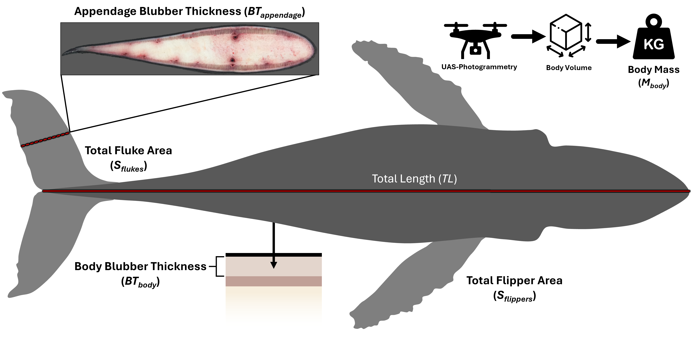
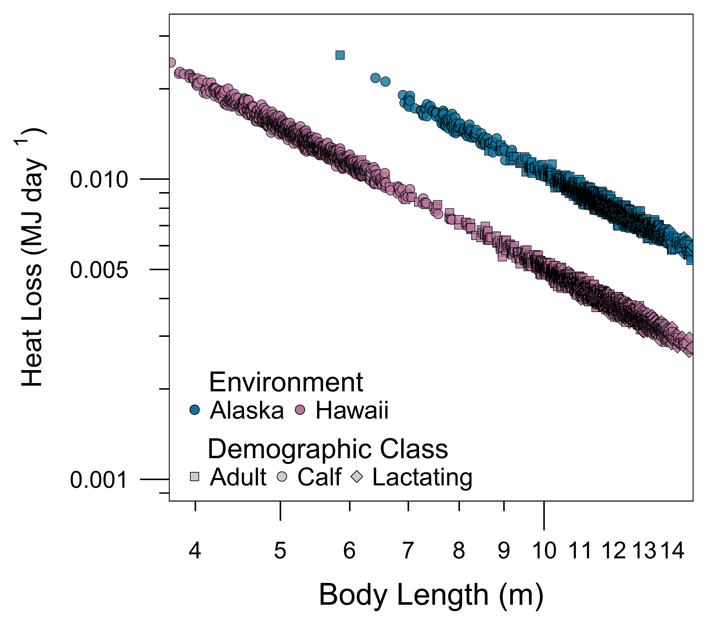

```{r setup, include=FALSE}
knitr::opts_chunk$set(echo = TRUE)
```

```{r Libraries, include=FALSE}
library(tidyverse)
library(ggplot2)
library(cowplot)
library(dplyr)
library(knitr)
library(tinytex)
library(rbbt)
library(ggspatial)
library(grid)
library(gridExtra)
library(pdftools)
library(magick)
library(PieGlyph)
library(purrr)
library(devtools)
library(patchwork)
library(flextable)
library(officer)
library(zoo)
library(tuneR)
library(seewave)
library(reshape2)
library(metR)
library(sf)
library(scales)
library(formatdown)
library(data.table)
library(R.matlab)
library(officer)
library(glue)
library(broom)
library(mgcv)
library(ggnewscale)
library(janitor)

load_all()
```

```{r FUNCTION - Convert PDF to PNG, include=FALSE}
convert_pdf_to_png <- function(pdf_file, png_file, dpi = 300) {
  image <- image_read_pdf(pdf_file)
  image_write(image, path = png_file, density = dpi)
}
```

```{r FUNCTION - Linear Relationship Equation, include=FALSE}
Linear_Relationship <- function(x, y) {
  m <- lm(y ~ x)
  coef_a <- format(coef(m)[1], digits = 4)
  coef_b <- format(coef(m)[2], digits = 4)
  r2 <- format(summary(m)$r.squared, digits = 3)
  
  equation <- paste("y =", coef_a, "+", coef_b, "* x, R^2 =", r2)
  
  as.character(equation)
}

Linear_Relationship2 <- function(x, y) {
  m <- lm(y ~ x)
  coef_a <- format(coef(m)[1], digits = 4)
  coef_b <- format(coef(m)[2], digits = 4)
  
  equation <- paste("y =", coef_a, "+", coef_b, "* x")
  
  as.character(equation)
}
```

```{r FUNCTION - Heat Loss Model, include = FALSE}
heat_loss_model <- function(BodyLength, BodyMass, BodySurfaceArea, BodyBlubberThickness, FlipperSurfaceArea, FlipperChordLength, AppendageBlubberThickness, FlukeSurfaceArea, FlukeChordLength, BlubberThermalConductivity, VentilationRate, CoreBodyTemperature, WarmAmbientTemp, ColdAmbientTemp, MetabolicBetaFactor, Vt_frac, Vc_frac, EO2, FO2, CO2_kJ_per_L, LC_mult) {
  
  ExtremityTurnedOffTemperatureWarm = WarmAmbientTemp
  ExtremityTurnedOffTemperatureCold = ColdAmbientTemp
  TidalVolume = Vt_frac*Vc_frac*(0.135*(BodyMass^0.92))
  KleiberBMR = 3.39 * (BodyMass^0.75) # in Watts
  TotalSurfaceArea = BodySurfaceArea + FlipperSurfaceArea + FlukeSurfaceArea
  
  # Allometric total lung capacity (L) then varied by LC_mult
  LC_total_L_base <- 0.135 * (BodyMass^0.92)
  LC_total_L      <- LC_total_L_base * LC_mult
  
  # Log-transformed
  Log10BodyLength = log10(BodyLength)
  Log10BodySurfaceArea = log10(BodySurfaceArea)
  Log10BodyMass = log10(BodyMass)
  
  # Conductive Heat Loss Equation For Body (Glarou et al. 2025)
  WarmConductiveBodyOnlyHeatLoss = (BlubberThermalConductivity*BodySurfaceArea*(CoreBodyTemperature-WarmAmbientTemp))/BodyBlubberThickness
  WarmConductiveBodyOnlyHeatLossMassSpecific = WarmConductiveBodyOnlyHeatLoss / BodyMass
  WarmConductiveBodyOnlyHeatFluxPerArea = WarmConductiveBodyOnlyHeatLoss / BodySurfaceArea
  
  ColdConductiveBodyOnlyHeatLoss = (BlubberThermalConductivity*BodySurfaceArea*(CoreBodyTemperature-ColdAmbientTemp))/BodyBlubberThickness
  ColdConductiveBodyOnlyHeatLossMassSpecific = ColdConductiveBodyOnlyHeatLoss / BodyMass
  ColdConductiveBodyOnlyHeatFluxPerArea = ColdConductiveBodyOnlyHeatLoss / BodySurfaceArea
  
  # Conductive Heat Loss Equation for Flippers/Flukes (Glarou et al. 2025)
  WarmConductiveFlipperHeatLoss = (BlubberThermalConductivity*FlipperSurfaceArea*(CoreBodyTemperature-WarmAmbientTemp))/AppendageBlubberThickness
  WarmConductiveFlipperHeatLossMassSpecific = WarmConductiveFlipperHeatLoss / BodyMass
  WarmConductiveFlipperHeatFluxPerArea = WarmConductiveFlipperHeatLoss / FlipperSurfaceArea 
  
  WarmConductiveFlukeHeatLoss = (BlubberThermalConductivity*FlukeSurfaceArea*(CoreBodyTemperature-WarmAmbientTemp))/AppendageBlubberThickness
  WarmConductiveFlukeHeatLossMassSpecific = WarmConductiveFlukeHeatLoss / BodyMass
  WarmConductiveFlukeHeatFluxPerArea = WarmConductiveFlukeHeatLoss / FlukeSurfaceArea 
  
  WarmAppendagesConductiveHeatLoss = WarmConductiveFlipperHeatLoss + WarmConductiveFlukeHeatLoss
  WarmAppendagesConductiveHeatLossMassSpecific = WarmAppendagesConductiveHeatLoss / BodyMass
  WarmAppendagesConductiveHeatFluxPerArea = WarmAppendagesConductiveHeatLoss / (FlipperSurfaceArea + FlukeSurfaceArea)
  
  ColdConductiveFlipperHeatLoss = (BlubberThermalConductivity*FlipperSurfaceArea*(CoreBodyTemperature-ColdAmbientTemp))/AppendageBlubberThickness
  ColdConductiveFlipperHeatLossMassSpecific = ColdConductiveFlipperHeatLoss / BodyMass
  ColdConductiveFlipperHeatFluxPerArea = ColdConductiveFlipperHeatLoss / FlipperSurfaceArea 
  
  ColdConductiveFlukeHeatLoss = (BlubberThermalConductivity*FlukeSurfaceArea*(CoreBodyTemperature-ColdAmbientTemp))/AppendageBlubberThickness
  ColdConductiveFlukeHeatLossMassSpecific = ColdConductiveFlukeHeatLoss / BodyMass
  ColdConductiveFlukeHeatFluxPerArea = ColdConductiveFlukeHeatLoss / FlukeSurfaceArea 
  
  ColdAppendagesConductiveHeatLoss = ColdConductiveFlipperHeatLoss + ColdConductiveFlukeHeatLoss
  ColdAppendagesConductiveHeatLossMassSpecific = ColdAppendagesConductiveHeatLoss / BodyMass
  ColdAppendagesConductiveHeatFluxPerArea = ColdAppendagesConductiveHeatLoss / (FlipperSurfaceArea + FlukeSurfaceArea)
  
  # Conductive Heat Loss For Full Body + Appendages
  WarmAllConductiveHeatLoss = WarmConductiveBodyOnlyHeatLoss + WarmConductiveFlipperHeatLoss + WarmConductiveFlukeHeatLoss
  WarmAllConductiveHeatLossMassSpecific = WarmAllConductiveHeatLoss / BodyMass
  WarmAllConductiveHeatFlux = WarmAllConductiveHeatLoss / TotalSurfaceArea
  WarmAppendagesAsPercentageOfConductiveHeatLoss = WarmAppendagesConductiveHeatLoss/WarmAllConductiveHeatLoss*100
  
  ColdAllConductiveHeatLoss = ColdConductiveBodyOnlyHeatLoss + ColdConductiveFlipperHeatLoss + ColdConductiveFlukeHeatLoss
  ColdAllConductiveHeatLossMassSpecific = ColdAllConductiveHeatLoss / BodyMass
  ColdAllConductiveHeatFlux = ColdAllConductiveHeatLoss / TotalSurfaceArea
  ColdAppendagesAsPercentageOfConductiveHeatLoss = ColdAppendagesConductiveHeatLoss/ColdAllConductiveHeatLoss*100
  
  # Ventilatory Heat Loss Equation (Sumich 2021)
  WarmVentilatoryHeatLoss = (VentilationRate/60)*(143.5 - 1.37 * WarmAmbientTemp - 0.07 * (WarmAmbientTemp^2))*0.0864
  WarmVentilatoryHeatLossMassSpecific = WarmVentilatoryHeatLoss / BodyMass
  ColdVentilatoryHeatLoss = (VentilationRate/60)*(143.5 - 1.37 * ColdAmbientTemp - 0.07 * (ColdAmbientTemp^2))*0.0864
  ColdVentilatoryHeatLossMassSpecific = ColdVentilatoryHeatLoss / BodyMass
  
  # Total Heat Loss Estimation ("Open" including flippers and flukes and "Closed" without)
  WarmWindowsOpenHeatLoss = WarmConductiveBodyOnlyHeatLoss + WarmVentilatoryHeatLoss + WarmConductiveFlipperHeatLoss + WarmConductiveFlukeHeatLoss
  WarmWindowsOpenHeatLossMassSpecific = WarmWindowsOpenHeatLoss / BodyMass
  WarmWindowsClosedHeatLoss = WarmConductiveBodyOnlyHeatLoss + WarmVentilatoryHeatLoss
  WarmWindowsClosedHeatLossMassSpecific = WarmWindowsClosedHeatLoss / BodyMass
  
  ColdWindowsOpenHeatLoss = ColdConductiveBodyOnlyHeatLoss + ColdVentilatoryHeatLoss + ColdConductiveFlipperHeatLoss + ColdConductiveFlukeHeatLoss
  ColdWindowsOpenHeatLossMassSpecific = ColdWindowsOpenHeatLoss / BodyMass
  ColdWindowsClosedHeatLoss = ColdConductiveBodyOnlyHeatLoss + ColdVentilatoryHeatLoss
  ColdWindowsClosedHeatLossMassSpecific = ColdWindowsClosedHeatLoss / BodyMass
  
  # Basal Metabolic Rate to Heat Loss Ratios (Thermal Windows Closed and Open - including flippers and flukes)
  BMRtoWarmWindowsOpenHeatLossRatio = KleiberBMR/WarmWindowsOpenHeatLoss
  BMRtoWarmWindowsClosedHeatLossRatio = KleiberBMR/WarmWindowsClosedHeatLoss
  
  BMRtoColdWindowsOpenHeatLossRatio = KleiberBMR/ColdWindowsOpenHeatLoss
  BMRtoColdWindowsClosedHeatLossRatio = KleiberBMR/ColdWindowsClosedHeatLoss
  
  # Difference Between Alaska "Windows Closed" Heat Loss and BMR
  DiffBMRAlaskaHeatLossWindowsClosed = ColdWindowsClosedHeatLoss - KleiberBMR
  DiffBMRAlaskaHeatLossWindowsClosedPositiveOnly = pmax(DiffBMRAlaskaHeatLossWindowsClosed, 0)
  
  # "Breath Method" Estimation of Field Metabolic Rate
  FMR_Breath_Method_W <- (1000 * (Vt_frac * Vc_frac * LC_total_L * VentilationRate * FO2 * EO2 * CO2_kJ_per_L)) / 60
  FMR_Breath_Method_W_kg <- FMR_Breath_Method_W / BodyMass
  
  # Estimating Possible "Field" Metabolic Rate Sustainable Range
  WarmLowerRealisticBMRMetBetaFactor = WarmWindowsClosedHeatLoss / KleiberBMR
  WarmUpperRealisticBMRMetBetaFactor = WarmWindowsOpenHeatLoss / KleiberBMR
  ColdLowerRealisticBMRMetBetaFactor = ColdWindowsClosedHeatLoss / KleiberBMR
  ColdUpperRealisticBMRMetBetaFactor = ColdWindowsOpenHeatLoss / KleiberBMR
  
  # Lower Tcrit Value (at 1-4x Kleiber BMR)
  TcritScenario1 = CoreBodyTemperature-((BodyBlubberThickness*KleiberBMR)/(BodySurfaceArea*BlubberThermalConductivity))
  TcritScenario2 = CoreBodyTemperature-((BodyBlubberThickness*(KleiberBMR*1.25))/(BodySurfaceArea*BlubberThermalConductivity))
  TcritScenario3 = CoreBodyTemperature-((BodyBlubberThickness*(KleiberBMR*1.5))/(BodySurfaceArea*BlubberThermalConductivity))
  TcritScenario4 = CoreBodyTemperature-((BodyBlubberThickness*(KleiberBMR*1.75))/(BodySurfaceArea*BlubberThermalConductivity))
  TcritScenario5 = CoreBodyTemperature-((BodyBlubberThickness*(KleiberBMR*2))/(BodySurfaceArea*BlubberThermalConductivity))
  
  # Upper Tcrit Value
  # Ambient temperature at which maximal heat loss
  # (thermal windows fully open) equals Kleiber BMR
  
  UpperTcritFunction <- function(Tambient) {
    
    ConductiveBodyHeatLoss <-
      (BlubberThermalConductivity *
         BodySurfaceArea *
         (CoreBodyTemperature - Tambient)) /
      BodyBlubberThickness
    
    ConductiveFlipperHeatLoss <-
      (BlubberThermalConductivity *
         FlipperSurfaceArea *
         (CoreBodyTemperature - Tambient)) /
      AppendageBlubberThickness
    
    ConductiveFlukeHeatLoss <-
      (BlubberThermalConductivity *
         FlukeSurfaceArea *
         (CoreBodyTemperature - Tambient)) /
      AppendageBlubberThickness
    
    VentilatoryHeatLoss <-
      (VentilationRate / 60) *
      (143.5 - 1.37 * Tambient - 0.07 * Tambient^2) *
      0.0864
    
    WindowsOpenHeatLoss <-
      ConductiveBodyHeatLoss +
      ConductiveFlipperHeatLoss +
      ConductiveFlukeHeatLoss +
      VentilatoryHeatLoss
    
    WindowsOpenHeatLoss - KleiberBMR
  }
  
  # Solve between 0°C and just below core body temperature
  UpperTcrit <- tryCatch(
    {
      uniroot(
        UpperTcritFunction,
        interval = c(0, CoreBodyTemperature - 0.01)
      )$root
    },
    error = function(e) NA_real_
  )
  
  # Return Values
  return(list(Body_Length_m = BodyLength,
              Body_Mass_kg = BodyMass,
              Body_Surface_Area_m2 = BodySurfaceArea,
              Body_Blubber_Thickness_m = BodyBlubberThickness,
              Appendage_Blubber_Thickness_m = AppendageBlubberThickness,
              Total_Surface_Area_m2 = TotalSurfaceArea,
              Ventilation_Rate = VentilationRate,
              Tidal_Volume = TidalVolume,
              Blubber_Thermal_Conductivity = BlubberThermalConductivity,
              Core_Body_Temperature = CoreBodyTemperature,
              Warm_Ambient_Temperature = WarmAmbientTemp,
              Cold_Ambient_Temperature = ColdAmbientTemp,
              Metabolic_Beta_Factor = MetabolicBetaFactor,
              LC_total_L_base = LC_total_L_base,
              LC_total_L = LC_total_L,
              Vt_frac = Vt_frac,
              Vc_frac = Vc_frac,
              EO2 = EO2,
              FO2 = FO2,
              CO2_kJ_per_L = CO2_kJ_per_L,
              
              Log_10_Body_Length_m = Log10BodyLength,
              Log_10_Body_Surface_Area_m2 = Log10BodySurfaceArea,
              Log_10_Body_Mass_kg = Log10BodyMass,
              
              Warm_Conductive_Body_Only_Heat_Loss_W = WarmConductiveBodyOnlyHeatLoss,
              Warm_Conductive_Body_Only_Heat_Loss_Mass_Specific_W_Per_kg = WarmConductiveBodyOnlyHeatLossMassSpecific,
              Warm_Conductive_Body_Only_Heat_Flux_Per_m2 = WarmConductiveBodyOnlyHeatFluxPerArea,
              
              Cold_Conductive_Body_Only_Heat_Loss_W = ColdConductiveBodyOnlyHeatLoss,
              Cold_Conductive_Body_Only_Heat_Loss_Mass_Specific_W_Per_kg = ColdConductiveBodyOnlyHeatLossMassSpecific,
              Cold_Conductive_Body_Only_Heat_Flux_Per_m2 = ColdConductiveBodyOnlyHeatFluxPerArea,
              
              Warm_Conductive_Flipper_Heat_Loss_W = WarmConductiveFlipperHeatLoss,
              Warm_Conductive_Flipper_Heat_Loss_Mass_Specific_W_Per_kg = WarmConductiveFlipperHeatLossMassSpecific,
              Warm_Conductive_Flipper_Heat_Flux_Per_m2 = WarmConductiveFlipperHeatFluxPerArea,
              
              Warm_Conductive_Fluke_Heat_Loss_W = WarmConductiveFlukeHeatLoss, 
              Warm_Conductive_Fluke_Heat_Loss_Mass_Specific_W_Per_kg = WarmConductiveFlukeHeatLossMassSpecific,
              Warm_Conductive_Fluke_Heat_Flux_Per_m2 = WarmConductiveFlukeHeatFluxPerArea,
              
              Warm_Appendages_Conductive_Heat_Loss_W = WarmAppendagesConductiveHeatLoss,
              Warm_Appendages_Conductive_Heat_Loss_Mass_Specific_W_Per_kg = WarmAppendagesConductiveHeatLossMassSpecific,
              Warm_Appendages_Conductive_Heat_Flux_Per_m2 = WarmAppendagesConductiveHeatFluxPerArea,
              
              Cold_Conductive_Flipper_Heat_Loss_W = ColdConductiveFlipperHeatLoss,
              Cold_Conductive_Flipper_Heat_Loss_Mass_Specific_W_Per_kg = ColdConductiveFlipperHeatLossMassSpecific,
              Cold_Conductive_Flipper_Heat_Flux_Per_m2 = ColdConductiveFlipperHeatFluxPerArea,
              
              Cold_Conductive_Fluke_Heat_Loss_W = ColdConductiveFlukeHeatLoss,
              Cold_Conductive_Fluke_Heat_Loss_Mass_Specific_W_Per_kg = ColdConductiveFlukeHeatLossMassSpecific,
              Cold_Conductive_Fluke_Heat_Flux_Per_m2 = ColdConductiveFlukeHeatFluxPerArea,
              
              Cold_Appendages_Conductive_Heat_Loss_W = ColdAppendagesConductiveHeatLoss,
              Cold_Appendages_Conductive_Heat_Loss_Mass_Specific_W_Per_kg = ColdAppendagesConductiveHeatLossMassSpecific,
              Cold_Appendages_Conductive_Heat_Flux_Per_m2 = ColdAppendagesConductiveHeatFluxPerArea,
              
              Warm_All_Conductive_Heat_Loss_W = WarmAllConductiveHeatLoss,
              Warm_All_Conductive_Heat_Loss_Mass_Specific_W_kg = WarmAllConductiveHeatLossMassSpecific,
              Warm_All_Conductive_Heat_Flux_Per_m2 = WarmAllConductiveHeatFlux,
              Warm_Appendages_As_Percentage_Of_Conductive_Heat_Loss = WarmAppendagesAsPercentageOfConductiveHeatLoss,
              
              Cold_All_Conductive_Heat_Loss_W = ColdAllConductiveHeatLoss,
              Cold_All_Conductive_Heat_Loss_Mass_Specific_W_kg = ColdAllConductiveHeatLossMassSpecific,
              Cold_All_Conductive_Heat_Flux_Per_m2 = ColdAllConductiveHeatFlux,
              Cold_Appendages_As_Percentage_Of_Conductive_Heat_Loss = ColdAppendagesAsPercentageOfConductiveHeatLoss,
              
              Warm_Ventilatory_Heat_Loss_W = WarmVentilatoryHeatLoss,
              Warm_Ventilatory_Heat_Loss_Mass_Specific_W_kg = WarmVentilatoryHeatLossMassSpecific,
              
              Cold_Ventilatory_Heat_Loss_W = ColdVentilatoryHeatLoss,
              Cold_Ventilatory_Heat_Loss_Mass_Specific_W_kg = ColdVentilatoryHeatLossMassSpecific,
              
              Warm_Windows_Open_Heat_Loss_W = WarmWindowsOpenHeatLoss,
              Warm_Windows_Open_Heat_Loss_Mass_Specific_W_kg = WarmWindowsOpenHeatLossMassSpecific,
              Warm_Windows_Closed_Heat_Loss_W = WarmWindowsClosedHeatLoss,
              Warm_Windows_CLosed_Heat_Loss_Mass_Specific_W_kg = WarmWindowsClosedHeatLossMassSpecific,
              
              Cold_Windows_Open_Heat_Loss_W = ColdWindowsOpenHeatLoss,
              Cold_Windows_Open_Heat_Loss_Mass_Specific_W_kg = ColdWindowsOpenHeatLossMassSpecific,
              Cold_Windows_Closed_Heat_Loss_W = ColdWindowsClosedHeatLoss,
              Cold_Windows_Closed_Heat_Loss_Mass_Specific_W_kg = ColdWindowsClosedHeatLossMassSpecific,
              
              Kleiber_BMR_W = KleiberBMR,
              
              BMR_to_Warm_Windows_Open_Heat_Loss_Ratio = BMRtoWarmWindowsOpenHeatLossRatio,
              BMR_to_Warm_Windows_Closed_Heat_Loss_Ratio = BMRtoWarmWindowsClosedHeatLossRatio,
              BMR_to_Cold_Windows_Open_Heat_Loss_Ratio = BMRtoColdWindowsOpenHeatLossRatio,
              BMR_to_Cold_Windows_Closed_Heat_Loss_Ratio = BMRtoColdWindowsClosedHeatLossRatio,
              
              Diff_BMR_Alaska_Heat_Loss_Windows_Closed = DiffBMRAlaskaHeatLossWindowsClosed,
              Diff_BMR_Alaska_Heat_Loss_Windows_Closed_Positive_Only = DiffBMRAlaskaHeatLossWindowsClosedPositiveOnly,
              
              FMR_Breath_Method_W = FMR_Breath_Method_W,
              FMR_Breath_Method_W_kg = FMR_Breath_Method_W_kg,
              
              Warm_Lower_Realistic_BMR_Met_Beta_Factor = WarmLowerRealisticBMRMetBetaFactor,
              Warm_Upper_Realistic_BMR_Met_Beta_Factor = WarmUpperRealisticBMRMetBetaFactor,
              Cold_Lower_Realistic_BMR_Met_Beta_Factor = ColdLowerRealisticBMRMetBetaFactor,
              Cold_Upper_Realistic_BMR_Met_Beta_Factor = ColdUpperRealisticBMRMetBetaFactor,
              
              T_crit_Scenario_1 = TcritScenario1,
              T_crit_Scenario_2 = TcritScenario2,
              T_crit_Scenario_3 = TcritScenario3,
              T_crit_Scenario_4 = TcritScenario4,
              T_crit_Scenario_5 = TcritScenario5,
              
              Upper_T_crit = UpperTcrit))}
```

```{r DATA - Add Fluke/Flipper Morphometric Estimates Directly to "Morphometrics" Dataset, include = FALSE}
# Required Morphometric Regressions - Flippers and Flukes
BLvFlipperArea_model <- lm(log10(Full_Mean_Flipper_SA_m2) ~ log10(Body_Length_m), data = HumpbackHeatLoss::FlukeFlipperMetrics)
BLvFlipperChord_model <- lm(log10(Mean_Flipper_Chord_m) ~ log10(Body_Length_m), data = HumpbackHeatLoss::FlukeFlipperMetrics)

BLvFlukeArea_model <- lm(log10(Full_Mean_Fluke_SA_m2) ~ log10(Body_Length_m), data = HumpbackHeatLoss::FlukeFlipperMetrics)
BLvFlukeChord_model <- lm(log10(Mean_Fluke_Chord_Midspan_m) ~ log10(Body_Length_m), data = HumpbackHeatLoss::FlukeFlipperMetrics)

VR_model <- lm(log10(FR_Overall) ~ log10(Body_Length_m),
               data = HumpbackHeatLoss::CATSMomCalfVentilation)
VR_sigma_log10 <- summary(VR_model)$sigma

# Appendage Blubber Regression
BLvAppendageBlubber_model <- lm(log10(Appendage_Average_Blubber_Thickness_m) ~ log10(Body_Length_m), data = HumpbackHeatLoss::AppendageBlubberData)

# Additional Useful Morphometric Regressions
BLvSA_model <- lm(log10(Surface_Area_m2) ~ log10(Body_Length_m), data = HumpbackHeatLoss::Morphometrics)
BLvBM_model <- lm(log10(Body_Mass_kg) ~ log10(Body_Length_m), data = HumpbackHeatLoss::Morphometrics)
BMvSA_model <- lm(log10(Body_Mass_kg) ~ log10(Surface_Area_m2), data = HumpbackHeatLoss::Morphometrics)

# Add Appendage Morphometrics to "Morphometrics" data sheet
Morphometrics <- HumpbackHeatLoss::Morphometrics %>%
  filter(!is.na(Region), !is.na(Body_Length_m), !is.na(Surface_Area_m2)) %>%
  mutate(
    Predicted_Total_Flipper_Area_m2 = 10^predict(BLvFlipperArea_model, newdata = data.frame(Body_Length_m = Body_Length_m)),
    Total_Flipper_Area_As_Percent_Of_Body = Predicted_Total_Flipper_Area_m2 / Surface_Area_m2 * 100,
    
    Predicted_Total_Fluke_Area_m2 = 10^predict(BLvFlukeArea_model, newdata = data.frame(Body_Length_m = Body_Length_m)),
    Total_Fluke_Area_As_Percent_Of_Body = Predicted_Total_Fluke_Area_m2 / Surface_Area_m2 * 100,
    
    Total_Appendage_Area_m2 = Predicted_Total_Flipper_Area_m2 + Predicted_Total_Fluke_Area_m2,
    Total_Appendage_Area_As_Percent_Of_Body = Total_Appendage_Area_m2 / Surface_Area_m2 * 100,
    Total_Appendage_Area_As_Percent_Of_Body_Plus_Appendage_Area = Total_Appendage_Area_m2 / (Surface_Area_m2 + Total_Appendage_Area_m2) * 100,
    
    Predicted_Total_Body_Plus_Appendage_Surface_Area_m2 = Predicted_Total_Flipper_Area_m2 + Predicted_Total_Fluke_Area_m2 + Surface_Area_m2,
    
    Predicted_Flipper_Chord_m = 10^predict(BLvFlipperChord_model, newdata = data.frame(Body_Length_m = Body_Length_m)), 
    Predicted_Fluke_Chord_m = 10^predict(BLvFlukeChord_model, newdata = data.frame(Body_Length_m = Body_Length_m)),
    
    Predicted_Appendage_Blubber_thickness_m = 10^predict(BLvAppendageBlubber_model, newdata = data.frame(Body_Length_m = Body_Length_m)),
    
    Predicted_Body_Blubber_Thickness_m = (0.0119345 - (0.0003168 * Body_Length_m)) * Body_Length_m,
    
    Ventilation_Rate = 10^predict(VR_model, newdata = data.frame(Body_Length_m = Body_Length_m)))

# helper: pretty sentence for log10(y) ~ log10(x)
scale_sentence <- function(mod, y = "y", x = "x") {
  co  <- coef(mod)
  a   <- unname(co[1])                 # intercept on log10 scale
  b   <- unname(co[2])                 # exponent
  g   <- glance(mod)
  tdy <- tidy(mod)
  ci  <- confint(mod, "log10(Body_Length_m)", level = 0.95)
  
  glue(
    "{y} = 10^{round(a, 3)}*{x}^{round(b, 3)} ",
    "; R^2 = {round(g$r.squared, 3)}"
  )
}

flipper_sentence <- scale_sentence(BLvFlipperArea_model, y="y", x="x")
fluke_sentence   <- scale_sentence(BLvFlukeArea_model,   y="y",   x="x")
```

```{r DATA - Create Modeled Monte-Carlo Heat Loss Dataframe, include = FALSE}
set.seed(585)

# Helper: draw a ±10% multiplier (Uniform)
u10 <- function(n) runif(n, min = 0.9, max = 1.1)

# Helper: draw a ±25% multiplier (Uniform)
u20 <- function(n) runif(n, min = 0.70, max = 1.20)

# Helper: draw a ±25% multiplier (Uniform)
u25 <- function(n) runif(n, min = 0.75, max = 1.25)

# Helper: draw a ±50% multiplier (Uniform)
u50 <- function(n) runif(n, min = 0.50, max = 1.50)

# Draw multiplicative VR noise from ±k*sigma on log10 scale
vr_mult_from_sigma <- function(n, sigma_log10, k = 1) {
  # Uniform over [-k*sigma, +k*sigma] in log10 space
  10^(runif(n, min = -k * sigma_log10, max =  k * sigma_log10))
}

# Parameters we will vary (BodyLength held fixed)
vary_params <- c(
  "BodyMass",
  "BodySurfaceArea",
  "BodyBlubberThickness",
  "FlipperSurfaceArea",
  "FlipperChordLength",
  "AppendageBlubberThickness",
  "FlukeSurfaceArea",
  "FlukeChordLength",
  "BlubberThermalConductivity",
  "VentilationRate",
  "CoreBodyTemperature",
  "WarmAmbientTemp",
  "ColdAmbientTemp",
  "MetabolicBetaFactor"
)

# Function to run MC for a single row of Morphometrics
run_mc_for_row <- function(row, n_iter = 100) {
  # Build the "most likely" input set (BodyLength fixed)
  base_inputs <- list(
    BodyLength = row[["Body_Length_m"]],
    BodyMass   = row[["Body_Mass_kg"]],
    BodySurfaceArea = row[["Surface_Area_m2"]],
    BodyBlubberThickness = row[["Predicted_Body_Blubber_Thickness_m"]],
    FlipperSurfaceArea = row[["Predicted_Total_Flipper_Area_m2"]],
    FlipperChordLength = row[["Predicted_Flipper_Chord_m"]],
    AppendageBlubberThickness = row[["Predicted_Appendage_Blubber_thickness_m"]],
    FlukeSurfaceArea   = row[["Predicted_Total_Fluke_Area_m2"]],
    FlukeChordLength   = row[["Predicted_Fluke_Chord_m"]],
    VentilationRate = row[["Ventilation_Rate"]],
    BlubberThermalConductivity = 0.2,
    CoreBodyTemperature = 36,
    WarmAmbientTemp = 25,
    ColdAmbientTemp = 5,
    MetabolicBetaFactor = 1
  )
  
  # Generate multipliers for every varied parameter
  mults <- tibble::tibble(
    iter = seq_len(n_iter),
    BodyMass = u10(n_iter),
    BodySurfaceArea = u10(n_iter),
    BodyBlubberThickness = u10(n_iter),
    FlipperSurfaceArea = u25(n_iter),
    FlipperChordLength = u10(n_iter),
    AppendageBlubberThickness = u50(n_iter),
    FlukeSurfaceArea = u25(n_iter),
    FlukeChordLength = u10(n_iter),
    BlubberThermalConductivity = u10(n_iter),
    VentilationRate = vr_mult_from_sigma(n_iter, sigma_log10 = VR_sigma_log10, k = 1),
    CoreBodyTemperature = u10(n_iter),
    WarmAmbientTemp = u10(n_iter),
    ColdAmbientTemp = u10(n_iter),
    MetabolicBetaFactor = u10(n_iter),
    Vt_frac = runif(n_iter, 0.4, 0.8),
    Vc_frac = runif(n_iter, 0.8, 0.9),
    EO2     = runif(n_iter, 0.3, 0.4),
    LC_mult = runif(n_iter, 0.8, 1.2))
  
  # For each iteration, apply multipliers (BodyLength stays fixed) and run the model
  draws <- purrr::pmap_dfr(
    .l = mults,
    .f = function(iter, ...) {
      mvec <- list(...)
      # Compose the inputs for this iteration
      inp <- base_inputs
      for (nm in vary_params) {
        inp[[nm]] <- base_inputs[[nm]] * mvec[[nm]]
      }
      # Run model
      out <- heat_loss_model(
        BodyLength = inp$BodyLength,
        BodyMass = inp$BodyMass,
        BodySurfaceArea = inp$BodySurfaceArea,
        BodyBlubberThickness = inp$BodyBlubberThickness,
        FlipperSurfaceArea = inp$FlipperSurfaceArea,
        FlipperChordLength = inp$FlipperChordLength,
        AppendageBlubberThickness = inp$AppendageBlubberThickness,
        FlukeSurfaceArea = inp$FlukeSurfaceArea,
        FlukeChordLength = inp$FlukeChordLength,
        BlubberThermalConductivity = inp$BlubberThermalConductivity,
        VentilationRate = inp$VentilationRate,
        CoreBodyTemperature = inp$CoreBodyTemperature,
        WarmAmbientTemp = inp$WarmAmbientTemp,
        ColdAmbientTemp = inp$ColdAmbientTemp,
        MetabolicBetaFactor = inp$MetabolicBetaFactor,
        Vt_frac = mvec$Vt_frac,
        Vc_frac = mvec$Vc_frac,
        EO2     = mvec$EO2,
        LC_mult = mvec$LC_mult,
        FO2 = 0.2095,
        CO2_kJ_per_L = 20.1
      )
      tibble::as_tibble(out) %>% dplyr::mutate(iter = iter)
    }
  )
  
  # Attach identifiers from the row (edit to your preferred ID cols)
  id_cols <- tibble::as_tibble(row[c("Individual_ID", "Region", "Demographic_Class", "Calf_Age_Days", "Body_Length_m", "Body_Condition")])
  draws <- draws %>%
    dplyr::mutate(
      Individual_ID = id_cols$Individual_ID,
      Region        = id_cols$Region,
      Demographic_Class = id_cols$Demographic_Class,
      Calf_Age_Days = id_cols$Calf_Age_Days,
      Body_Length_m = id_cols$Body_Length_m,
      Body_Condition = id_cols$Body_Condition
    ) %>%
    dplyr::relocate(Individual_ID, Region, Calf_Age_Days, Body_Length_m, Body_Condition, iter)
  
  draws
}

# Run MC per individual
MC_HeatLoss_Draws <- Morphometrics %>%
  dplyr::mutate(.row_id = dplyr::row_number()) %>%
  dplyr::group_split(.row_id) %>%
  purrr::map_dfr(~ run_mc_for_row(dplyr::slice(.x, 1))) %>%
  dplyr::mutate(dplyr::across(where(is.logical), as.numeric))

# Summaries per individual across all numeric outputs
MC_HeatLoss_Summaries <- MC_HeatLoss_Draws %>%
  dplyr::group_by(Individual_ID, Region, Demographic_Class, Calf_Age_Days, Body_Length_m, Body_Condition) %>%
  dplyr::summarise(
    dplyr::across(
      where(is.numeric) & !dplyr::matches("^iter$"),
      list(
        mean = ~ mean(.x, na.rm = TRUE),
        sd   = ~ sd(.x, na.rm = TRUE),
        p05  = ~ stats::quantile(.x, 0.05, na.rm = TRUE),
        p50  = ~ stats::quantile(.x, 0.50, na.rm = TRUE),
        p95  = ~ stats::quantile(.x, 0.95, na.rm = TRUE)
      ),
      .names = "{.col}_{.fn}"
    ),
    .groups = "drop"
  )
```

```{r DATA - Extra energy Alaska vs Hawai‘i over day 0–90, echo=FALSE, message=FALSE, warning=FALSE}
if (!exists("lsmr_long")) {
  lsmr_long <- MC_HeatLoss_Summaries %>%
    transmute(
      D      = Calf_Age_Days,
      BMR_W  = Kleiber_BMR_W_mean,
      Hawaii = Warm_Lower_Realistic_BMR_Met_Beta_Factor_mean,
      Alaska = Cold_Lower_Realistic_BMR_Met_Beta_Factor_mean) %>%
    pivot_longer(cols = c(Hawaii, Alaska),
                 names_to = "Environment", values_to = "LSMR_multiple") %>%
    filter(!is.na(D), !is.na(LSMR_multiple), !is.na(BMR_W)) %>%
    arrange(Environment, D) %>%
    group_by(Environment, D) %>%
    summarise(LSMR_multiple = median(LSMR_multiple, na.rm = TRUE),
              BMR_W = median(BMR_W, na.rm = TRUE),
              .groups = "drop") %>%
    mutate(LSMR_W = LSMR_multiple * BMR_W)
}

# Split, fit GAMs for Watts
.choose_k <- function(x) pmin(12, pmax(4, floor(dplyr::n_distinct(x)/3)))

by_env <- split(lsmr_long, lsmr_long$Environment)

fit_env <- lapply(by_env, function(dat){
  k <- .choose_k(dat$D)
  m <- mgcv::gam(LSMR_W ~ s(D, k = k), data = dat, method = "REML")
  list(model = m, minD = min(dat$D), maxD = max(dat$D))
})

# Prediction grid: days 0–90
D_grid <- seq(0, 90, by = 0.1)

# Predict both curves on the same grid
preds <- tibble(D = D_grid,
                Alaska = as.numeric(predict(fit_env$Alaska$model, newdata = tibble(D = D_grid), type = "response")),
                Hawaii = as.numeric(predict(fit_env$Hawaii$model, newdata = tibble(D = D_grid), type = "response")))

# If any NAs (e.g., extreme extrapolation), fill linearly to avoid dropping points
fill_na <- function(x){
  if (all(is.na(x))) return(x)
  idx <- which(!is.na(x))
  approx(x = idx, y = x[idx], xout = seq_along(x), rule = 2)$y
}

preds$Alaska <- fill_na(preds$Alaska)
preds$Hawaii <- fill_na(preds$Hawaii)

# Trapezoid helper on an arbitrary grid
trap <- function(x, y) sum(diff(x) * (head(y, -1) + tail(y, -1)) / 2)

# Differences in Watts
preds <- preds %>%
  mutate(deltaW = Alaska - Hawaii,
         deltaW_pos = pmax(deltaW, 0))

# Integrate W over days -> W·day, then convert to Joules
Wday_signed <- trap(preds$D, preds$deltaW)
Wday_excess <- trap(preds$D, preds$deltaW_pos)

J_signed <- Wday_signed * 86400
J_excess <- Wday_excess * 86400

MJ_signed <- J_signed / 1e6
MJ_excess <- J_excess / 1e6

# Average extra power over the interval (useful sanity check)
avg_W_signed <- J_signed / (90 * 86400)
avg_W_excess <- J_excess / (90 * 86400)

# Coverage notes (warn if 0–90 goes outside observed ranges)
rng_msg <- c(
  if (0 < fit_env$Alaska$minD || 90 > fit_env$Alaska$maxD)
    sprintf("Note: Alaska fit extrapolates beyond observed [%g, %g] days.",
            fit_env$Alaska$minD, fit_env$Alaska$maxD),
  if (0 < fit_env$Hawaii$minD || 90 > fit_env$Hawaii$maxD)
    sprintf("Note: Hawai‘i fit extrapolates beyond observed [%g, %g] days.",
            fit_env$Hawaii$minD, fit_env$Hawaii$maxD))

# Export variables if you want to reference them in-text later
EnergyDiff_J_Signed  <- J_signed
EnergyDiff_J_Excess  <- J_excess
EnergyDiff_MJ_Signed <- MJ_signed
EnergyDiff_MJ_Excess <- MJ_excess
```

```{r TABLE - Creation of Morphometrics Table, include = FALSE}
# ---------- 1. Summarize in long format ----------
MorphSummary_long <- Morphometrics %>% 
  group_by(Demographic_Class, Region) %>% 
  summarise(
    n = n(),
    Body_Length_mean = mean(Body_Length_m, na.rm = TRUE),
    Body_Length_sd   = sd(Body_Length_m, na.rm = TRUE),
    
    Body_Mass_mean = mean(Body_Mass_kg, na.rm = TRUE),
    Body_Mass_sd   = sd(Body_Mass_kg, na.rm = TRUE),
    
    Surface_Area_mean = mean(Surface_Area_m2, na.rm = TRUE),
    Surface_Area_sd   = sd(Surface_Area_m2, na.rm = TRUE),
    
    Body_Condition_mean = mean(Body_Condition, na.rm = TRUE),
    Body_Condition_sd   = sd(Body_Condition, na.rm = TRUE),
    
    Blubber_mean = mean(Predicted_Body_Blubber_Thickness_m, na.rm = TRUE),
    Blubber_sd   = sd(Predicted_Body_Blubber_Thickness_m, na.rm = TRUE),
    .groups = "drop"
  ) %>%
  mutate(
    Region = factor(Region, levels = c("HI", "AK")),
    n_fmt = format(n, big.mark = ","),
    Body_Length_fmt = sprintf("%.2f ± %.2f", Body_Length_mean, Body_Length_sd),
    Body_Mass_fmt = sprintf("%.0f ± %.0f", Body_Mass_mean, Body_Mass_sd),
    Surface_Area_fmt = sprintf("%.2f ± %.2f", Surface_Area_mean, Surface_Area_sd),
    Body_Condition_fmt = sprintf("%.5f ± %.5f", Body_Condition_mean, Body_Condition_sd),
    Predicted_Body_Blubber_Thickness_fmt = sprintf("%.5f ± %.5f", Blubber_mean, Blubber_sd)
  ) %>%
  select(Demographic_Class, Region, n_fmt, Body_Length_fmt, Body_Mass_fmt,
         Surface_Area_fmt, Body_Condition_fmt, Predicted_Body_Blubber_Thickness_fmt)

# ---------- 2. Reshape to wide format ----------
MorphSummary_wide <- MorphSummary_long %>% 
  pivot_wider(
    names_from = Region,
    values_from = c(n_fmt, Body_Length_fmt, Body_Mass_fmt, Surface_Area_fmt, Body_Condition_fmt, Predicted_Body_Blubber_Thickness_fmt),
    names_glue = "{.value}_{Region}"
  )

# ---------- 3. Create total summary ----------
overall_summary_long <- Morphometrics %>% 
  group_by(Region) %>% 
  summarise(
    n = n(),
    
    Body_Length_mean = mean(Body_Length_m, na.rm = TRUE),
    Body_Length_sd   = sd(Body_Length_m, na.rm = TRUE),
    
    Body_Mass_mean = mean(Body_Mass_kg, na.rm = TRUE),
    Body_Mass_sd   = sd(Body_Mass_kg, na.rm = TRUE),
    
    Surface_Area_mean = mean(Surface_Area_m2, na.rm = TRUE),
    Surface_Area_sd   = sd(Surface_Area_m2, na.rm = TRUE),
    
    Body_Condition_mean = mean(Body_Condition, na.rm = TRUE),
    Body_Condition_sd   = sd(Body_Condition, na.rm = TRUE),
    
    Predicted_Body_Blubber_Thickness_mean =
      mean(Predicted_Body_Blubber_Thickness_m, na.rm = TRUE),
    Predicted_Body_Blubber_Thickness_sd =
      sd(Predicted_Body_Blubber_Thickness_m, na.rm = TRUE),
    
    .groups = "drop"
  ) %>%
  mutate(
    Region = factor(Region, levels = c("HI", "AK")),
    Demographic_Class = "Total",
    
    n_fmt = format(n, big.mark = ","),
    
    Body_Length_fmt =
      sprintf("%.2f ± %.2f", Body_Length_mean, Body_Length_sd),
    
    Body_Mass_fmt =
      sprintf("%.0f ± %.0f", Body_Mass_mean, Body_Mass_sd),
    
    Surface_Area_fmt =
      sprintf("%.2f ± %.2f", Surface_Area_mean, Surface_Area_sd),
    
    Body_Condition_fmt =
      sprintf("%.5f ± %.5f", Body_Condition_mean, Body_Condition_sd),
    
    Predicted_Body_Blubber_Thickness_fmt =
      sprintf("%.5f ± %.5f",
              Predicted_Body_Blubber_Thickness_mean,
              Predicted_Body_Blubber_Thickness_sd)
  ) %>% 
  select(
    Demographic_Class, Region, n_fmt,
    Body_Length_fmt, Body_Mass_fmt,
    Surface_Area_fmt, Body_Condition_fmt,
    Predicted_Body_Blubber_Thickness_fmt
  ) %>%
  pivot_wider(
    names_from = Region,
    values_from = c(
      n_fmt,
      Body_Length_fmt,
      Body_Mass_fmt,
      Surface_Area_fmt,
      Body_Condition_fmt,
      Predicted_Body_Blubber_Thickness_fmt
    ),
    names_glue = "{.value}_{Region}"
  )

# ---------- 4. Combine into one table ----------
MorphTable <- bind_rows(MorphSummary_wide, overall_summary_long) %>% 
  mutate(Demographic_Class = factor(Demographic_Class,
                                    levels = c("Calf", "Juvenile", "Yearling", "Lactating", "Adult", "Total")
  )) %>% 
  arrange(Demographic_Class)

# ---------- 5. Build custom header ----------
header_data <- data.frame(
  col_keys = names(MorphTable),
  group = c("Demographic Class",
            "Sample Size", "Sample Size",
            "Body Length (cm)", "Body Length (cm)",
            "Body Mass (kg)", "Body Mass (kg)",
            "Surface Area (m2)", "Surface Area (m2)",
            "Body Condition", "Body Condition",
            "Body Blubber Thickness (m)", "Body Blubber Thickness (m)"),
  labels = c("Demographic Class",
             "Alaska", "Hawaii",
             "Alaska", "Hawaii",
             "Alaska", "Hawaii",
             "Alaska", "Hawaii",
             "Alaska", "Hawaii",
             "Alaska", "Hawaii"),
  stringsAsFactors = FALSE
)

# ---------- 6. Create flextable ----------
MorphTable_ft <- flextable(MorphTable) %>%
  set_header_df(mapping = header_data, key = "col_keys") %>%
  merge_v(part = "header") %>%
  merge_h(i = 1, part = "header") %>%
  align(i = 1:2, align = "center", part = "header") %>%
  align(part = "body", align = "center") %>%
  valign(part = "all", valign = "center") %>%
  bold(part = "header") %>%
  fontsize(i = 1, size = 9, part = "header") %>%
  fontsize(i = 2, size = 8, part = "header") %>%
  fontsize(part = "body", size = 8) %>%
  width(width = 1.2) %>%
  theme_booktabs()

# ---------- 7. Export to Word in landscape ----------
Morphometrics_Table <- read_docx() %>%
  body_add_flextable(MorphTable_ft) %>%
  body_end_section_landscape()

print(Morphometrics_Table, target = "man/Morphometric_Summary_WideTable.docx")
```

```{r TABLE - Creation of Appendage Blubber Table, include = FALSE}
AppendageTable <- HumpbackHeatLoss::AppendageBlubberData %>%
  select(
    ID,
    Species,
    Sex,
    Age_Class,
    Stranding_Notes,
    Flipper_or_Fluke,
    Body_Length_m,
    Appendage_Average_Blubber_Thickness_mm
  ) %>%
  clean_names() %>%
  rename(
    body_length_m = body_length_m,
    appendage_blubber_thickness_mm = appendage_average_blubber_thickness_mm
  ) %>%
  mutate(
    sex = factor(sex),
    age_class = factor(age_class),
    flipper_or_fluke = factor(flipper_or_fluke)
  )

AppendageTable_ft <- flextable(AppendageTable) %>%
  set_header_labels(
    id = "ID",
    species = "Species",
    sex = "Sex",
    age_class = "Age class",
    stranding_notes = "Stranding notes",
    flipper_or_fluke = "Flipper / fluke",
    body_length_m = "Body length (m)",
    appendage_blubber_thickness_mm = "Appendage blubber thickness (mm)"
  ) %>%
  align(part = "all", align = "center") %>%
  valign(part = "all", valign = "center") %>%
  fontsize(part = "all", size = 8) %>%
  theme_booktabs()
```

```{r FIGURE - Conductive Heat Loss 3-Panel vs. Body Length, echo = FALSE, message = FALSE, warning = FALSE, results = 'hide', fig.keep = 'none', fig.align = 'center', fig.dim = c(8, 8)}
HL3 <- MC_HeatLoss_Summaries %>%
  transmute(
    Individual_ID, Region, Demographic_Class, Body_Length_m,
    Body_median_W = if_else(Region == "HI", Warm_Conductive_Body_Only_Heat_Loss_W_p50, Cold_Conductive_Body_Only_Heat_Loss_W_p50),
    Body_low_W = if_else(Region == "HI", Warm_Conductive_Body_Only_Heat_Loss_W_p05, Cold_Conductive_Body_Only_Heat_Loss_W_p05),
    Body_high_W = if_else(Region == "HI", Warm_Conductive_Body_Only_Heat_Loss_W_p95, Cold_Conductive_Body_Only_Heat_Loss_W_p95),
    Flipper_median_W = if_else(Region == "HI", Warm_Conductive_Flipper_Heat_Loss_W_p50, Cold_Conductive_Flipper_Heat_Loss_W_p50),
    Flipper_low_W  = if_else(Region == "HI", Warm_Conductive_Flipper_Heat_Loss_W_p05, Cold_Conductive_Flipper_Heat_Loss_W_p05),
    Flipper_high_W = if_else(Region == "HI", Warm_Conductive_Flipper_Heat_Loss_W_p95, Cold_Conductive_Flipper_Heat_Loss_W_p95),
    Fluke_median_W = if_else(Region == "HI", Warm_Conductive_Fluke_Heat_Loss_W_p50, Cold_Conductive_Fluke_Heat_Loss_W_p50),
    Fluke_low_W = if_else(Region == "HI", Warm_Conductive_Fluke_Heat_Loss_W_p05, Cold_Conductive_Fluke_Heat_Loss_W_p05),
    Fluke_high_W = if_else(Region == "HI", Warm_Conductive_Fluke_Heat_Loss_W_p95, Cold_Conductive_Fluke_Heat_Loss_W_p95)) %>%
  tidyr::pivot_longer(cols = -c(Individual_ID, Region, Demographic_Class, Body_Length_m),
                      names_to   = c("Component", ".value"),
                      names_pattern = "(Body|Flipper|Fluke)_(median|low|high)_W") %>%
  mutate(RegionLabel = recode(Region, AK = "Alaska", HI = "Hawaii"),
         median_MJday = (median/1e6) * 86400,
         low_MJday    = (low/1e6)    * 86400,
         high_MJday   = (high/1e6)   * 86400,
         Component = factor(Component,
                            levels = c("Flipper","Fluke","Body"),
                            labels = c("Flippers","Flukes","Body")))

HL3_for_fit <- HL3 %>%
  tidyr::pivot_longer(cols = c(median_MJday, low_MJday, high_MJday), names_to = "which", values_to = "MJday")

fit_lines_HL3 <- HL3_for_fit %>%
  dplyr::group_by(Component, RegionLabel, which) %>%
  dplyr::group_modify(~{
    m <- lm(log10(MJday) ~ log10(Body_Length_m), data = .x)
    newx <- tibble::tibble(
      Body_Length_m = seq(min(.x$Body_Length_m, na.rm = TRUE),
                          max(.x$Body_Length_m, na.rm = TRUE),
                          length.out = 300))
    pred <- predict(m, newdata = newx)
    newx$MJday <- 10^pred
    newx}) %>%
  dplyr::ungroup()

panel_labels <- tibble::tibble(
  Component = factor(c("Flippers", "Flukes", "Body"),
                     levels = levels(HL3$Component)),
  label = c("A", "B", "C"))

# ---- Regression equations for each panel and environment ----
regression_labels_HL3 <- HL3 %>%
  dplyr::group_by(Component, RegionLabel) %>%
  dplyr::group_modify(~{
    
    eq <- Linear_Relationship(
      log10(.x$Body_Length_m),
      log10(.x$median_MJday)
    )
    
    tibble::tibble(label = eq)
  }) %>%
  dplyr::ungroup() %>%
  dplyr::mutate(
    
    # Match formatting used in previous figure
    label = gsub("R\\^2", "R²", label),
    label = gsub(" \\* x", "x", label),
    
    # Position equations in bottom-right corner
    x = 14.4,
    
    y = dplyr::case_when(
      RegionLabel == "Alaska" ~ 18,
      RegionLabel == "Hawaii" ~ 13
    )
  )

# ---- Plot: 3 panels (points = medians, lines = 5–95% range) ----
pHeatLossFourPanel <- ggplot(HL3, aes(x = Body_Length_m, color = RegionLabel, fill  = RegionLabel, shape = Demographic_Class)) +
  geom_linerange(aes(ymin = low_MJday, ymax = high_MJday), alpha = 0.35, linewidth = 1.2) +
  geom_point(aes(y = median_MJday), size = 5, alpha = 0.8, stroke = 0.7, colour = "black") +
  geom_line(data = fit_lines_HL3, aes(x = Body_Length_m, y = MJday, linetype = which, group = interaction(Component, RegionLabel, which)), color = "black", linewidth = 2, inherit.aes = FALSE, show.legend = FALSE) +
  scale_shape_manual(values = c("Calf" = 21, "Adult" = 22, "Lactating" = 23), name = "Demographic Class") +
  scale_fill_manual(values = c("Alaska" = "#0B76A0", "Hawaii" = "#BA76A0"), name = "Environment") +
  scale_color_manual(values = c("Alaska" = "#0B76A0", "Hawaii" = "#BA76A0"), name = "Environment") +
  scale_linetype_manual(
    values = c(median_MJday = "solid",
               low_MJday    = "dotted",
               high_MJday   = "dotted"),
    guide = "none") +
  scale_x_log10(breaks = 4:14, limits = c(3.73, 14.81), expand = c(0,0), 
                guide = guide_axis_logticks(short = 1, mid = 2, long = 3)) +
  scale_y_log10(breaks = c(1, 5, 10, 50, 100, 500, 1000, 5000),
                guide = guide_axis_logticks(short = 1, mid = 2, long = 3)) +
  labs(x = "Body Length (m)",
       y = bquote("Heat Loss"~"(MJ "*day^-1*")")) +
  facet_wrap(~ Component, ncol = 3, scales = "fixed") +
  geom_text(data = panel_labels,
            aes(x = 3.8, y = 1700, label = label),
            inherit.aes = FALSE,
            hjust = -0.1,   # push slightly right from left edge
            vjust = 0.1,    # push slightly down from top edge
            size = 12,      # adjust to taste (this is large text)
            fontface = "bold") +
  geom_text(
    data = regression_labels_HL3,
    aes(
      x = x,
      y = y,
      label = label,
      color = RegionLabel
    ),
    inherit.aes = FALSE,
    hjust = 1,
    vjust = 0,
    size = 8,
    show.legend = FALSE
  ) +
  coord_cartesian(clip = "off") +
  theme_classic(base_size = 10) +
  theme(axis.text.x  = element_text(size = 34, margin = margin(t = 16)),
        axis.text.y  = element_text(size = 34, margin = margin(r = 16)),
        axis.title.x = element_text(size = 44, margin = margin(t = 28)),
        axis.title.y = element_text(size = 40, margin = margin(r = 24)),
        axis.ticks.length = unit(14, "pt"),
        axis.ticks = element_line(linewidth = 1),
        panel.border = element_rect(color = "black", fill = NA, linewidth = 1.2),
        axis.line    = element_blank(),
        panel.spacing = unit(1.2, "lines"),
        strip.background = element_rect(fill = "gray90", color = "black", linewidth = 1),
        strip.text = element_text(size = 36, face = "bold"),
        legend.position = c(0.0, 0.0),
        legend.justification = c("left", "bottom"),
        legend.direction = "horizontal",
        legend.background = element_blank(),
        legend.box.background = element_blank(),
        legend.title = element_text(size = 30),
        legend.text  = element_text(size = 26),
        legend.key.width = unit(12, "mm"),
        legend.key.height = unit(12, "mm"),
        panel.grid.minor = element_blank(),
        plot.margin = margin(20, 20, 24, 20)) +
  guides(color = "none",
         fill = guide_legend(
           override.aes = list(shape = 21, size = 8, alpha = 1, colour = "black"),
           title.position = "top", title.hjust = 0.5),
         shape = guide_legend(
           override.aes = list(size = 6, alpha = 1, fill = "gray80", colour = "black"),
           title.position = "top", title.hjust = 0.5))

# ---- Save ----
dir.create("figs", showWarnings = FALSE)
ggsave("figs/HeatLossThreePanel.pdf", pHeatLossFourPanel, height = 360, width = 960, units = "mm", dpi = 300)
convert_pdf_to_png("figs/HeatLossThreePanel.pdf", "figs/HeatLossThreePanel.png", dpi = 300)
```

```{r FIGURE - Absolute Heat Loss Potential - Hawai‘i and Alaska, echo = FALSE, message = FALSE, warning = FALSE, results = 'hide', fig.keep = 'none', fig.align = 'center', fig.dim = c(8, 8)}
# 1) Build a per-individual long table for plotting (W -> MJ/day)
HeatLoss_indiv_summary <- MC_HeatLoss_Summaries %>%
  dplyr::transmute(Individual_ID, Region, Demographic_Class, Body_Length_m,
                   Hawaii_median_W = `Warm_Windows_Open_Heat_Loss_W_p50`,
                   Hawaii_low_W    = `Warm_Windows_Open_Heat_Loss_W_p05`,
                   Hawaii_high_W   = `Warm_Windows_Open_Heat_Loss_W_p95`,
                   Alaska_median_W = `Cold_Windows_Closed_Heat_Loss_W_p50`,
                   Alaska_low_W    = `Cold_Windows_Closed_Heat_Loss_W_p05`,
                   Alaska_high_W   = `Cold_Windows_Closed_Heat_Loss_W_p95`) %>%
  tidyr::pivot_longer(cols = -c(Individual_ID, Region, Demographic_Class, Body_Length_m),
                      names_to = c("TemperatureRegion", ".value"),
                      names_pattern = "(Hawaii|Alaska)_(median|low|high)_W") %>%
  dplyr::mutate(expected_region = dplyr::recode(Region, AK = "Alaska", HI = "Hawaii")) %>%
  dplyr::filter(TemperatureRegion == expected_region) %>%
  dplyr::select(-expected_region) %>%
  dplyr::mutate(median_MJday = (median/1e6) * 86400,
                low_MJday    = (low/1e6)    * 86400,
                high_MJday   = (high/1e6)   * 86400)

df_HI <- HeatLoss_indiv_summary %>% dplyr::filter(Region == "HI")
df_AK <- HeatLoss_indiv_summary %>% dplyr::filter(Region == "AK")

eq_HI <- Linear_Relationship(log10(df_HI$Body_Length_m), log10(df_HI$median_MJday))
eq_AK <- Linear_Relationship(log10(df_AK$Body_Length_m), log10(df_AK$median_MJday))

annos <- dplyr::bind_rows(
  tibble::tibble(
    TemperatureRegion = "Hawaii",
    x = min(df_HI$Body_Length_m, na.rm = TRUE) * 1.05,
    y = max(df_HI$high_MJday, na.rm = TRUE) * 1.1,
    label = eq_HI
  ),
  tibble::tibble(
    TemperatureRegion = "Alaska",
    x = min(df_HI$Body_Length_m, na.rm = TRUE) * 1.05,
    y = max(df_HI$high_MJday, na.rm = TRUE) * 0.85,
    label = eq_AK
  )
) %>%
  dplyr::mutate(
    label = gsub("R\\^2", "R²", label),
    label = gsub(" \\* x", "x", label)
  )

HeatLoss_for_fit <- HeatLoss_indiv_summary %>%
  tidyr::pivot_longer(cols = c(median_MJday, low_MJday, high_MJday), names_to = "which", values_to = "MJday")

fit_lines <- HeatLoss_for_fit %>%
  group_by(TemperatureRegion, which) %>%
  group_modify(~{
    m <- lm(log10(MJday) ~ log10(Body_Length_m), data = .x)
    newx <- tibble(
      Body_Length_m = seq(min(.x$Body_Length_m), max(.x$Body_Length_m), length.out = 300))
    pred <- predict(m, newdata = newx)
    newx$MJday <- 10^pred
    newx}) %>%
  ungroup()

pHeatLossIndiv <- ggplot(HeatLoss_indiv_summary, aes(x = Body_Length_m)) +
  geom_linerange(aes(ymin = low_MJday, ymax = high_MJday, color = TemperatureRegion), linewidth = 1, alpha = 0.35, show.legend = FALSE) +
  geom_point(aes(y = median_MJday, shape = Demographic_Class, fill  = TemperatureRegion), size = 6, alpha = 0.9, colour = "black", stroke = 0.7) +
  geom_line(data = fit_lines, aes(x = Body_Length_m, y = MJday, linetype = which, group = interaction(TemperatureRegion, which)), color = "black", linewidth = 2, inherit.aes = FALSE, show.legend = FALSE) +
  geom_text(data = annos, aes(x = x, y = y, label = label, color = TemperatureRegion), hjust = 0, vjust = 1, size = 24, show.legend = FALSE, inherit.aes = FALSE) +
  scale_shape_manual(values = c("Calf" = 21, "Adult" = 22, "Lactating" = 23), name = "Demographic Class") +
  scale_fill_manual(values = c("Alaska" = "#0B76A0", "Hawaii" = "#BA76A0"), name = "Environment") +
  scale_color_manual(values = c("Alaska" = "#0B76A0", "Hawaii" = "#BA76A0"), guide = "none") +
  scale_linetype_manual(values = c(median_MJday = "solid",
                                   low_MJday    = "dotted",
                                   high_MJday   = "dotted"), guide = "none") +
  scale_x_log10(breaks = 4:14, limits = c(3.73, 14.81), expand = c(0, 0),
                guide = guide_axis_logticks(short = 1, mid = 2, long = 3)) +
  scale_y_log10(breaks = c(50, 100, 500, 1000, 5000),
                guide = guide_axis_logticks(short = 1, mid = 2, long = 3)) +
  labs(x = "Body Length (m)",
       y = bquote("Heat Loss"~"(MJ "*day^-1*")")) +
  theme_classic(base_size = 8) +
  theme(axis.text = element_text(size = 45, margin = margin(t = 15)),
        axis.title = element_text(size = 50, margin = margin(t = 40)),
        axis.ticks.length = unit(10, "pt"),
        axis.ticks = element_line(size = 2),
        axis.line = element_line(color = "black", size = 1),
        legend.position = c(0.99, 0.03),
        legend.justification = c(1, 0),
        legend.direction = "horizontal",
        legend.title = element_text(size = 50),
        legend.text = element_text(size = 45),
        legend.key.width = unit(30, "mm"),
        legend.key.size  = unit(2.0, "cm"),
        panel.grid.minor = element_blank()) +
  guides(fill = guide_legend(override.aes = list(shape = 21, size = 16, alpha = 1, colour = "black")),
         shape = guide_legend(override.aes = list(size = 8, alpha = 1, fill = "gray80", colour = "black")))

dir.create("figs", showWarnings = FALSE)
ggsave("figs/HeatLossMonteCarlo.pdf", pHeatLossIndiv, height = 720, width = 960, units = "mm", dpi = 300)
convert_pdf_to_png("figs/HeatLossMonteCarlo.pdf", "figs/HeatLossMonteCarlo.png", dpi = 300)
```

```{r FIGURE - Mass-Specific Heat Loss Vs. Body Condition, echo = FALSE, message = FALSE, warning = FALSE, results = 'hide', fig.keep = 'none', fig.align = 'center', fig.dim = c(8, 8)}
MC_HeatLoss_Summaries <- MC_HeatLoss_Summaries %>%
  mutate(
    True_Region_Windows_Open_Heat_Loss_W = case_when(
      Region == "HI" ~ Warm_Windows_Open_Heat_Loss_W_mean,
      Region == "AK" ~ Cold_Windows_Closed_Heat_Loss_W_mean,
      TRUE ~ NA_real_
    ),
    Mass_Specific_True_Region_Windows_Open_Heat_Loss_W =
      True_Region_Windows_Open_Heat_Loss_W / Body_Mass_kg_mean,
    RegionLabel = recode(Region, AK = "Alaska", HI = "Hawaii")
  )

df_plot <- MC_HeatLoss_Summaries %>%
  filter(!Demographic_Class %in% c("Juvenile", "Yearling")) %>%
  mutate(Demographic_Class = factor(Demographic_Class, levels = c("Calf","Adult","Lactating")))

env_cols <- c("Alaska" = "#0B76A0", "Hawaii" = "#BA76A0")

# Global x limits (Body Condition)
x_lims <- range(df_plot$Body_Condition, na.rm = TRUE)

# Global y limits on log10 scale
y_vals <- log10(df_plot$Mass_Specific_True_Region_Windows_Open_Heat_Loss_W)
y_lims <- range(y_vals, na.rm = TRUE)

# Optional: pad slightly so points aren't touching borders
x_pad <- diff(x_lims) * 0.02
y_pad <- diff(y_lims) * 0.05

x_lims <- c(x_lims[1] - x_pad, x_lims[2] + x_pad)
y_lims <- c(y_lims[1] - y_pad, y_lims[2] + y_pad)

make_row <- function(cls, show_legend = FALSE, show_y_title = FALSE, show_x_axis = TRUE,
                     bc_stat = c("mean","median")) {
  
  bc_stat <- match.arg(bc_stat)
  
  df_cls <- df_plot %>% filter(Demographic_Class == cls)
  
  # Environment-specific body-condition reference values (mean or median)
  bc_ref <- df_cls %>%
    dplyr::group_by(RegionLabel) %>%
    dplyr::summarise(
      bc_ref = if (bc_stat == "mean") mean(Body_Condition, na.rm = TRUE)
      else median(Body_Condition, na.rm = TRUE),
      .groups = "drop"
    )
  
  # Environment-specific regression equations
  reg_labels <- df_cls %>%
    dplyr::group_by(RegionLabel) %>%
    dplyr::group_modify(~{
      
      m <- lm(
        log10(Mass_Specific_True_Region_Windows_Open_Heat_Loss_W) ~ Body_Condition,
        data = .x
      )
      
      s <- summary(m)
      
      intercept <- coef(m)[1]
      slope     <- coef(m)[2]
      r2        <- s$r.squared
      
      tibble::tibble(
        label = paste0(
          "y = ",
          round(intercept, 3),
          ifelse(slope >= 0, " + ", " - "),
          round(abs(slope), 4),
          "x, R² = ",
          round(r2, 3)
        )
      )
    }) %>%
    dplyr::ungroup() %>%
    dplyr::mutate(
      x = x_lims[2] - 0.02 * diff(x_lims),
      y = dplyr::case_when(
        RegionLabel == "Alaska" ~ y_lims[2] + 0.05 * diff(y_lims),
        RegionLabel == "Hawaii" ~ y_lims[2] - 0.045 * diff(y_lims)
      )
    )
  
  p_scatter <- ggplot(df_cls) +
    # Vertical dotted lines at mean/median body condition by environment
    geom_vline(
      data = bc_ref,
      aes(xintercept = bc_ref, color = RegionLabel),
      linetype = "dashed", linewidth = 3.5,
      inherit.aes = FALSE, show.legend = FALSE
    ) +
    geom_point(
      aes(x = Body_Condition,
          y = log10(Mass_Specific_True_Region_Windows_Open_Heat_Loss_W),
          fill = RegionLabel),
      shape = 21, size = 10, alpha = 0.5,
      colour = "black", stroke = 0.8
    ) +
    geom_smooth(
      aes(
        x = Body_Condition,
        y = log10(Mass_Specific_True_Region_Windows_Open_Heat_Loss_W),
        group = RegionLabel
      ),
      method = "lm", se = TRUE,
      linewidth = 3,
      color = "black",
      fill  = "black",
      alpha = 0.20
    ) +
    geom_text(
      data = reg_labels,
      aes(
        x = x,
        y = y,
        label = label,
        color = RegionLabel
      ),
      inherit.aes = FALSE,
      hjust = 1,
      vjust = 1,
      size = 9,
      show.legend = FALSE
    ) +
    scale_color_manual(values = env_cols, name = "Environment", guide = "none") +
    scale_fill_manual(values = env_cols, name = "Environment") +
    coord_cartesian(xlim = x_lims, ylim = y_lims) +
    labs(
      x = if (show_x_axis) "Body Condition" else NULL,
      y = NULL,
      title = cls
    ) +
    theme_classic(base_size = 8) +
    theme(
      axis.text = element_text(size = 40),
      axis.title.x = element_text(size = 65, margin = margin(t = 20)),
      axis.title.y = element_text(size = 55, margin = margin(r = 40)),
      plot.title = element_text(size = 46, face = "bold", hjust = 0),
      axis.text.x  = if (show_x_axis) element_text(size = 40) else element_blank(),
      axis.ticks.x = if (show_x_axis) element_line() else element_blank(),
      legend.position = if (show_legend) c(0.02, 0.02) else "none",
      legend.justification = c("left", "bottom"),
      legend.direction = "horizontal",
      legend.title = element_text(size = 45),
      legend.text = element_text(size = 40),
      legend.key.width  = unit(20, "mm"),
      legend.key.height = unit(10, "mm")
    ) +
    guides(fill = guide_legend(override.aes = list(shape = 21, size = 16, alpha = 1, colour = "black")))
  
  p_dens <- ggplot(df_cls, aes(y = log10(Mass_Specific_True_Region_Windows_Open_Heat_Loss_W))) +
    geom_density(
      aes(fill = RegionLabel),
      color = "black", alpha = 0.55, linewidth = 1.2
    ) +
    scale_fill_manual(values = env_cols) +
    coord_cartesian(ylim = y_lims) +
    theme_classic(base_size = 12) +
    theme(
      axis.text.y = element_blank(),
      axis.text.x = element_blank(),
      axis.title  = element_blank(),
      axis.line = element_line(color = "black", linewidth = 1),
      legend.position = "none",
      panel.grid.minor = element_blank(),
      plot.margin = margin(0, 0, 0, 0)
    )
  
  wrap_plots(p_scatter, p_dens, ncol = 2, widths = c(4, 1)) &
    theme(
      plot.margin   = margin(t = 10, r = 0, b = 25, l = 0),
      panel.spacing = unit(12, "pt")
    )
}

# Main stacked plot (no y-axis titles inside rows)
p_main <- (
  make_row("Calf", show_legend = TRUE,  show_y_title = FALSE, show_x_axis = FALSE, bc_stat = "mean") /
    make_row("Adult", show_legend = FALSE, show_y_title = FALSE, show_x_axis = FALSE, bc_stat = "mean") /
    make_row("Lactating", show_legend = FALSE, show_y_title = FALSE, show_x_axis = TRUE,  bc_stat = "mean")
)

# Left-side y-title as a grob (does NOT affect row heights)
y_grob <- grid::textGrob(
  label = expression("Mass–Specific Heat Loss (MJ day"^{-1}~"kJ"^{-1}*")"),
  rot   = 90,
  gp    = grid::gpar(fontsize = 70)
)

pBCvHL_3rows <- wrap_elements(full = y_grob) + p_main +
  plot_layout(widths = c(0.05, 1))

ggsave(
  "figs/HeatLossVsBodyCondition.pdf",
  pBCvHL_3rows,
  height = 720,
  width = 960,
  units = "mm",
  dpi = 300
)

convert_pdf_to_png(
  "figs/HeatLossVsBodyCondition.pdf",
  "figs/HeatLossVsBodyCondition.png",
  dpi = 300
)
```

```{r FIGURE - Critical Temperature Vs. Body Length, echo = FALSE, message = FALSE, warning = FALSE, results = 'hide', fig.keep = 'none', fig.align = 'center', fig.dim = c(8, 8)}
MC_HeatLoss_Summaries <- MC_HeatLoss_Summaries %>%
  mutate(Environment = recode(Region, AK = "Alaska", HI = "Hawaii"))

Kleiber_label_df <- data.frame(x = c(3.68, 3.68, 3.68, 3.68, 3.65),
                               y = c(17.5, 12.8,  7.65,  2.75, -3.0),
                               lab = c("1x Kleiber",
                                       "1.25x Kleiber",
                                       "1.5x Kleiber",
                                       "1.75x Kleiber",
                                       "2x Kleiber"))

pHeatLossVsBodyCondition <- ggplot(
  MC_HeatLoss_Summaries %>% filter(Demographic_Class == "Calf")) +
  geom_vline(xintercept = 4.31, linetype = "dashed", size = 3) +
  geom_point(aes(x = Body_Length_m, y = T_crit_Scenario_1_mean, fill = Environment),
             shape = 21, size = 8, alpha = 0.5, colour = "black", stroke = 0.6) +
  geom_point(aes(x = Body_Length_m, y = T_crit_Scenario_2_mean, fill = Environment),
             shape = 21, size = 8, alpha = 0.5, colour = "black", stroke = 0.6) +
  geom_point(aes(x = Body_Length_m, y = T_crit_Scenario_3_mean, fill = Environment),
             shape = 21, size = 8, alpha = 0.5, colour = "black", stroke = 0.6) +
  geom_point(aes(x = Body_Length_m, y = T_crit_Scenario_4_mean, fill = Environment),
             shape = 21, size = 8, alpha = 0.5, colour = "black", stroke = 0.6) +
  geom_point(aes(x = Body_Length_m, y = T_crit_Scenario_5_mean, fill = Environment),
             shape = 21, size = 8, alpha = 0.5, colour = "black", stroke = 0.6) +
  geom_smooth(data = subset(MC_HeatLoss_Summaries, Demographic_Class == "Calf"),
              aes(x = Body_Length_m, y = T_crit_Scenario_1_mean),
              method = "lm", se = FALSE, color = "black", size = 3) +
  geom_smooth(data = subset(MC_HeatLoss_Summaries, Demographic_Class == "Calf"),
              aes(x = Body_Length_m, y = T_crit_Scenario_2_mean),
              method = "lm", se = FALSE, color = "black", size = 3) +
  geom_smooth(data = subset(MC_HeatLoss_Summaries, Demographic_Class == "Calf"),
              aes(x = Body_Length_m, y = T_crit_Scenario_3_mean),
              method = "lm", se = FALSE, color = "black", size = 3) +
  geom_smooth(data = subset(MC_HeatLoss_Summaries, Demographic_Class == "Calf"),
              aes(x = Body_Length_m, y = T_crit_Scenario_4_mean),
              method = "lm", se = FALSE, color = "black", size = 3) +
  geom_smooth(data = subset(MC_HeatLoss_Summaries, Demographic_Class == "Calf"),
              aes(x = Body_Length_m, y = T_crit_Scenario_5_mean),
              method = "lm", se = FALSE, color = "black", size = 3) +
  geom_hline(yintercept = 5, linetype = "dotted", size = 3) +
  geom_hline(yintercept = 25, linetype = "dotted", size = 3) +
  geom_text(data = Kleiber_label_df,
            aes(x = x, y = y, label = lab),
            inherit.aes = FALSE, hjust = 1, size = 13, color = "black") +
  annotate("text", x = 9.95, y = 25 + 0.8, label = "Modeled Hawaii\ntemperature (25\u00B0C)",
           hjust = 1, vjust = 0, size = 16, color = "black") +
  annotate("text", x = 9.95, y = 5 + 0.8, label = "Modeled Alaska\ntemperature (5\u00B0C)",
           hjust = 1, vjust = 0, size = 16, color = "black") +
  annotate("text", x = 4.31 + 0.12, y = 30, label = "Average length (TL)\nat birth",
           hjust = 0, vjust = 1, size = 16, color = "black") +
  scale_color_manual(values = c("AK" = "#0B76A0", "HI" = "#BA76A0"), guide = "none") +
  scale_fill_manual(values = c("Alaska" = "#0B76A0", "Hawaii" = "#BA76A0"), name = "Environment") +
  scale_x_continuous(expand = c(0, 0), limits = c(3, 10), breaks = seq(3, 10, by = 1)) +
  scale_y_continuous(expand = c(0, 0), limits = c(-22, 32), breaks = seq(-20, 30, by = 10)) +
  labs(x = "Body Length (m)",
       y = "Critical Temperature (°C)",
       fill = "Environment") +
  theme_classic(base_size = 8) +
  theme(axis.text = element_text(size = 45, margin = margin(t = 15)),
        axis.title = element_text(size = 50, margin = margin(t = 40)),
        axis.ticks.length = unit(10, "pt"),
        axis.ticks = element_line(size = 2),
        axis.line = element_line(color = "black", size = 1),
        legend.position = c(0.02, 0.02),
        legend.justification = c(0, 0),
        legend.title = element_text(size = 50),
        legend.text = element_text(size = 45),
        legend.key.width = unit(30, "mm"),
        legend.key.size  = unit(2.0, "cm"),
        panel.grid.minor = element_blank()) +
  guides(fill = guide_legend(override.aes = list(shape = 21, size = 16, alpha = 1, colour = "black")),
         shape = guide_legend(override.aes = list(size = 8, alpha = 1, fill = "gray80", colour = "black")))

# Save
ggsave("figs/LowerCritTempVsBodyLength.pdf", height = 720, width = 960,
       units = "mm", dpi = 300)
convert_pdf_to_png("figs/LowerCritTempVsBodyLength.pdf",
                   "figs/LowerCritTempVsBodyLength.png", dpi = 300)
```

```{r FIGURE - Upper and Lower Critical Temperatures Vs. Body Length, echo = FALSE, message = FALSE, warning = FALSE, results = 'hide', fig.keep = 'none', fig.align = 'center', fig.dim = c(8, 8)}
MC_HeatLoss_Summaries <- MC_HeatLoss_Summaries %>%
  mutate(Environment = recode(Region, AK = "Alaska", HI = "Hawaii"))

# Create long-format dataset containing the 1x Kleiber
# lower and upper critical temperatures
CritTemp_plot <- MC_HeatLoss_Summaries %>%
  dplyr::select(
    Individual_ID,
    Region,
    Environment,
    Demographic_Class,
    Body_Length_m,
    T_crit_Scenario_1_mean,
    Upper_T_crit_mean
  ) %>%
  tidyr::pivot_longer(
    cols = c(
      T_crit_Scenario_1_mean,
      Upper_T_crit_mean
    ),
    names_to = "Critical_Temperature_Type",
    values_to = "Critical_Temperature_C"
  ) %>%
  mutate(
    Critical_Temperature_Type = recode(
      Critical_Temperature_Type,
      T_crit_Scenario_1_mean = "Lower",
      Upper_T_crit_mean = "Upper"
    ),
    Critical_Temperature_Type = factor(
      Critical_Temperature_Type,
      levels = c(
        "Lower",
        "Upper"
      )
    )
  )

## Regression equations for lower and upper critical temperatures
CritTemp_regression_labels <- CritTemp_plot %>%
  dplyr::group_by(Critical_Temperature_Type) %>%
  dplyr::group_modify(~{
    
    m <- lm(Critical_Temperature_C ~ Body_Length_m, data = .x)
    
    intercept <- coef(m)[1]
    slope     <- coef(m)[2]
    r2        <- summary(m)$r.squared
    
    tibble::tibble(
      label = paste0(
        "y = ",
        round(intercept, 3),
        ifelse(slope >= 0, " + ", " - "),
        round(abs(slope), 4),
        "x, R² = ",
        round(r2, 3)
      )
    )
  }) %>%
  dplyr::ungroup() %>%
  dplyr::mutate(
    x = dplyr::case_when(
      Critical_Temperature_Type == "Lower" ~ 6.0,
      Critical_Temperature_Type == "Upper" ~ 7.0
    ),
    y = dplyr::case_when(
      Critical_Temperature_Type == "Lower" ~ 9.5,
      Critical_Temperature_Type == "Upper" ~ 32.0
    )
  )

pHeatLossVsBodyCondition <- ggplot(CritTemp_plot) +

  # Shade temperatures below -2°C
  annotate(
    "rect",
    xmin = -Inf,
    xmax = Inf,
    ymin = -Inf,
    ymax = -2,
    fill = "lightblue",
    alpha = 0.3
  ) +

  # Average length at birth
  geom_vline(
    xintercept = 4.31,
    linetype = "dashed",
    size = 3
  ) +

  # Individual lower and upper critical temperatures
  geom_point(
    aes(
      x = Body_Length_m,
      y = Critical_Temperature_C,
      fill = Environment,
      shape = Critical_Temperature_Type
    ),
    size = 8,
    alpha = 0.5,
    colour = "black",
    stroke = 0.8
  ) +

  # Regression lines for lower and upper critical temperatures
  geom_smooth(
    aes(
      x = Body_Length_m,
      y = Critical_Temperature_C,
      group = Critical_Temperature_Type
    ),
    method = "lm",
    se = FALSE,
    color = "black",
    linetype = "solid",
    size = 3
  ) +
  
  geom_text(
    data = CritTemp_regression_labels,
    aes(
      x = x,
      y = y,
      label = label
    ),
    inherit.aes = FALSE,
    hjust = 0,
    vjust = 0,
    size = 16,
    color = "black"
  ) +
  
  # Freezing temperature of seawater
  geom_hline(
    yintercept = -2,
    linetype = "dotdash",
    size = 3
  ) +

  # Modeled environmental temperatures
  geom_hline(
    yintercept = 5,
    linetype = "dotted",
    size = 3
  ) +
  geom_hline(
    yintercept = 25,
    linetype = "dotted",
    size = 3
  ) +

  annotate(
    "text",
    x = 15.05,
    y = 25 + 0.8,
    label = "Modeled Hawaiian\nTemperature (25\u00B0C)",
    hjust = 1,
    vjust = 0,
    size = 16,
    color = "black"
  ) +

  annotate(
    "text",
    x = 15.05,
    y = 5 + 0.8,
    label = "Modeled Alaskan\nTemperature (5\u00B0C)",
    hjust = 1,
    vjust = 0,
    size = 16,
    color = "black"
  ) +

  annotate(
    "text",
    x = 15.05,
    y = -2 + 0.8,
    label = "Seawater Freezing \nTemperature (-2\u00B0C)",
    hjust = 1,
    vjust = 0,
    size = 16,
    color = "black"
  ) +
  
  annotate(
    "text",
    x = 12,
    y = -5,
    label = "\"Zone of Irrelevance\"",
    hjust = 1,
    vjust = 0,
    size = 24,
    color = "#4682B4"
  ) +

  annotate(
    "text",
    x = 4.31 + 0.12,
    y = 2,
    label = "Average Birth \nLength (TL)",
    hjust = 0,
    vjust = 1,
    size = 16,
    color = "black"
  ) +

  scale_x_continuous(
    expand = c(0, 0),
    limits = c(3, 15.15),
    breaks = seq(3, 15, by = 3)
  ) +

  scale_y_continuous(
    expand = c(0, 0),
    limits = c(-7, 37),
    breaks = seq(-5, 35, by = 5)
  ) +

  scale_fill_manual(
    values = c(
      "Alaska" = "#0B76A0",
      "Hawaii" = "#BA76A0"
    ),
    name = "Environment"
  ) +

  scale_shape_manual(
    values = c(
      "Lower" = 21,
      "Upper" = 22
    ),
    name = "Critical Temperature"
  ) +

  labs(
    x = "Body Length (m)",
    y = "Temperature (°C)",
    fill = "Environment",
    shape = "Critical Temperature"
  ) +

  theme_classic(base_size = 8) +

  theme(
    axis.text = element_text(
      size = 45,
      margin = margin(t = 15)
    ),
    axis.title = element_text(
      size = 50,
      margin = margin(t = 40)
    ),
    axis.ticks.length = unit(10, "pt"),
    axis.ticks = element_line(size = 2),
    axis.line = element_line(
      color = "black",
      size = 1
    ),

    # Horizontal legend layout
    legend.position = c(0.99, 0.96),
    legend.justification = c(1, 0),
    legend.direction = "horizontal",
    legend.box = "horizontal",
    legend.spacing.x = unit(12, "mm"),

    # No white legend box
    legend.background = element_blank(),
    legend.box.background = element_blank(),
    legend.key = element_blank(),

    legend.title = element_text(
      size = 36,
      hjust = 0.5
    ),
    legend.text = element_text(size = 32),
    legend.key.width = unit(20, "mm"),
    legend.key.size = unit(2.0, "cm"),
    panel.grid.minor = element_blank()
  ) +

  guides(
    fill = guide_legend(
      title.position = "left",
      title.hjust = 1,
      override.aes = list(
        shape = 21,
        size = 16,
        alpha = 1,
        colour = "black"
      )
    ),
    shape = guide_legend(
      title.position = "left",
      title.hjust = 1,
      override.aes = list(
        size = 10,
        alpha = 1,
        fill = "black",
        colour = "black"
      )
    )
  )

# Save
ggsave(
  "figs/CriticalTempVsBodyLength.pdf",
  pHeatLossVsBodyCondition,
  height = 720,
  width = 960,
  units = "mm",
  dpi = 300
)

convert_pdf_to_png(
  "figs/CriticalTempVsBodyLength.pdf",
  "figs/CriticalTempVsBodyLength.png",
  dpi = 300
)
```

```{r Figure - Metabolic "Sensible Range" vs Body Length, echo = FALSE, message = FALSE, warning = FALSE, results = 'hide', fig.keep = 'none', fig.align = 'center', fig.dim = c(8, 8)}
# ---- Build a long table for ribbon bounds ----
ribbon_long <- MC_HeatLoss_Summaries %>%
  transmute(
    Body_Length_m,
    Alaska_ymin = Cold_Lower_Realistic_BMR_Met_Beta_Factor_mean,
    Alaska_ymax = Cold_Upper_Realistic_BMR_Met_Beta_Factor_mean,
    Hawaii_ymin = Warm_Lower_Realistic_BMR_Met_Beta_Factor_mean,
    Hawaii_ymax = Warm_Upper_Realistic_BMR_Met_Beta_Factor_mean
  ) %>%
  pivot_longer(
    cols = -Body_Length_m,
    names_to = c("Environment", ".value"),
    names_pattern = "(Alaska|Hawaii)_(ymin|ymax)"
  ) %>%
  filter(!is.na(Body_Length_m), !is.na(ymin), !is.na(ymax)) %>%
  arrange(Environment, Body_Length_m)

# grid for smooth edges
x_grid <- seq(min(ribbon_long$Body_Length_m, na.rm = TRUE),
              max(ribbon_long$Body_Length_m, na.rm = TRUE),
              length.out = 500)

.choose_k <- function(x) pmin(18, pmax(6, floor(dplyr::n_distinct(x)/3)))

# ---- Smooth ymin/ymax per environment using GAM ----
ribbon_smooth <- ribbon_long %>%
  group_by(Environment) %>%
  group_modify(~{
    dat <- .
    k <- .choose_k(dat$Body_Length_m)
    
    m_lo <- mgcv::gam(ymin ~ s(Body_Length_m, k = k), data = dat, method = "REML")
    m_hi <- mgcv::gam(ymax ~ s(Body_Length_m, k = k), data = dat, method = "REML")
    
    tibble(
      Body_Length_m = x_grid,
      ymin = as.numeric(predict(m_lo, newdata = tibble(Body_Length_m = x_grid))),
      ymax = as.numeric(predict(m_hi, newdata = tibble(Body_Length_m = x_grid)))
    )
  }) %>%
  ungroup()

FMR_ratio_summaries <- MC_HeatLoss_Summaries %>%
  dplyr::transmute(Individual_ID, Body_Length_m,
                   FMR_over_BMR_p05 = FMR_Breath_Method_W_p05 / Kleiber_BMR_W_mean,
                   FMR_over_BMR_p50 = FMR_Breath_Method_W_p50 / Kleiber_BMR_W_mean,
                   FMR_over_BMR_p95 = FMR_Breath_Method_W_p95 / Kleiber_BMR_W_mean)

# ---- compute dynamic y-axis top (max + 0.1) from plotted layers ----
ymax_data <- max(FMR_ratio_summaries$FMR_over_BMR_p95,   # linerange tops
                 ribbon_smooth$ymax,                    # ribbon tops
                 na.rm = TRUE)

y_top <- ymax_data + 0.1

# (optional) nice-ish breaks that adapt
y_breaks <- seq(0, ceiling(y_top), by = 1)

pFullRangeFMRvsBL <- ggplot(MC_HeatLoss_Summaries, aes(x = Body_Length_m)) +
  geom_linerange(data = FMR_ratio_summaries,
                 aes(x = Body_Length_m, ymin = FMR_over_BMR_p05, ymax = FMR_over_BMR_p95),
                 inherit.aes = FALSE, size = 1.5, alpha = 0.4) +
  geom_point(data = FMR_ratio_summaries,
             aes(x = Body_Length_m, y = FMR_over_BMR_p50),
             inherit.aes = FALSE, shape = 21, size = 6, stroke = 1.2,
             color = "black", fill = "gray95", alpha = 0.45) +
  geom_ribbon(data = ribbon_smooth,
              aes(x = Body_Length_m, ymin = ymin, ymax = ymax, fill = Environment),
              inherit.aes = FALSE, alpha = 0.5) +
  geom_smooth(data = FMR_ratio_summaries,
              aes(x = Body_Length_m, y = FMR_over_BMR_p50),
              inherit.aes = FALSE,
              method = "gam", formula = y ~ s(x, k = 8),
              se = TRUE, linewidth = 2.5, color = "black") +
  geom_hline(yintercept = 1, linetype = "dotted", size = 3) +
  scale_fill_manual(values = c("Alaska" = "#0B76A0", "Hawaii" = "#BA76A0")) +
  scale_x_continuous(expand = c(0, 0)) +
  scale_y_continuous(breaks = y_breaks,
                     labels = y_breaks,
                     expand = c(0, 0)) +
  coord_cartesian(ylim = c(0, y_top), clip = "off") +
  labs(x = "Body Length (m)",
       y = "Metabolic Rate (Multiples of BMR)",
       fill = "Environment") +
  theme_classic(base_size = 8) +
  theme(axis.text = element_text(size = 40),
        axis.title.x = element_text(size = 60, margin = margin(t = 10)),
        axis.title.y = element_text(size = 60, margin = margin(r = 10)),
        axis.line = element_line(color = "black", size = 1),
        legend.position = c(0.99, 0.92),
        legend.justification = c(1, 0),
        legend.title = element_text(size = 50),
        legend.text = element_text(size = 45),
        legend.key.width = unit(30, "mm"),
        panel.grid.minor = element_blank())

ggsave("figs/SensibleFMRrange.pdf", height = 720, width = 960, units = "mm", dpi = 300)

convert_pdf_to_png("figs/SensibleFMRrange.pdf", "figs/SensibleFMRrange.png", dpi = 300)
```

```{r FIGURE - Calf Age vs. Sustainable Metabolic Rate, echo = FALSE, message = FALSE, warning = FALSE, results = 'hide', fig.keep = 'none', fig.align = 'center', fig.dim = c(8, 8)}
# ---- Build long table (same as before) ----
lsmr_long <- MC_HeatLoss_Summaries %>%
  transmute(
    D      = Calf_Age_Days,
    BMR_W  = Kleiber_BMR_W_mean,
    Hawaii = Warm_Lower_Realistic_BMR_Met_Beta_Factor_mean,
    Alaska = Cold_Lower_Realistic_BMR_Met_Beta_Factor_mean
  ) %>%
  pivot_longer(cols = c(Hawaii, Alaska),
               names_to = "Environment", values_to = "LSMR_multiple") %>%
  filter(!is.na(D), !is.na(LSMR_multiple), !is.na(BMR_W)) %>%
  arrange(Environment, D) %>%
  group_by(Environment, D) %>%
  summarise(
    LSMR_multiple = median(LSMR_multiple, na.rm = TRUE),
    BMR_W         = median(BMR_W, na.rm = TRUE),
    .groups = "drop"
  ) %>%
  mutate(LSMR_W = LSMR_multiple * BMR_W)

# For nice alignment
x_rng <- range(lsmr_long$D, na.rm = TRUE)

# Intersection of observed D for both envs (so the shaded band only spans where both exist)
rng_by_env <- lsmr_long %>%
  group_by(Environment) %>%
  summarise(lo = min(D), hi = max(D), .groups = "drop")

D_lo <- max(rng_by_env$lo, na.rm = TRUE)
D_hi <- min(rng_by_env$hi, na.rm = TRUE)
D_grid_shade <- if (is.finite(D_lo) && is.finite(D_hi) && D_hi > D_lo) {
  seq(D_lo, D_hi, length.out = 400)
} else {
  seq(min(lsmr_long$D), max(lsmr_long$D), length.out = 400) # fallback
}

# Helper to choose a smooth complexity based on data density
.choose_k <- function(x) pmin(12, pmax(4, floor(dplyr::n_distinct(x)/3)))

# ---- Fit smooths & predictions for MULTIPLES ----
fit_mult_lines <- lsmr_long %>%
  group_by(Environment) %>%
  group_modify(~{
    dat <- .
    k <- .choose_k(dat$D)
    m <- mgcv::gam(LSMR_multiple ~ s(D, k = k), data = dat, method = "REML")
    grid <- seq(min(dat$D), max(dat$D), length.out = 400)
    tibble(Environment = dat$Environment[1], D = grid,
           fit = predict(m, newdata = tibble(D = grid)))
  }) %>% ungroup()

fit_mult_shade <- lsmr_long %>%
  group_by(Environment) %>%
  group_modify(~{
    dat <- .
    k <- .choose_k(dat$D)
    m <- mgcv::gam(LSMR_multiple ~ s(D, k = k), data = dat, method = "REML")
    tibble(Environment = dat$Environment[1], D = D_grid_shade,
           fit = predict(m, newdata = tibble(D = D_grid_shade)))
  }) %>%
  ungroup() %>%
  pivot_wider(names_from = Environment, values_from = fit) %>%
  drop_na() %>%
  transmute(D, ymin = pmin(Hawaii, Alaska), ymax = pmax(Hawaii, Alaska))

# ---- Fit smooths & predictions for WATTS ----
fit_W_lines <- lsmr_long %>%
  group_by(Environment) %>%
  group_modify(~{
    dat <- .
    k <- .choose_k(dat$D)
    m <- mgcv::gam(LSMR_W ~ s(D, k = k), data = dat, method = "REML")
    grid <- seq(min(dat$D), max(dat$D), length.out = 400)
    tibble(Environment = dat$Environment[1], D = grid,
           fit = predict(m, newdata = tibble(D = grid)))
  }) %>% ungroup()

fit_W_shade <- lsmr_long %>%
  group_by(Environment) %>%
  group_modify(~{
    dat <- .
    k <- .choose_k(dat$D)
    m <- mgcv::gam(LSMR_W ~ s(D, k = k), data = dat, method = "REML")
    tibble(Environment = dat$Environment[1], D = D_grid_shade,
           fit = predict(m, newdata = tibble(D = D_grid_shade)))
  }) %>%
  ungroup() %>%
  pivot_wider(names_from = Environment, values_from = fit) %>%
  drop_na() %>%
  transmute(D, ymin = pmin(Hawaii, Alaska), ymax = pmax(Hawaii, Alaska))

# Build predictions for both environments specifically on [0, 90]
D_grid_090 <- seq(0, 90, length.out = 401)

fit_W_shade_090 <- lsmr_long %>%
  dplyr::group_by(Environment) %>%
  dplyr::group_modify(~{
    dat <- .
    k <- .choose_k(dat$D)
    m <- mgcv::gam(LSMR_W ~ s(D, k = k), data = dat, method = "REML")
    tibble::tibble(
      Environment = dat$Environment[1],
      D   = D_grid_090,
      fit = as.numeric(predict(m, newdata = tibble::tibble(D = D_grid_090), type = "response"))
    )
  }) %>%
  dplyr::ungroup() %>%
  tidyr::pivot_wider(names_from = Environment, values_from = fit) %>%
  tidyr::drop_na() %>%  # only shade where both fits are defined
  dplyr::transmute(D, ymin = pmin(Hawaii, Alaska), ymax = pmax(Hawaii, Alaska))

# ---- Use your existing energy totals ----
Excess_MJ_0_90 <- if (exists("MJ_excess")) MJ_excess else if (exists("MJ_signed")) MJ_signed else NA_real_

# --- y-position for the label: midpoint of fitted Alaska & Hawai‘i at day 100 (W) ---
if (exists("preds")) {
  # use the predictions you already made on 0–90
  yA90 <- as.numeric(approx(preds$D, preds$Alaska, xout = 90, rule = 2)$y)
  yH90 <- as.numeric(approx(preds$D, preds$Hawaii, xout = 90, rule = 2)$y)
} else {
  # fall back to direct prediction from the GAMs
  yA90 <- as.numeric(predict(fit_env$Alaska$model, newdata = tibble(D = 90), type = "response"))
  yH90 <- as.numeric(predict(fit_env$Hawaii$model, newdata = tibble(D = 90), type = "response"))
}
y_lab_bottom <- mean(c(yA90, yH90), na.rm = TRUE)
# Place text slightly to the RIGHT of the 100-d line if there is room; otherwise just left
dx <- diff(x_rng)
x_lab <- if (x_rng[2] > 90) 90 + 0.02 * dx else 90 - 0.02 * dx
hjust_lab <- if (x_rng[2] > 90) 0 else 1

label_txt <- if (!is.na(Excess_MJ_0_90)) {
  sprintf("Excess (0–90 d): %s MJ",
          format(round(Excess_MJ_0_90), big.mark = ",", scientific = FALSE, trim = TRUE))
} else {
  "Excess (0–90 d)"
}

# ---- Top panel: multiples (points + fitted lines + shaded band). Hide x-axis. ----
p_top <- ggplot() +
  geom_point(data = lsmr_long,
             aes(x = D, y = LSMR_multiple, color = Environment),
             size = 6, alpha = 0.9) +
  geom_line(data = fit_mult_lines,
            aes(x = D, y = fit, group = Environment) ,color = "black",
            linewidth = 3, alpha = 0.95) +
  geom_vline(xintercept = 90, linetype = "dotted", linewidth = 3) +
  geom_hline(yintercept = 1, linetype = "dashed", linewidth = 3) +
  coord_cartesian(clip = "off") +
  scale_color_manual(values = c("Alaska" = "#0B76A0", "Hawaii" = "#BA76A0")) +
  scale_x_continuous(limits = x_rng, expand = c(0, 0)) +
  labs(x = NULL, y = "Lowest Sustainable Metabolic Rate (Multiples of Kleiber BMR)", color = "Environment") +
  annotate("text",
           x = -Inf, y = Inf, label = "A",
           hjust = -0.2, vjust = 1.2,
           fontface = "bold", size = 20, color = "black") +
  coord_cartesian(clip = "off") +
  theme_classic(base_size = 8) +
  theme(
    axis.text        = element_text(size = 50),
    axis.title.y     = element_text(size = 50, margin = margin(r = 10)),
    axis.title.x     = element_blank(),
    axis.text.x      = element_blank(),
    axis.ticks.x     = element_blank(),
    axis.line        = element_line(color = "black", linewidth = 1),
    legend.position  = "none",
    panel.grid.minor = element_blank(),
    plot.margin      = margin(t = 10, r = 10, b = 0, l = 5)
  )

# ---- Bottom panel: Watts (points + fitted lines + shaded band). Keep x-axis & legend. ----
p_bottom <- ggplot() +
  geom_ribbon(data = fit_W_shade_090,
              aes(x = D, ymin = ymin, ymax = ymax),
              inherit.aes = FALSE, fill = "gray20", alpha = 0.18) +
  geom_point(data = lsmr_long,
             aes(x = D, y = LSMR_W, color = Environment),
             size = 6, alpha = 0.9) +
  geom_line(data = fit_W_lines,
            aes(x = D, y = fit, group = Environment), color = "black",
            linewidth = 3, alpha = 0.95) +
  geom_vline(xintercept = 90, linetype = "dotted", linewidth = 3) +
  annotate("text",
           x = x_lab, y = y_lab_bottom, label = label_txt,
           hjust = hjust_lab, vjust = 0.5, angle = 0, size = 24) +
  coord_cartesian(clip = "off") +
  scale_color_manual(values = c("Alaska" = "#0B76A0", "Hawaii" = "#BA76A0")) +
  scale_x_continuous(limits = x_rng, expand = c(0, 0)) +
  labs(x = "Calf Age (days)", y = "Lowest Sustainable Metabolic Rate (W)", color = "Environment") +
  annotate("text",
           x = -Inf, y = Inf, label = "B",
           hjust = -0.2, vjust = 1.2,
           fontface = "bold", size = 20, color = "black") +
  coord_cartesian(clip = "off") +
  theme_classic(base_size = 8) +
  theme(
    axis.text        = element_text(size = 50),
    axis.title.x     = element_text(size = 50, margin = margin(t = 30)),
    axis.title.y     = element_text(size = 50, margin = margin(r = 10)),
    axis.line        = element_line(color = "black", linewidth = 1),
    legend.position = c(0.99, 0.03),
    legend.justification = c(1, 0),
    legend.direction = "horizontal",
    legend.title = element_text(size = 65),
    legend.text = element_text(size = 55),
    legend.key.width = unit(30, "mm"),
    legend.key.size = unit(2.0, "cm"),
    panel.grid.minor = element_blank(),
    plot.margin = margin(t = 0, r = 10, b = 10, l = 5)) +
  guides(color = guide_legend(override.aes = list(size = 16)))

# ---- Stack and save ----
p_combo <- p_top / p_bottom + plot_layout(heights = c(1, 1))

ggsave("figs/CalfAgeMetabolicRate.pdf", plot = p_combo,
       width = 960, height = 1200, units = "mm", dpi = 300)

convert_pdf_to_png("figs/CalfAgeMetabolicRate.pdf", "figs/CalfAgeMetabolicRate.png", dpi = 300)
```

```{r SUPPLEMENTAL FIGURE - Morphometrics Regression (Body Length Vs. Surface Area), echo = FALSE, message = FALSE, warning = FALSE, results = 'hide', fig.keep = 'none', fig.align = 'center', fig.dim = c(8, 8)}
BodyResidualsData <- Morphometrics %>%
  mutate(
    logBL = log10(Body_Length_m),
    logSA = log10(Surface_Area_m2),
    predicted_logSA = predict(BLvSA_model),
    residual = logSA - predicted_logSA,
    percent_error = (10^residual - 1) * 100
  )

FlipperResidualsData <- HumpbackHeatLoss::FlukeFlipperMetrics %>%
  mutate(
    logBL = log10(Body_Length_m),
    logFlipperSA = log10(Full_Mean_Flipper_SA_m2),
    predicted_logFlipperSA = predict(BLvFlipperArea_model),
    residual = logFlipperSA - predicted_logFlipperSA,
    percent_error = (10^residual - 1) * 100
  )

FlukeResidualsData <- HumpbackHeatLoss::FlukeFlipperMetrics %>%
  mutate(
    logBL = log10(Body_Length_m),
    logFlukeSA = log10(Full_Mean_Fluke_SA_m2),
    predicted_logFlukeSA = predict(BLvFlukeArea_model),
    residual = logFlukeSA - predicted_logFlukeSA,
    percent_error = (10^residual - 1) * 100
  )

pBLvSA_log10_regression <- ggplot(Morphometrics, aes(x = Body_Length_m, y = Surface_Area_m2)) +
  geom_point(size = 3) +
  geom_smooth(method = "lm", se = FALSE, linewidth = 5, color = "gray40") +
  geom_smooth(aes(y = Surface_Area_m2 * (1 + quantile((10^(log10(Surface_Area_m2) - predict(BLvSA_model, newdata = Morphometrics)) - 1), probs = 0.05, na.rm = TRUE))),
              method = "lm", se = FALSE, linetype = "dashed", linewidth = 4, color = "darkblue") +
  geom_smooth(aes(y = Surface_Area_m2 * (1 + quantile((10^(log10(Surface_Area_m2) - predict(BLvSA_model, newdata = Morphometrics)) - 1), probs = 0.95, na.rm = TRUE))),
              method = "lm", se = FALSE, linetype = "dashed", linewidth = 4, color = "darkred") +
  scale_x_log10(expand = c(0, 0)) +
  scale_y_log10(expand = c(0, 0)) +
  annotate("text", x = min(Morphometrics$Body_Length_m, na.rm = TRUE) * 1.01,
           y = max(Morphometrics$Surface_Area_m2, na.rm = TRUE),
           label = Linear_Relationship(log10(Morphometrics$Body_Length_m), log10(Morphometrics$Surface_Area_m2)),
           hjust = 0, vjust = 1, size = 18) +
  labs(x = "Body Length (m)",
       y = bquote("Body Surface Area (m"^2*")")) +
  theme_classic(base_size = 8) +
  theme(axis.text.x = element_blank(),
        axis.text.y = element_text(size = 40),
        axis.title.x = element_blank(),
        axis.title.y = element_text(size = 32, margin = margin(t = 10, r = 0, b = 0, l = 0)),
        axis.line = element_line(color = "black", size = 1),
        legend.position = "none",
        panel.grid.minor = element_blank())

pBLvSA_residuals <- ggplot(BodyResidualsData, aes(x = percent_error)) +
  geom_density(fill = "gray70", color = "black") +
  geom_vline(xintercept = quantile(BodyResidualsData$percent_error, probs = 0.05), 
             linetype = "dashed", color = "darkblue", linewidth = 3) +
  geom_vline(xintercept = quantile(BodyResidualsData$percent_error, probs = 0.95), 
             linetype = "dashed", color = "darkred", linewidth = 3) +
  annotate("text",
           x = quantile(BodyResidualsData$percent_error, probs = 0.05),
           y = 0.04,
           label = paste0(round(quantile(BodyResidualsData$percent_error, probs = 0.05), 1), "%"),
           vjust = 2, size = 10, color = "darkblue") +
  annotate("text",
           x = quantile(BodyResidualsData$percent_error, probs = 0.95),
           y = 0.04,
           label = paste0("+", round(quantile(BodyResidualsData$percent_error, probs = 0.95), 1), "%"),
           vjust = 2, size = 10, color = "darkred") +
  scale_x_continuous(expand = c(0, 0)) +
  scale_y_continuous(expand = c(0, 0)) +
  labs(
    x = "Percent Deviation from Predicted Surface Area (%)",
    y = "Count") +
  coord_flip() +
  theme_classic(base_size = 8) +
  theme(axis.text.x = element_blank(),
        axis.text.y = element_text(size = 40),
        axis.title.x = element_blank(),
        axis.title.y = element_blank(),
        axis.line = element_line(color = "black", size = 1),
        legend.position = "none",
        panel.grid.minor = element_blank())

pBLvFlipperArea_log10_regression <- ggplot(HumpbackHeatLoss::FlukeFlipperMetrics, aes(x = Body_Length_m, y = Full_Mean_Flipper_SA_m2)) +
  geom_point(size = 6) +
  geom_smooth(method = "lm", se = FALSE, linewidth = 5, color = "gray40") +
  geom_smooth(aes(y = Full_Mean_Flipper_SA_m2 * (1 + quantile((10^(log10(Full_Mean_Flipper_SA_m2) - predict(BLvFlipperArea_model, newdata = HumpbackHeatLoss::FlukeFlipperMetrics)) - 1), probs = 0.05, na.rm = TRUE))),
              method = "lm", se = FALSE, linetype = "dashed", linewidth = 4, color = "darkblue") +
  geom_smooth(aes(y = Full_Mean_Flipper_SA_m2 * (1 + quantile((10^(log10(Full_Mean_Flipper_SA_m2) - predict(BLvFlipperArea_model, newdata = HumpbackHeatLoss::FlukeFlipperMetrics)) - 1), probs = 0.95, na.rm = TRUE))),
              method = "lm", se = FALSE, linetype = "dashed", linewidth = 4, color = "darkred") +
  scale_x_log10(expand = c(0, 0)) +
  scale_y_log10(expand = c(0, 0)) +
  annotate("text", x = min(HumpbackHeatLoss::FlukeFlipperMetrics$Body_Length_m, na.rm = TRUE) * 1.01,
           y = max(HumpbackHeatLoss::FlukeFlipperMetrics$Full_Mean_Flipper_SA_m2, na.rm = TRUE),
           label = Linear_Relationship(log10(HumpbackHeatLoss::FlukeFlipperMetrics$Body_Length_m), log10(HumpbackHeatLoss::FlukeFlipperMetrics$Full_Mean_Flipper_SA_m2)),
           hjust = 0, vjust = 1, size = 18) +
  labs(x = "Body Length (m)",
       y = bquote("Total Flipper Surface Area (m"^2*")")) +
  theme_classic(base_size = 8) +
  theme(axis.text.x = element_blank(),
        axis.text.y = element_text(size = 40),
        axis.title.x = element_blank(),
        axis.title.y = element_text(size = 32, margin = margin(t = 10, r = 0, b = 0, l = 0)),
        
        axis.line = element_line(color = "black", size = 1),
        legend.position = "none",
        panel.grid.minor = element_blank())

pBLvFlipperArea_residuals <- ggplot(FlipperResidualsData, aes(x = percent_error)) +
  geom_density(fill = "gray70", color = "black") +
  geom_vline(xintercept = quantile(FlipperResidualsData$percent_error, probs = 0.05), 
             linetype = "dashed", color = "darkblue", linewidth = 3, na.rm = TRUE) +
  geom_vline(xintercept = quantile(FlipperResidualsData$percent_error, probs = 0.95), 
             linetype = "dashed", color = "darkred", linewidth = 3, na.rm = TRUE) +
  annotate("text",
           x = quantile(FlipperResidualsData$percent_error, probs = 0.05),
           y = 0.018,
           label = paste0(round(quantile(FlipperResidualsData$percent_error, probs = 0.05), 1), "%"),
           vjust = 2, size = 10, color = "darkblue") +
  annotate("text",
           x = quantile(FlipperResidualsData$percent_error, probs = 0.95),
           y = 0.018,
           label = paste0("+", round(quantile(FlipperResidualsData$percent_error, probs = 0.95), 1), "%"),
           vjust = 2, size = 10, color = "darkred") +
  scale_x_continuous(expand = c(0, 0)) +
  scale_y_continuous(expand = c(0, 0)) +
  labs(
    x = "Percent Deviation from Predicted Flipper Surface Area (%)",
    y = "Count") +
  coord_flip() +
  theme_classic(base_size = 8) +
  theme(axis.text.x = element_blank(),
        axis.text.y = element_text(size = 40),
        axis.title.x = element_blank(),
        axis.title.y = element_blank(),
        axis.line = element_line(color = "black", size = 1),
        legend.position = "none",
        panel.grid.minor = element_blank())

pBLvFlukeArea_log10_regression <- ggplot(HumpbackHeatLoss::FlukeFlipperMetrics, aes(x = Body_Length_m, y = Full_Mean_Fluke_SA_m2)) +
  geom_point(size = 6) +
  geom_smooth(method = "lm", se = FALSE, linewidth = 5, color = "gray40") +
  geom_smooth(aes(y = Full_Mean_Fluke_SA_m2 * (1 + quantile((10^(log10(Full_Mean_Fluke_SA_m2) - predict(BLvFlukeArea_model, newdata = HumpbackHeatLoss::FlukeFlipperMetrics)) - 1), probs = 0.05, na.rm = TRUE))),
              method = "lm", se = FALSE, linetype = "dashed", linewidth = 4, color = "darkblue") +
  geom_smooth(aes(y = Full_Mean_Fluke_SA_m2 * (1 + quantile((10^(log10(Full_Mean_Fluke_SA_m2) - predict(BLvFlukeArea_model, newdata = HumpbackHeatLoss::FlukeFlipperMetrics)) - 1), probs = 0.95, na.rm = TRUE))),
              method = "lm", se = FALSE, linetype = "dashed", linewidth = 4, color = "darkred") +
  scale_x_log10(expand = c(0, 0)) +
  scale_y_log10(expand = c(0, 0)) +
  annotate("text", x = min(HumpbackHeatLoss::FlukeFlipperMetrics$Body_Length_m, na.rm = TRUE) * 1.01,
           y = max(HumpbackHeatLoss::FlukeFlipperMetrics$Full_Mean_Fluke_SA_m2, na.rm = TRUE),
           label = Linear_Relationship(log10(HumpbackHeatLoss::FlukeFlipperMetrics$Body_Length_m), log10(HumpbackHeatLoss::FlukeFlipperMetrics$Full_Mean_Fluke_SA_m2)),
           hjust = 0, vjust = 1, size = 18) +
  labs(x = "Body Length (m)",
       y = bquote("Total Fluke Surface Area (m"^2*")")) +
  theme_classic(base_size = 8) +
  theme(axis.text = element_text(size = 40),
        axis.title.x = element_text(size = 45, margin = margin(t = 10, r = 0, b = 0, l = 0)),
        axis.title.y = element_text(size = 32, margin = margin(t = 0, r = 10, b = 0, l = 0)),
        axis.line = element_line(color = "black", size = 1),
        legend.position = "none",
        panel.grid.minor = element_blank())


pBLvFlukeArea_residuals <- ggplot(FlukeResidualsData, aes(x = percent_error)) +
  geom_density(fill = "gray70", color = "black") +
  geom_vline(xintercept = quantile(FlukeResidualsData$percent_error, probs = 0.05), 
             linetype = "dashed", color = "darkblue", linewidth = 3, na.rm = TRUE) +
  geom_vline(xintercept = quantile(FlukeResidualsData$percent_error, probs = 0.95), 
             linetype = "dashed", color = "darkred", linewidth = 3, na.rm = TRUE) +
  annotate("text",
           x = quantile(FlukeResidualsData$percent_error, probs = 0.05),
           y = 0.0185,
           label = paste0(round(quantile(FlukeResidualsData$percent_error, probs = 0.05), 1), "%"),
           vjust = 2, size = 10, color = "darkblue") +
  annotate("text",
           x = quantile(FlukeResidualsData$percent_error, probs = 0.95),
           y = 0.0185,
           label = paste0("+", round(quantile(FlukeResidualsData$percent_error, probs = 0.95), 1), "%"),
           vjust = 2, size = 10, color = "darkred") +
  scale_x_continuous(expand = c(0, 0)) +
  scale_y_continuous(expand = c(0, 0)) +
  labs(
    x = "Percent Deviation from Predicted Fluke Surface Area (%)",
    y = "Count") +
  coord_flip() +
  theme_classic(base_size = 8) +
  theme(axis.text.x = element_blank(),
        axis.text.y = element_text(size = 40),
        axis.title.x = element_blank(),
        axis.title.y = element_blank(),
        axis.line = element_line(color = "black", size = 1),
        legend.position = "none",
        panel.grid.minor = element_blank())

row1 <- (pBLvSA_log10_regression | pBLvSA_residuals) + plot_layout(widths = c(3, 1))
row2 <- (pBLvFlipperArea_log10_regression | pBLvFlipperArea_residuals) + plot_layout(widths = c(3, 1))
row3 <- (pBLvFlukeArea_log10_regression | pBLvFlukeArea_residuals) + plot_layout(widths = c(3, 1))

pBLvSA <- row1 / row2 / row3

ggsave("figs/BodyLengthSurfaceArea.pdf", height = 720, width = 960, units = "mm", dpi = 300)

convert_pdf_to_png("figs/BodyLengthSurfaceArea.pdf", "figs/BodyLengthSurfaceArea.png", dpi = 300)
```

```{r FIGURE - Morphometrics Regression (Body Length Vs. Blubber Thickness), echo = FALSE, message = FALSE, warning = FALSE, results = 'hide', fig.keep = 'none', fig.align = 'center', fig.dim = c(8, 8)}
AppendageBlubberResidualsData <- HumpbackHeatLoss::AppendageBlubberData %>%
  mutate(
    logBL = log10(Body_Length_m),
    logAppendageBT = log10(Appendage_Average_Blubber_Thickness_m),
    predicted_logAppendageBT = predict(BLvAppendageBlubber_model),
    residual = logAppendageBT - predicted_logAppendageBT,
    percent_error = (10^residual - 1) * 100
  )

# 10th/90th percent-deviation limits (from your existing percent_error)
q10 <- quantile(AppendageBlubberResidualsData$percent_error, 0.10, na.rm = TRUE)
q90 <- quantile(AppendageBlubberResidualsData$percent_error, 0.90, na.rm = TRUE)

# Prediction grid across body length (on log scale)
bl_min <- min(HumpbackHeatLoss::AppendageBlubberData$Body_Length_m, na.rm = TRUE)
bl_max <- max(HumpbackHeatLoss::AppendageBlubberData$Body_Length_m, na.rm = TRUE)

A <- unname(coef(BLvAppendageBlubber_model)[1])
B <- unname(coef(BLvAppendageBlubber_model)[2])

grid_app <- tibble::tibble(
  logBL = seq(log10(bl_min), log10(bl_max), length.out = 200)
) %>%
  dplyr::mutate(
    Body_Length_m = 10^logBL,
    BT_hat = 10^(A + B * logBL),
    low    = BT_hat * (1 + q10/100),
    high   = BT_hat * (1 + q90/100))

valid_blubber <- is.finite(log10(HumpbackHeatLoss::AppendageBlubberData$Body_Length_m)) &
  is.finite(log10(HumpbackHeatLoss::AppendageBlubberData$Appendage_Average_Blubber_Thickness_m))

# Coefficients
B_blubber <- unname(coef(BLvAppendageBlubber_model)[2])
A_blubber <- unname(coef(BLvAppendageBlubber_model)[1])

# Model stats
r2_blubber <- summary(BLvAppendageBlubber_model)$r.squared
n_blubber  <- sum(valid_blubber)

eq_label_blubber <- sprintf(
  "log\u2081\u2080(BT) = %.3f \u00B7 log\u2081\u2080(TL) + %.3f,  R\u00B2 = %.3f,  n = %d",
  round(B_blubber, 3),
  round(A_blubber, 3),
  round(r2_blubber, 3),
  n_blubber
)

pBLvAppendageBlubber_log10_regression <- ggplot(HumpbackHeatLoss::AppendageBlubberData, aes(x = Body_Length_m, y = Appendage_Average_Blubber_Thickness_m)) +
  geom_point(size = 4) +
  geom_ribbon(data = grid_app, aes(x = Body_Length_m, ymin = low, ymax = high), inherit.aes = FALSE, alpha = 0.15) +
  geom_line(data = grid_app, aes(x = Body_Length_m, y = low), inherit.aes = FALSE, linetype = "dashed", linewidth = 1.1, color = "darkblue") +
  geom_line(data = grid_app, aes(x = Body_Length_m, y = high), inherit.aes = FALSE, linetype = "dashed", linewidth = 1.1, color = "darkred") +
  geom_line(data = grid_app, aes(x = Body_Length_m, y = BT_hat), inherit.aes = FALSE, linewidth = 1.4, color = "gray40") +
  scale_x_log10(expand = expansion(mult = c(0.02, 0.02)),
                breaks = seq(1, 12, by = 1)) +
  scale_y_log10(expand = expansion(mult = c(0.02, 0.02)),
                breaks = seq(0.001, 0.009, by = 0.001),
                labels = scales::label_number(accuracy = 0.001)) +
  annotate("label",
           x = min(HumpbackHeatLoss::AppendageBlubberData$Body_Length_m, na.rm = TRUE),
           y = max(HumpbackHeatLoss::AppendageBlubberData$Appendage_Average_Blubber_Thickness_m, na.rm = TRUE),
           label = eq_label_blubber,
           hjust = 0,
           vjust = 1,
           label.size = 0,
           size = 8,
           fontface = "bold") +
  labs(x = "Body Length (m)",
       y = "Estimated Appendage Blubber Thickness (m)") +
  theme_classic(base_size = 8) +
  theme(
    axis.title.x = element_text(margin = margin(t = 8),  size = 40),
    axis.title.y = element_text(margin = margin(r = 8),  size = 40),
    axis.text    = element_text(size = 24),
    panel.grid.minor = element_blank()
  )

pBLvAppendageBlubber_residuals <- ggplot(AppendageBlubberResidualsData, aes(x = percent_error)) +
  geom_density(fill = "gray70", color = "black") +
  geom_vline(xintercept = quantile(AppendageBlubberResidualsData$percent_error, probs = 0.05), 
             linetype = "dashed", color = "darkblue", linewidth = 1.1, na.rm = TRUE) +
  geom_vline(xintercept = quantile(AppendageBlubberResidualsData$percent_error, probs = 0.95), 
             linetype = "dashed", color = "darkred", linewidth = 1.1, na.rm = TRUE) +
  annotate("text", x = quantile(AppendageBlubberResidualsData$percent_error, probs = 0.05), 
           y = 0.0032, label = paste0(round(quantile(AppendageBlubberResidualsData$percent_error, probs = 0.10), 1), "%"),
           vjust = -1.2, size = 6, color = "darkblue") +
  annotate("text", x = quantile(AppendageBlubberResidualsData$percent_error, probs = 0.95), 
           y = 0.0032, label = paste0("+", round(quantile(AppendageBlubberResidualsData$percent_error, probs = 0.90), 1), "%"),
           vjust = 1.8, size = 6, color = "darkred") +
  scale_x_continuous(expand = c(0, 0),
                     breaks = seq(-150, 150, by = 20)) +
  scale_y_continuous(expand = c(0, 0)) +
  labs(
    x = "Percent Deviation from Predicted Appendage Blubber Thickness (%)",
    y = "Count") +
  coord_flip() +
  theme_classic(base_size = 14) +
  theme(
    axis.title = element_blank(),
    axis.text.x = element_blank(),
    axis.text.y  = element_text(size = 24),
    axis.ticks.x = element_blank(),
    panel.grid.minor = element_blank()
  )

pBLvFBT <- (pBLvAppendageBlubber_log10_regression | pBLvAppendageBlubber_residuals) + plot_layout(widths = c(3, 1))

ggsave("figs/BodyLengthExtremityBlubberThickness.pdf", height = 360, width = 480, units = "mm", dpi = 300)

convert_pdf_to_png("figs/BodyLengthExtremityBlubberThickness.pdf", "figs/BodyLengthExtremityBlubberThickness.png", dpi = 300)
```

```{r FIGURE - Ventilation Regression (Body Length Vs. Ventilation Rate), echo=FALSE, message=FALSE, warning=FALSE, results='hide', fig.keep='none', fig.align='center', fig.dim=c(8,8)}
RespResidualsData <- HumpbackHeatLoss::CATSMomCalfVentilation %>%
  transmute(
    Body_Length_m,
    FR_Overall,
    logBL = log10(Body_Length_m),
    logFR = log10(FR_Overall)
  )

valid <- is.finite(RespResidualsData$logBL) & is.finite(RespResidualsData$logFR)
mod   <- lm(logFR ~ logBL, data = RespResidualsData[valid, ], na.action = na.exclude)

RespResidualsData <- RespResidualsData %>%
  mutate(
    pred_logFR   = predict(mod, newdata = ., na.action = na.pass),
    residual     = logFR - pred_logFR,
    percent_error = (10^residual - 1) * 100
  )

# Percent‐deviation limits
q10 <- quantile(RespResidualsData$percent_error, 0.10, na.rm = TRUE)
q90 <- quantile(RespResidualsData$percent_error, 0.90, na.rm = TRUE)

# Prediction grid on log(BL)
bl_min <- min(RespResidualsData$Body_Length_m[valid], na.rm = TRUE)
bl_max <- max(RespResidualsData$Body_Length_m[valid], na.rm = TRUE)
B     <- unname(coef(mod)[2]); A <- unname(coef(mod)[1])

grid <- tibble(
  logBL = seq(log10(bl_min), log10(bl_max), length.out = 200)) %>% 
  mutate(
    Body_Length_m = 10^logBL,
    FR_hat = 10^(A + B*logBL),
    low    = FR_hat * (1 + q10/100),
    high   = FR_hat * (1 + q90/100)
  )

# Equation label (unicode log10 and dot)
r2 <- summary(mod)$r.squared
n_fit <- sum(valid)
eq_label_text <- sprintf(
  "log\u2081\u2080(RR) = %.3f \u00B7 log\u2081\u2080(TL) + %.3f,  R\u00B2 = %.3f,  n = %d",
  round(B,3), round(A,3), round(r2,3), n_fit
)

# Integer ticks on log axes
xr <- range(RespResidualsData$Body_Length_m, na.rm = TRUE)
yr <- range(RespResidualsData$FR_Overall,   na.rm = TRUE)
x_breaks <- seq(floor(xr[1]), ceiling(xr[2]), by = 1)
y_breaks <- pretty(yr, n = 6)

# --- Left panel: points + fitted line + ribbon + dashed bounds
pBLvFR_log10_regression <-
  ggplot() +
  geom_point(data = RespResidualsData,
             aes(Body_Length_m, FR_Overall),
             size = 4, alpha = 0.85) +
  geom_ribbon(data = grid, aes(Body_Length_m, ymin = low, ymax = high), alpha = 0.15) +
  geom_line(data = grid, aes(Body_Length_m, low),  linetype = "dashed", linewidth = 1.1, color = "darkblue") +
  geom_line(data = grid, aes(Body_Length_m, high), linetype = "dashed", linewidth = 1.1, color = "darkred") +
  geom_line(data = grid, aes(Body_Length_m, FR_hat), linewidth = 1.4, color = "gray20") +
  scale_x_log10(breaks = x_breaks, labels = label_number(accuracy = 1),
                expand = expansion(mult = c(0.02, 0.02))) +
  scale_y_log10(breaks = y_breaks, labels = label_number(accuracy = 0.1),
                expand = expansion(mult = c(0.02, 0.06))) +
  annotate("label",
           x = bl_min, y = min(RespResidualsData$FR_Overall, na.rm = TRUE),
           label = eq_label_text, hjust = 0, vjust = 1,
           label.size = 0, size = 8, fontface = "bold") +
  labs(x = "Body Length (m)",
       y = bquote("Ventilation Rate (breaths min"^-1*")")) +
  theme_classic(base_size = 14) +
  theme(
    axis.title.x = element_text(margin = margin(t = 8),  size = 40),
    axis.title.y = element_text(margin = margin(r = 8),  size = 40),
    axis.text    = element_text(size = 24),
    panel.grid.minor = element_blank()
  )

# --- Right panel: residual density touching top/bottom
resid_clean <- filter(RespResidualsData, is.finite(percent_error))
pBLvFR_residuals <-
  ggplot(resid_clean, aes(percent_error)) +
  geom_density(fill = "gray70", color = "black") +
  geom_vline(xintercept = c(0, q10, q90),
             linetype = c("solid", "dashed", "dashed"),
             color = c("gray40", "darkblue", "darkred"),
             linewidth = c(0.5, 1.1, 1.1)) +
  annotate("text", x = q10, y = 0.01, label = paste0(round(q10, 1), "%"),
           vjust = 1.8, size = 4.5, color = "darkblue") +
  annotate("text", x = q90, y = 0.01, label = paste0("+", round(q90, 1), "%"),
           vjust = 1.8, size = 4.5, color = "darkred") +
  scale_x_continuous(limits = range(resid_clean$percent_error, na.rm = TRUE),
                     expand = c(0, 0)) +
  scale_y_continuous(expand = c(0, 0)) +
  labs(x = "Percent Deviation from Predicted Ventilation Rate (%)", y = NULL) +
  coord_flip(clip = "off") +
  theme_classic(base_size = 14) +
  theme(
    axis.title = element_blank(),
    axis.text.x = element_blank(),
    axis.text.y  = element_text(size = 24),
    axis.ticks.x = element_blank(),
    panel.grid.minor = element_blank()
  )

# --- Assemble + save
pBLvFR <- (pBLvFR_log10_regression | pBLvFR_residuals) + plot_layout(widths = c(3, 1))

ggsave("figs/BodyLengthVentilationRate.pdf", plot = pBLvFR,
       height = 360, width = 480, units = "mm", dpi = 300)
convert_pdf_to_png("figs/BodyLengthVentilationRate.pdf", "figs/BodyLengthVentilationRate.png", dpi = 300)
```

```{r SUPPLEMENTAL FIGURE - Ventilatory Heat Loss vs. Body Length, echo = FALSE, message = FALSE, warning = FALSE, results = 'hide', fig.keep = 'none', fig.align = 'center', fig.dim = c(8, 8)}
# ---- Build ventilatory-only table (W -> MJ/day) ----
HL_vent <- MC_HeatLoss_Summaries %>%
  dplyr::transmute(
    Individual_ID, Region, Demographic_Class, Body_Length_m,
    median_W = if_else(Region == "HI",
                       Warm_Ventilatory_Heat_Loss_W_p50,
                       Cold_Ventilatory_Heat_Loss_W_p50),
    low_W    = if_else(Region == "HI",
                       Warm_Ventilatory_Heat_Loss_W_p05,
                       Cold_Ventilatory_Heat_Loss_W_p05),
    high_W   = if_else(Region == "HI",
                       Warm_Ventilatory_Heat_Loss_W_p95,
                       Cold_Ventilatory_Heat_Loss_W_p95)
  ) %>%
  dplyr::mutate(
    RegionLabel  = dplyr::recode(Region, AK = "Alaska", HI = "Hawaii"),
    median_MJday = (median_W/1e6) * 86400,
    low_MJday    = (low_W/1e6)    * 86400,
    high_MJday   = (high_W/1e6)   * 86400
  )

# ---- Plot: ventilatory only (points only; no title; no fit/CI lines) ----
pHeatLossVent <- ggplot(HL_vent, aes(x = Body_Length_m, fill = RegionLabel, shape = Demographic_Class)) +
  geom_point(aes(y = median_MJday), size = 6, alpha = 0.8, stroke = 0.7, colour = "black") +
  
  scale_shape_manual(values = c("Calf" = 21, "Adult" = 22, "Lactating" = 23),
                     name = "Demographic Class") +
  scale_fill_manual(values = c("Alaska" = "#0B76A0", "Hawaii" = "#BA76A0"),
                    name = "Environment") +
  
  scale_x_log10(breaks = 4:14, limits = c(3.73, 14.81), expand = c(0,0),
                guide = guide_axis_logticks(short = 1, mid = 2, long = 3)) +
  scale_y_log10(limits = c(0.001, 0.03), breaks = c(0.001, 0.005, 0.01),
                guide = guide_axis_logticks(short = 1, mid = 2, long = 3)) +
  
  labs(x = "Body Length (m)",
       y = bquote("Heat Loss"~"(MJ "*day^-1*")")) +
  
  theme_classic(base_size = 10) +
  theme(
    axis.text.x  = element_text(size = 34, margin = margin(t = 16)),
    axis.text.y  = element_text(size = 34, margin = margin(r = 16)),
    axis.title.x = element_text(size = 44, margin = margin(t = 28)),
    axis.title.y = element_text(size = 40, margin = margin(r = 24)),
    axis.ticks.length = unit(14, "pt"),
    axis.ticks = element_line(linewidth = 1),
    panel.border = element_rect(color = "black", fill = NA, linewidth = 1.2),
    axis.line    = element_blank(),
    
    # keep your legend placement logic (adjust if you want)
    legend.position = c(0.02, 0.02),
    legend.justification = c("left", "bottom"),
    legend.direction = "horizontal",
    legend.background = element_blank(),
    legend.box.background = element_blank(),
    legend.title = element_text(size = 40),
    legend.text  = element_text(size = 36),
    legend.key.width = unit(12, "mm"),
    legend.key.height = unit(12, "mm"),
    
    panel.grid.minor = element_blank(),
    plot.margin = margin(20, 20, 24, 20)
  ) +
  guides(
    fill  = guide_legend(override.aes = list(shape = 21, size = 6, alpha = 1, colour = "black"),
                         title.position = "top", title.hjust = 0.5),
    shape = guide_legend(override.aes = list(size = 6, alpha = 1, fill = "gray80", colour = "black"),
                         title.position = "top", title.hjust = 0.5)
  )

# ---- Save ----
dir.create("figs", showWarnings = FALSE)
ggsave("figs/HeatLossVentilatory.pdf", pHeatLossVent, height = 320, width = 360, units = "mm", dpi = 300)
convert_pdf_to_png("figs/HeatLossVentilatory.pdf", "figs/HeatLossVentilatory.png", dpi = 300)
```

# Affiliations

1)  Marine Mammal Research Program, Hawaiʻi Institute of Marine Biology, University of Hawaiʻi at Mānoa, Kaneohe, HI 96744 USA

2)  Alaska Whale Foundation, PO Box 1927, Petersburg, AK 99833 USA

3)  Pacific Whale Foundation, 300 Maʻalaea Road, Suite 211, Wailuku, HI 96793 USA

4)  Fundacion Oceanografic, Carrer d'Eduardo Primo Yúfera, 1B, 46013, Valencia, Spain

5)  Global Diving Research SL, Sanlucar de Barrmeda, 11540, Spain

6)  Department of Ecoscience, Aarhus University, 4000 Roskilde, Denmark

7)  West Chester University, 700 S High St, West Chester, PA 19383 USA

8)  Health and Stranding Lab, College of Tropical Agriculture and Human Resources, University of Hawaiʻi at Mānoa, Honolulu, HI 96822 USA

Correspondence: wgough@hawaii.edu

# Keywords

Cetacean, Thermoregulation, Energetics, Modeling, Migration, Humpback Whale

# Abstract

Marine mammal thermoregulation depends primarily on heat flux through the well-insulated body wall and variable blood-flow through minimally insulated appendages (e.g., flippers, fins, flukes). Models of heat loss have been developed for many species, but the majority are focused on the body. Humpback whales (*Megaptera novaeangliae*) have large appendages relative to their body size, positioning them as a unique species to study the impact of these "thermal windows" on overall heat loss potential and resilience to rising oceanic temperatures. By combinging heat loss potential from the body and the appendages, we were able to estimate the thermoneutral zone and sustainable metabolic range of humpback whales spanning a range of body sizes in both warm (Hawaiʻi) and cold water (Southeast Alaska) environments. Heat loss was higher in Hawaiʻi with thermal windows "open" (`r format_numbers(as.numeric(mean(MC_HeatLoss_Summaries$Warm_Windows_Open_Heat_Loss_W_mean, na.rm=TRUE)), digits = 4, format = "dcml")`±`r format_numbers(as.numeric(sd(MC_HeatLoss_Summaries$Warm_Windows_Open_Heat_Loss_W_mean, na.rm=TRUE)), digits = 4, format = "dcml")` MJ day^-1^) than in Southeast Alaska with thermal windows "closed" (`r format_numbers(as.numeric(mean(MC_HeatLoss_Summaries$Cold_Windows_Closed_Heat_Loss_W_mean, na.rm=TRUE)), digits = 4, format = "dcml")`±`r format_numbers(as.numeric(sd(MC_HeatLoss_Summaries$Cold_Windows_Closed_Heat_Loss_W_mean, na.rm=TRUE)), digits = 3, format = "dcml")` MJ day^-1^), representing the upper and lower bounds of heat dissipation and retention, respectively. The appendages accounted for `r format_numbers(as.numeric(mean(MC_HeatLoss_Summaries$Warm_Appendages_As_Percentage_Of_Conductive_Heat_Loss_mean, na.rm = TRUE)), digits = 3, format = "dcml")`±`r format_numbers(as.numeric(sd(MC_HeatLoss_Summaries$Warm_Appendages_As_Percentage_Of_Conductive_Heat_Loss_mean, na.rm = TRUE)), digits = 2, format = "dcml")` % of total conductive heat loss with thermal windows "open", helping all but the largest individuals in Hawaiʻi to avoid hyperthermia. Small calves, meanwhile, required metabolic rates above basal in Southeast Alaska, even with thermal windows fully "closed". Interpreting this elevation as a distinct energetic cost resulted in an additional heat loss burden of `r format_numbers(as.numeric(Excess_MJ_0_90), digits = 4, format = "dcml")` MJ. These results demonstrate that the large appendages of humpback whales provide a powerful mechanism for regulating heat loss, allowing individuals to avoid both hyperthermia and hypothermia across contrasting thermal environments. 

# Introduction

Maintaining a favorable balance between energetic gain and expenditure is critical for the continuation of life. For animals, energetic intake comes from a singular source (foraging), but energetic costs are often varied and include complex behavioral and physiological processes such as locomotion (for motile species) [@alexander05; @schmidt-nielsen72], prey capture [@bolnick_ferry-graham02; @griffiths80], digestion [@armstrong_blaxter56], somatic growth [@christiansen_etal22; @vanaswegen_etal25b; @millward_etal76], reproduction [@bell80; @remick92], thermoregulation [@scholander_etal50], and basal metabolism [@kleiber75; @spaargaren94; @he_etal23]. For species that can be housed under human care, these costs can oftentimes be quantified holistically or separated out into their component processes [@allen_etal22; @lindstrom_etal99; @williams_davis24; @fahlman_etal25]. For larger or cryptic species that cannot be housed under human care, or for situations where species cannot be reliably observed without significant changes to behavior, energetic estimates are often modeled through a patchwork of quantifiable parameters and up-to-date approximations from more tractable species or historical records [@boyles_brack09; @pirotta_etal18; @gough_etal22].

The infraorder *Cetacea* includes many large-bodied, highly mobile species that cannot be ethically or logistically maintained in human care. Field experiments on large, free-swimming cetaceans require ideal conditions, large swaths of open ocean, and cutting-edge technology (e.g., biologging tags, unmanned aerial systems [UAS] or drones, acoustic monitors) to interpret changes in behavior [@castellote_etal12; @cure_etal13; @cure_etal15; @southall_etal16]. These constraints have made large cetaceans strong candidates for computational modeling, both to generate energetic baselines [@goldbogen_etal19; @gough_etal22; @gough_etal25; @christiansen_etal23; @fahlman_etal25] and to explore the potential physiological consequences and energetic costs associated with disturbance [@czapanskiy_etal21; @hin_etal19; @pirotta_etal18; @christiansen_etal25].

Long-distance migrations between cold foraging areas and warm breeding habitats add significant complexity to energetic modeling of large whales. Understanding the annual energetic cycle of these species requires empirical data or accurate estimations of various costs for both sides of the migratory route. Given the substantial differences in water temperature between the two locations (as much as ~30°C), thermoregulation is likely among the most energetically costly processes affected by migration, requiring a suite of adaptations to either conserve or dissipate heat in response to environmental conditions [@favilla_etal24]. Researchers have posited multiple behavioral reasons for the migratory life history of large whales, including predator avoidance in the early stages of life, enhanced parasite removal, seasonality of resources, or the possibility of a more favorable thermal environment during early development [@corkeron_connor99; @clapham01; @pitman_etal20]. This latter hypothesis treats thermoregulation as a distinct energetic cost. However, recent studies [@sumich21; @christiansen_etal26] have challenged this interpretation, suggesting instead that heat loss is simply a byproduct of metabolism. These studies have found the heat loss of newborn calves to be lower than their estimated $FMR$, implying that thermoregulation is unlikely to drive migration provided the calves can adequately dissipate excess metabolic heat [@sumich21; @christiansen_etal26].

The majority of cetacean heat loss is thought to be modulated through regional heterothermy in the extremities (i.e., flippers, tail flukes, and dorsal fin), with a counter-current heat exchange system that either restricts or facilitates the movement of warm blood near to the skin's surface [@scholander_schevill55]. This system consists of rosettes of veins surrounding a central artery that permits heat exchange to route warm blood back to the body. When a large heat load must be dissipated, a rise in blood pressure increases the diameter of the central artery, collapsing the surrounding veins and distributing blood to superficial veins beneath the skin. Body and appendage sizes should, therefore, have a significant impact on thermoregulation. Bergmann's rule suggests that larger animals with lower surface-to-volume ratios will inhabit colder environments at higher latitudes, while Allen's rule suggests that species living in colder environments will have smaller appendages to decrease excess heat loss [@vanaswegen_etal19; @ray60]. Among the large whales, the humpback whale (*Megaptera novaeangliae*) exists at an intersection of these two rules, having large body size (~30,000 kg; ~12-14 m in length; @vanaswegen_etal25b), but also disproportionately large flippers (~30% of body length) [@fish_battle95; @kahane-rapport_goldbogen18]. It is also one of the few large whale species that migrates all the way from near-freezing polar waters to warm tropical waters and back, thereby experiencing an exceptionally wide range of thermal environments.

Models of thermoregulation in large whales have traditionally focused on body heat loss, with thermal windows treated as areas of minimal heat loss that remain “closed” [@glarou_etal25; @sumich21; @christiansen_etal26]. While this approach captures the capacity to conserve heat, it does not account for the potential contribution of thermal windows to dissipating excess metabolic heat. This may be particularly important for humpback whales, whose disproportionately large flippers and flukes provide substantial surface area for heat exchange and may expand the range of metabolic activity that can be thermally sustained.

Building on the large body of physiological and anatomical work performed on small cetaceans species in human care, as well as the models generated for a variety of larger cetacean species, we sought to combine uniquely broad UAS-derived morphometric and biologging tag-derived kinematic datasets from humpback whales across a range of body sizes in both Hawai‘i and Southeast Alaska into a holistic computational model of heat loss potential under two conditions: with thermal windows "open" and "closed". From this, we hoped to provide a novel estimate of metabolic scope and the thermoneutral zone. We hypothesized that the large appendages of humpback whales would substantially increase heat dissipation when thermal windows were open, particularly benefiting large individuals in warm water. Conversely, we predicted that small-bodied calves would face greater thermal constraints in cold water, requiring higher minimum metabolic rates to maintain thermal balance. Together, these comparisons allowed us to assess how body size and environmental temperature shape thermoregulatory constraints across the humpback whale migratory range.

# Methods

## Morphometric Variables From UAS-Photogrammetry

For the majority of our analyses, we used a dataset of morphometrics (n = `r format_numbers(as.numeric(nrow(Morphometrics)), digits = 4, format = "dcml")` individuals) collected by UAS-photogrammetry on humpback whales between 2018 and 2025 across Hawaiian (breeding ground; n = `r format_numbers(as.numeric(nrow(Morphometrics %>% filter(Region == "HI"))), digits = 4, format = "dcml")`) and Southeast Alaskan (foraging ground; n = `r format_numbers(as.numeric(nrow(Morphometrics %>% filter(Region == "AK"))), digits = 4, format = "dcml")`) waters. Additional details on the UAS protocols and data collection methodology pertaining to this dataset have been provided by van Aswegen et al. [-@vanaswegen_etal25a; -@vanaswegen_etal25; -@vanaswegen_etal25b].

Morphometric measurements for each animal included the total body length from the anterior point of the rostrum to the tail notch ($TL$; in m) and 19 distinct width measurements taken at 5% intervals along the length of the animal. From the combination of these length and width measurements, we estimated the body volume ($BV$; in m^3^) following the approach of Christiansen et al. [-@christiansen_etal19], applying body height-width ratios measured in van Aswegen et al. [-@vanaswegen_etal25]. The body condition of each animal was estimated using residuals calculated from the log-log linear relationship between BV and TL, fitted separately for adult female, male, and unknown-sex whales (van Aswegen et al. 2025c). We estimated total body mass ($M_{\text{body}}$; in kg) following Christiansen et al. [-@christiansen_etal22], by partitioning the body volume of an animal into tissue types that scale with $TL$ - muscle, bone, viscera - and blubber volume, which varies with body condition. Body surface area ($S_{\text{body}}$; in m^2^) was calculated using the approach of Glarou et al. [-@glarou_etal25], using our estimates of $TL$, body width, and body height. Calf age was estimated following van Aswegen et al [-@vanaswegen_etal25b], by modeling birth size and postnatal growth rates as functions of maternal $TL$. Approximate birth dates were inferred from the predicted $BV$ at birth and daily growth rates derived from repeated measurements or from the relationship between maternal $TL$ and calf $BV$ growth rates. Figure S1 provides a visualization for a subset of relevant morphometric measurements.

We used a subset of UAS images to determine the surface area of the pectoral flippers ($S_{\text{flippers}}$; in m^2^) and tail flukes ($S_{\text{flukes}}$; in m^2^). In all images, animals were at the surface with their flippers and flukes extended and flat. We used ImageJ v1.54g [@schindelin_etal12] to scale each image to the known $TL$ of the animal, then outline each extremity to determine the dorsal area ($S_{flippers}$ and $S_{flukes}$; in m^2^). The left and right sides of each pair of extremities were measured separately, then averaged together to account for measurement error. To determine the overall area of each pair of extremities, the "single side" values for $S_{flippers}$ and $S_{flukes}$ were quadrupled. For each individual in our subset of UAS images, we regressed relevant morphometric values ($S_{flippers}$ and $S_{flukes}$) against $TL$ (Figure S2) and used those predictive models to estimate the extremity areas for each individual in our broader dataset.

## Body and Appendage Blubber Thickness

We estimated the body blubber thickness ($BT_{\text{body}}$, m) as a same-thickness sheet surrounding the entire body (without appendages) using a regression equation for humpback whales taken from Glarou et al. [-@glarou_etal25]:

$$
BT_{\text{body}} = TL*(0.0119345 - (0.0003168 * TL)) \quad (1)
$$

To determine the blubber thickness of the appendages ($BT_{\text{appendage}}$), we obtained flippers and/or flukes from stranded individuals representing multiple species, including the pygmy killer whale (*Feresa attenuata*), striped dolphin (*Stenella coeruleoalba*), harbor porpoise (*Phocoena phocoena*), and humpback whale (measurements are outlined in Table S1). We divided each appendage at three cross-sectional positions (approximately 25%, 50%, and 75% along the span) and measured the average blubber thickness from 12 positions around the periphery of the chord at each position. To determine a single measure of blubber thickness for each appendage, we averaged our measurements (36 in total) for that appendage. For the harbor porpoise and humpback whales in our dataset, we only had single mid-span cross-sectional images. For individuals where we had a flipper and fluke, blubber thicknesses were found to be similar between the two. As a result, we incorporated measures from flippers and flukes into a single "appendage" measurement. For each individual, we also had an estimate of $TL$, allowing us to create a regression between $BT_{\text{appendage}}$ and $TL$ and use that to determine the $BT_{\text{appendage}}$ for each individual in our broader morphometric dataset (Figure S3).

## Conductive Heat Loss

We used the "flat plate" model first introduced by Blix and Folkow [-@folkow_blix92] to determine the heat loss ($HL_{\text{body}}$; in W) from the body of an animal to its environment using the equation:

$$
HL_{\text{body}} = \frac{k*S_{\text{body}}*(T_{\text{body}}-T_{\text{ambient}})}{BT_{\text{body}}} \quad (2)
$$

where $k$ was the conductivity of blubber (W m^-1^ °C^-1^), $T_{body}$ and $T_{ambient}$ were the internal body temperature of the animal and the ambient temperature of the water, respectively (°C). Our model assumed that there was sufficient forced convection to create a negligible boundary layer and maintain the full temperature gradient between $T_{body}$ and $T_{ambient}$.

To determine the heat loss potential from the flippers ($HL_{\text{flippers}}$; in W) and flukes ($HL_{\text{flukes}}$; in W) of the animal, we used the same heat loss equation (Equation 1) and substituted in values specific to each extremity:

$$
HL_{\text{flippers}} = \frac{k*S_{\text{flippers}}*(T_{\text{flippers}}-T_{\text{ambient}})}{BT_{\text{appendage}}} \quad (3)
$$
$$
HL_{\text{flukes}} = \frac{k*S_{\text{flukes}}*(T_{\text{flukes}}-T_{\text{ambient}})}{BT_{\text{appendage}}} \quad (4)
$$

## Ventilatory Heat Loss

We determined the average ventilation rates $r_{v}$ (breaths min^-1^) of humpback mothers (n=20) and calves (n=32) over a period of hours using methods outlined by Blawas et al. [-@blawas25a] and accelerometry tag data (Customized Animal Tracking Solutions) collected between 2020-2025 in Hawaiian waters from animals in primarily resting and transiting behavioral states [@hollers_etal26]. We did not explicitly incorporate variability due to behavioral state for each individual, instead aggregating all breaths throughout a tag deployment into a single averaged mean. Figure S4 shows the relation between $r_{v}$ and $TL$. Using this regression, we estimated $r_{v}$ for each of the individuals in our morphometric dataset, then used those $r_{v}$ values to estimate the heat lost to warm expired air during ventilation using an equation from Sumich (2021):

$$
HL_{\text{vent}} = \frac{r_{v}}{60}*(143.5-1.37*T_{\text{ambient}}-0.07*T_{\text{ambient}}^2) \quad (5)
$$

## Overall Heat Loss Potential

For our overall determination of heat loss potential in each environment, we considered two scenarios: one where the thermal windows (i.e., the flippers and flukes) were "open" and actively contributing to heat loss, and one where those same thermal windows were fully "closed", allowing the animal to conserve heat (Figure 1B-C). In the "open" condition, the temperature of the flippers and flukes ($T_{flippers}$ and $T_{flukes}$) was set equal to $T_{body}$, while in the "closed" condition, the temperature of the extremities was set equal to the $T_{ambient}$, resulting in a heat loss potential of zero [@george_etal21]. In either scenario, our overall heat loss was determined by combining conductive and ventilatory heat loss using the equation:

$$
HL = HL_{\text{body}}+HL_{\text{flippers}}+HL_{\text{flukes}}+HL_{\text{vent}} \quad (6)
$$

We did not have the data to estimate intermediate heat loss scenarios, and instead had to rely on our binary extremes (i.e., fully "open" and fully "closed). To account for unknown sources of variability in our resultant heat loss estimates, we performed a Monte-Carlo simulation (100 iterations with replacement) for each individual in our dataset. In each iteration, we randomly chose values from defined ranges for a series of variables. We used relevant body length ($TL$) regressions to anchor range midpoints for variables such as body mass ($M_{body}$), surface area (body, $S_{\text{body}}$; flipper, $S_{\text{flipper}}$; fluke, $S_{\text{fluke}}$), body blubber thickness ($BT_{\text{body}}$), and ventilation rate ($r_{v}$). For $M_{body}$ and $S_{\text{body}}$, we chose ranges extending ±10% from those midpoints based on work by van Aswegen [-@vanaswegen_etal25b] and our own dataset (Figure S2A), respectively. For $S_{\text{flipper}}$ and $S_{\text{fluke}}$, those same ranges were extended ±25% from each midpoint, once again based on our own dataset (Figure S2B-C). For $BT_{\text{body}}$, we used a range of ±10% based on estimates of humpback blubber thickness taken from Glarou et al. [-@glarou_etal25]. For $BT_{\text{appendage}}$, we used a wider range extending ±50% based on our dataset showing a greater spread in the residuals of the fitted model regression (Figures S3). For $r_{v}$, we based our range on the residual standard deviation of the fitted model, equating to ~±30% around the allometric prediction (Figure S4). For $k$, we chose a fixed midpoint value of 0.2 [@glarou_etal25; @parry49] and a range of ±10%. Finally, we chose fixed midpoint values of 36°C, 5°C, and 25°C for $T_{body}$, $T_{ambient}$ in Southeast Alaska, and $T_{ambient}$ in Hawai‘i, respectively [@kagawa-viviani_giambelluca20; @deser_etal10; @hokkanen90]. These temperatures were also sampled from a ±10% range.

## Field Metabolic Rate

We inferred the field metabolic rate ($FMR$) from the mean ventilation rate ($r_{v}$) for each individual in our morphometric dataset using the equation:

$$
FMR = \frac{1000 ∗ ({V_{t}}*{V_{c}}*{LC_{total}}*{r_{v}}*{F_{O_{2}}}*{E_{O_{2}}}*{C_{O_{2}}})}{60} \quad (7)  
$$

where $r_{v}$ was estimated from $TL$, $V_{t}$ was the tidal volume (L breath^-1^), $V_{c}$ was the vital capacity, $LC_{total}$ was the total lung capacity (L), $F_{O_{2}}$ was the fraction of oxygen in atmospheric air, $E_{O_{2}}$ was the oxygen extraction efficiency, and $C_{O_{2}}$ was the calorific coefficient of oxygen (kJ L^-1^). This equation has been used in recent studies to estimate metabolic rates in large whales, including the humpback and southern right whale (*Eubalaena australis*) [@christiansen_etal23; @videsen_etal23; @christiansen_etal25], as well as smaller cetaceans such as the short-finned pilot whale [@gough_etal25]. Given the various sources of uncertainty in this equation, we included these calculations in our Monte-Carlo simulations (similar to [@videsen_etal23]), generating 100 samples (with replacement) for each individual using paramaterized ranges for each variable. These included a range of 0.4-0.8 for $V_{t}$ [@fahlman_etal16; @wahrenbrock_etal74], a range of 0.8-0.9 for $V_{t}$ (Fahlman et al., 2017; Kooyman, 1973), and a range of 0.3-0.4 for $E_{O_{2}}$ (Videsen et al., 2023). For each individual, $LC_{total}$ was calculated from body mass using an allometric equation ($0.135*(M_{\text{body}}^.92)$) [@fahlman_etal11; @kooyman73], then varied by ±20% to account for certainty surrounding lung function [@isojunno_etal18]. Our estimate of $r_{v}$ was perturbed ±10% from the allometric prediction to reflect individual and contextual variability in breathing patterns. Finally, we set $F_{O_{2}}$ at 0.2095 and $C_{O_{2}}$ at 20.1 [@folkow_blix92].

## Critical Temperatures

The upper and lower critical temperatures define the limits of a species' thermoneutral zone (i.e., the range of temperatures within which a consistent basal metabolic rate can be maintained). We followed methods outlined by Watts et al. [-@watts_etal93] to calculate critical temperatures ($T_{crit}$; in °C) as the ambient temperatures at which conductive $HL$ was equal to the basal metabolic heat generated by the body ($BMR$; [@kleiber75]):

$$
T_{crit} = {T_{body}}-\frac{{BT_{body}}*BMR}{k*{S_{body}}} \quad (8)
$$

To estimate the upper and lower critical temperatures, we performed this analysis with thermal windows open and closed, respectively. In both scenarios, this equation only incorporated conductive $HL$, though our results allowed us to safely assume that $HL_{\text{vent}}$ was negligible in relation to the conductive component.

## Statistics (NEED TO UPDATE)

For analyses of calf age, we fitted generalized additive models for each environment using the function *gam* in the R package *mgcv* [@wood11]. We modeled the response as a Gaussian-distributed continuous variable with an identity link, and included calf age (days) as a smooth term using a thin-plate regression spline (s(D)). Smoothing parameters were estimated by restricted maximum likelihood (REML). To reflect differences in data density across environments, the basis dimension ($m$) was set adaptively as a function of the number of unique age values ($m=min(12,max(4,⌊n_{unique} (age)/3⌋))$). Model adequacy was evaluated using standard GAM diagnostics, including residual-versus-fitted plots and Q-Q plots, and by checking whether the chosen basis dimension was adequate (k-index). No additional predictors were considered and no stepwise model selection was performed beyond REML-based smoothing selection. To determine the total cost between the two environments for the age range from 0-90 days (the time that mother-calf pairs are assumed to remain on the calving ground), we predicted both environment fits on a common grid and plotted the point-wise envelope, restricted to ages where both fits exist. Values are presented as mean ± standard deviation, unless otherwise stated.

# Results

## Morphometrics

Our morphometric dataset (n = `r format_numbers(as.numeric(nrow(Morphometrics)), digits = 4, format = "dcml")` individuals) included measurements on `r format_numbers(as.numeric(nrow(Morphometrics %>% filter(Demographic_Class == "Calf"))), digits = 4, format = "dcml")` calves (n = `r format_numbers(as.numeric(nrow(Morphometrics %>% filter(Demographic_Class == "Calf" & Region == "HI"))), digits = 4, format = "dcml")` in Hawai‘i; n = `r format_numbers(as.numeric(nrow(Morphometrics %>% filter(Demographic_Class == "Calf" & Region == "AK"))), digits = 3, format = "dcml")` in Alaska), `r format_numbers(as.numeric(nrow(Morphometrics %>% filter(Demographic_Class == "Lactating"))), digits = 4, format = "dcml")` lactating mothers (n = `r format_numbers(as.numeric(nrow(Morphometrics %>% filter(Demographic_Class == "Lactating" & Region == "HI"))), digits = 4, format = "dcml")` in Hawai‘i; n = `r format_numbers(as.numeric(nrow(Morphometrics %>% filter(Demographic_Class == "Lactating" & Region == "AK"))), digits = 3, format = "dcml")` in Alaska), `r format_numbers(as.numeric(nrow(Morphometrics %>% filter(Demographic_Class == "Juvenile"))), digits = 2, format = "dcml")` juveniles (n = `r format_numbers(as.numeric(nrow(Morphometrics %>% filter(Demographic_Class == "Juvenile" & Region == "HI"))), digits = 2, format = "dcml")` in Hawai‘i; n = `r format_numbers(as.numeric(nrow(Morphometrics %>% filter(Demographic_Class == "Juvenile" & Region == "AK"))), digits = 1, format = "dcml")` in Alaska), `r format_numbers(as.numeric(nrow(Morphometrics %>% filter(Demographic_Class == "Yearling"))), digits = 2, format = "dcml")` yearlings in Hawai‘i, and `r format_numbers(as.numeric(nrow(Morphometrics %>% filter(Demographic_Class == "Adult"))), digits = 4, format = "dcml")` adults of unknown sex (n = `r format_numbers(as.numeric(nrow(Morphometrics %>% filter(Demographic_Class == "Adult" & Region == "HI"))), digits = 4, format = "dcml")` in Hawai‘i; n = `r format_numbers(as.numeric(nrow(Morphometrics %>% filter(Demographic_Class == "Adult" & Region == "AK"))), digits = 3, format = "dcml")` in Alaska). Table 1 presents a subset of important morphometric values for each demographic class and geographic location. Our subset of animals with visually flat flippers and flukes (n = `r format_numbers(as.numeric(nrow(HumpbackHeatLoss::FlukeFlipperMetrics)), digits = 2, format = "dcml")`) were all from Hawai‘i and covered a similar $TL$ range as our larger dataset (`r format_numbers(as.numeric(min(HumpbackHeatLoss::FlukeFlipperMetrics$Body_Length_m)), digits = 3, format = "dcml")`-`r format_numbers(as.numeric(max(HumpbackHeatLoss::FlukeFlipperMetrics$Body_Length_m)), digits = 4, format = "dcml")` m). Relationships between $TL$ and selected morphometric estimates ($S_{\text{body}}$; $S_{\text{flippers}}$; $S_{\text{flukes}}$; $BT_{\text{appendage}}$, $r_{v}$) are shown in the supplementary materials (Figures S2-S4). In our dataset, $S_{\text{flippers}}$ and $S_{\text{flukes}}$ were found to be `r format_numbers(as.numeric(mean(Morphometrics$Total_Flipper_Area_As_Percent_Of_Body)), digits = 3, format = "dcml")`±`r format_numbers(as.numeric(sd(Morphometrics$Total_Flipper_Area_As_Percent_Of_Body)), digits = 2, format = "dcml")`% and `r format_numbers(as.numeric(mean(Morphometrics$Total_Fluke_Area_As_Percent_Of_Body)), digits = 3, format = "dcml")`±`r format_numbers(as.numeric(sd(Morphometrics$Total_Fluke_Area_As_Percent_Of_Body)), digits = 1, format = "dcml")`% of $S_{\text{body}}$, respectively. The combination of all appendages ($S_{\text{flippers}}$ and $S_{\text{flukes}}$) was, therefore, found to be `r format_numbers(as.numeric(mean(Morphometrics$Total_Appendage_Area_As_Percent_Of_Body)), digits = 3, format = "dcml")`±`r format_numbers(as.numeric(sd(Morphometrics$Total_Appendage_Area_As_Percent_Of_Body)), digits = 2, format = "dcml")`% of $S_{\text{body}}$ and `r format_numbers(as.numeric(mean(Morphometrics$Total_Appendage_Area_As_Percent_Of_Body_Plus_Appendage_Area)), digits = 3, format = "dcml")`±`r format_numbers(as.numeric(sd(Morphometrics$Total_Appendage_Area_As_Percent_Of_Body_Plus_Appendage_Area)), digits = 2, format = "dcml")`% of total surface area (sum of $S_{\text{body}}$, $S_{\text{flippers}}$, and $S_{\text{flukes}}$).

## Heat Loss

Broken down into the components of $HL$, we found that daily conductive heat loss potential averaged across all values of $TL$ was highest from the flippers (Hawai‘i: `r format_numbers(as.numeric(mean(MC_HeatLoss_Summaries$Warm_Conductive_Flipper_Heat_Loss_W_mean, na.rm=TRUE)), digits = 4, format = "dcml")`±`r format_numbers(as.numeric(sd(MC_HeatLoss_Summaries$Warm_Conductive_Flipper_Heat_Loss_W_mean, na.rm=TRUE)), digits = 3, format = "dcml")` MJ day^-1^; Alaska: `r format_numbers(as.numeric(mean(MC_HeatLoss_Summaries$Cold_Conductive_Flipper_Heat_Loss_W_mean, na.rm=TRUE)), digits = 4, format = "dcml")`±`r format_numbers(as.numeric(sd(MC_HeatLoss_Summaries$Cold_Conductive_Flipper_Heat_Loss_W_mean, na.rm=TRUE)), digits = 4, format = "dcml")` MJ day^-1^) and flukes (Hawai‘i: `r format_numbers(as.numeric(mean(MC_HeatLoss_Summaries$Warm_Conductive_Fluke_Heat_Loss_W_mean, na.rm=TRUE)), digits = 4, format = "dcml")`±`r format_numbers(as.numeric(sd(MC_HeatLoss_Summaries$Warm_Conductive_Fluke_Heat_Loss_W_mean, na.rm=TRUE)), digits = 3, format = "dcml")` MJ day^-1^; Alaska: `r format_numbers(as.numeric(mean(MC_HeatLoss_Summaries$Cold_Conductive_Fluke_Heat_Loss_W_mean, na.rm=TRUE)), digits = 4, format = "dcml")`±`r format_numbers(as.numeric(sd(MC_HeatLoss_Summaries$Cold_Conductive_Fluke_Heat_Loss_W_mean, na.rm=TRUE)), digits = 4, format = "dcml")` MJ day^-1^). The daily conductive heat loss potential of the body was lower (Hawai‘i: `r format_numbers(as.numeric(mean(MC_HeatLoss_Summaries$Warm_Conductive_Body_Only_Heat_Loss_W_mean, na.rm=TRUE)), digits = 4, format = "dcml")`±`r format_numbers(as.numeric(sd(MC_HeatLoss_Summaries$Warm_Conductive_Body_Only_Heat_Loss_W_mean, na.rm=TRUE)), digits = 3, format = "dcml")` MJ day^-1^; Alaska: `r format_numbers(as.numeric(mean(MC_HeatLoss_Summaries$Cold_Conductive_Body_Only_Heat_Loss_W_mean, na.rm=TRUE)), digits = 4, format = "dcml")`±`r format_numbers(as.numeric(sd(MC_HeatLoss_Summaries$Cold_Conductive_Body_Only_Heat_Loss_W_mean, na.rm=TRUE)), digits = 3, format = "dcml")` MJ day^-1^), and the ventilatory heat loss potential was exceedingly low (Hawai‘i: `r format_numbers(as.numeric(mean(MC_HeatLoss_Summaries$Warm_Ventilatory_Heat_Loss_W_mean, na.rm=TRUE)), digits = 2, format = "dcml")`±`r format_numbers(as.numeric(sd(MC_HeatLoss_Summaries$Warm_Ventilatory_Heat_Loss_W_mean, na.rm=TRUE)), digits = 2, format = "dcml")` MJ day^-1^; Alaska: `r format_numbers(as.numeric(mean(MC_HeatLoss_Summaries$Cold_Ventilatory_Heat_Loss_W_mean, na.rm=TRUE)), digits = 3, format = "dcml")`±`r format_numbers(as.numeric(sd(MC_HeatLoss_Summaries$Cold_Ventilatory_Heat_Loss_W_mean, na.rm=TRUE)), digits = 2, format = "dcml")` MJ day^-1^) (Figure S5). When the thermal windows were open, the flippers and flukes collectively accounted for `r format_numbers(as.numeric(mean(MC_HeatLoss_Summaries$Warm_Appendages_As_Percentage_Of_Conductive_Heat_Loss_mean, na.rm = TRUE)), digits = 3, format = "dcml")`±`r format_numbers(as.numeric(sd(MC_HeatLoss_Summaries$Warm_Appendages_As_Percentage_Of_Conductive_Heat_Loss_mean, na.rm = TRUE)), digits = 2, format = "dcml")`% of total conductive heat loss potential, compared with `r format_numbers(as.numeric(100 - mean(MC_HeatLoss_Summaries$Warm_Appendages_As_Percentage_Of_Conductive_Heat_Loss_mean, na.rm = TRUE)), digits = 3, format = "dcml")`±`r format_numbers(as.numeric(sd(MC_HeatLoss_Summaries$Warm_Appendages_As_Percentage_Of_Conductive_Heat_Loss_mean, na.rm = TRUE)), digits = 2, format = "dcml")`% attributable to the body. Figure 2 shows the relationship between conductive heat loss and $TL$ for both geographic regions, and Figure S5 shows this same relationship between ventilatory heat loss and $TL$.

Heat flux was higher for the appendages (Hawai‘i: `r format_numbers(as.numeric(mean(MC_HeatLoss_Summaries$Warm_Conductive_Flipper_Heat_Flux_Per_m2_mean, na.rm=TRUE)), digits = 4, format = "dcml")`±`r format_numbers(as.numeric(sd(MC_HeatLoss_Summaries$Warm_Conductive_Flipper_Heat_Flux_Per_m2_mean, na.rm=TRUE)), digits = 4, format = "dcml")` W m^2^; Alaska: `r format_numbers(as.numeric(mean(MC_HeatLoss_Summaries$Cold_Conductive_Flipper_Heat_Flux_Per_m2_mean, na.rm=TRUE)), digits = 5, format = "dcml")`±`r format_numbers(as.numeric(sd(MC_HeatLoss_Summaries$Cold_Conductive_Flipper_Heat_Flux_Per_m2_mean, na.rm=TRUE)), digits = 3, format = "dcml")` W m^2^) than it was for the body (Hawai‘i: `r format_numbers(as.numeric(mean(MC_HeatLoss_Summaries$Warm_Conductive_Body_Only_Heat_Flux_Per_m2_mean, na.rm=TRUE)), digits = 3, format = "dcml")`±`r format_numbers(as.numeric(sd(MC_HeatLoss_Summaries$Warm_Conductive_Body_Only_Heat_Flux_Per_m2_mean, na.rm=TRUE)), digits = 2, format = "dcml")` W m^2^; Alaska: `r format_numbers(as.numeric(mean(MC_HeatLoss_Summaries$Cold_Conductive_Body_Only_Heat_Flux_Per_m2_mean, na.rm=TRUE)), digits = 3, format = "dcml")`±`r format_numbers(as.numeric(sd(MC_HeatLoss_Summaries$Cold_Conductive_Body_Only_Heat_Flux_Per_m2_mean, na.rm=TRUE)), digits = 3, format = "dcml")` W m^2^), across both geographic regions. Calves displayed higher heat flux in both geographic regions (Hawai‘i: `r format_numbers(as.numeric(mean(MC_HeatLoss_Summaries$Warm_Conductive_Body_Only_Heat_Flux_Per_m2_mean[MC_HeatLoss_Summaries$Demographic_Class == "Calf"], na.rm=TRUE)), digits = 3, format = "dcml")`±`r format_numbers(as.numeric(sd(MC_HeatLoss_Summaries$Warm_Conductive_Body_Only_Heat_Flux_Per_m2_mean[MC_HeatLoss_Summaries$Demographic_Class == "Calf"], na.rm=TRUE)), digits = 2, format = "dcml")` W m^2^; Alaska: `r format_numbers(as.numeric(mean(MC_HeatLoss_Summaries$Cold_Conductive_Body_Only_Heat_Flux_Per_m2_mean[MC_HeatLoss_Summaries$Demographic_Class == "Calf"], na.rm=TRUE)), digits = 4, format = "dcml")`±`r format_numbers(as.numeric(sd(MC_HeatLoss_Summaries$Cold_Conductive_Body_Only_Heat_Flux_Per_m2_mean[MC_HeatLoss_Summaries$Demographic_Class == "Calf"], na.rm=TRUE)), digits = 3, format = "dcml")` W m^2^) than either adults of unknown sex (Hawai‘i: `r format_numbers(as.numeric(mean(MC_HeatLoss_Summaries$Warm_Conductive_Body_Only_Heat_Flux_Per_m2_mean[MC_HeatLoss_Summaries$Demographic_Class == "Adult"], na.rm=TRUE)), digits = 3, format = "dcml")`±`r format_numbers(as.numeric(sd(MC_HeatLoss_Summaries$Warm_Conductive_Body_Only_Heat_Flux_Per_m2_mean[MC_HeatLoss_Summaries$Demographic_Class == "Adult"], na.rm=TRUE)), digits = 2, format = "dcml")` W m^2^; Alaska: `r format_numbers(as.numeric(mean(MC_HeatLoss_Summaries$Cold_Conductive_Body_Only_Heat_Flux_Per_m2_mean[MC_HeatLoss_Summaries$Demographic_Class == "Adult"], na.rm=TRUE)), digits = 3, format = "dcml")`±`r format_numbers(as.numeric(sd(MC_HeatLoss_Summaries$Cold_Conductive_Body_Only_Heat_Flux_Per_m2_mean[MC_HeatLoss_Summaries$Demographic_Class == "Adult"], na.rm=TRUE)), digits = 2, format = "dcml")` W m^2^) or lactating females (Hawai‘i: `r format_numbers(as.numeric(mean(MC_HeatLoss_Summaries$Warm_Conductive_Body_Only_Heat_Flux_Per_m2_mean[MC_HeatLoss_Summaries$Demographic_Class == "Lactating"], na.rm=TRUE)), digits = 3, format = "dcml")`±`r format_numbers(as.numeric(sd(MC_HeatLoss_Summaries$Warm_Conductive_Body_Only_Heat_Flux_Per_m2_mean[MC_HeatLoss_Summaries$Demographic_Class == "Lactating"], na.rm=TRUE)), digits = 2, format = "dcml")` W m^2^; Alaska: `r format_numbers(as.numeric(mean(MC_HeatLoss_Summaries$Cold_Conductive_Body_Only_Heat_Flux_Per_m2_mean[MC_HeatLoss_Summaries$Demographic_Class == "Lactating"], na.rm=TRUE)), digits = 3, format = "dcml")`±`r format_numbers(as.numeric(sd(MC_HeatLoss_Summaries$Cold_Conductive_Body_Only_Heat_Flux_Per_m2_mean[MC_HeatLoss_Summaries$Demographic_Class == "Lactating"], na.rm=TRUE)), digits = 2, format = "dcml")` W m^2^).

Combining our conductive and ventilatory heat loss components together, we found mean daily heat loss potential values of `r format_numbers(as.numeric(mean(MC_HeatLoss_Summaries$Warm_Windows_Open_Heat_Loss_W_mean, na.rm=TRUE)), digits = 4, format = "dcml")`±`r format_numbers(as.numeric(sd(MC_HeatLoss_Summaries$Warm_Windows_Open_Heat_Loss_W_mean, na.rm=TRUE)), digits = 4, format = "dcml")` MJ day^-1^ and `r format_numbers(as.numeric(mean(MC_HeatLoss_Summaries$Warm_Windows_Closed_Heat_Loss_W_mean, na.rm=TRUE)), digits = 4, format = "dcml")`±`r format_numbers(as.numeric(sd(MC_HeatLoss_Summaries$Warm_Windows_Closed_Heat_Loss_W_mean, na.rm=TRUE)), digits = 3, format = "dcml")` MJ day^-1^ in Hawai‘i for the "windows open" and "windows closed" conditions, respectively. In Alaska, we found a value of `r format_numbers(as.numeric(mean(MC_HeatLoss_Summaries$Cold_Windows_Open_Heat_Loss_W_mean, na.rm=TRUE)), digits = 5, format = "dcml")`±`r format_numbers(as.numeric(sd(MC_HeatLoss_Summaries$Cold_Windows_Open_Heat_Loss_W_mean, na.rm=TRUE)), digits = 4, format = "dcml")` MJ day^-1^ for the "windows open" condition and a value of `r format_numbers(as.numeric(mean(MC_HeatLoss_Summaries$Cold_Windows_Closed_Heat_Loss_W_mean, na.rm=TRUE)), digits = 4, format = "dcml")`±`r format_numbers(as.numeric(sd(MC_HeatLoss_Summaries$Cold_Windows_Closed_Heat_Loss_W_mean, na.rm=TRUE)), digits = 3, format = "dcml")` MJ day^-1^ for the "windows closed" condition. Across a range of body sizes, heat loss was higher in Hawai‘i with the thermal windows open than in Alaska with thermal windows closed (Figure 3), highlighting the contribution of heat loss from the extremities.

We found that calves displayed the highest average mass-specific heat loss potential (Hawai‘i, `r format_numbers(as.numeric(mean(MC_HeatLoss_Summaries$Warm_Windows_Open_Heat_Loss_Mass_Specific_W_kg_mean[MC_HeatLoss_Summaries$Demographic_Class == "Calf"], na.rm = TRUE)), digits = 3, format = "dcml")`±`r format_numbers(as.numeric(sd(MC_HeatLoss_Summaries$Warm_Windows_Open_Heat_Loss_Mass_Specific_W_kg_mean[MC_HeatLoss_Summaries$Demographic_Class == "Calf"], na.rm = TRUE)), digits = 2, format = "dcml")` W kg^-1^; Alaska, `r format_numbers(as.numeric(mean(MC_HeatLoss_Summaries$Cold_Windows_Open_Heat_Loss_Mass_Specific_W_kg_mean[MC_HeatLoss_Summaries$Demographic_Class == "Calf"], na.rm = TRUE)), digits = 3, format = "dcml")`±`r format_numbers(as.numeric(sd(MC_HeatLoss_Summaries$Cold_Windows_Open_Heat_Loss_Mass_Specific_W_kg_mean[MC_HeatLoss_Summaries$Demographic_Class == "Calf"], na.rm = TRUE)), digits = 3, format = "dcml")` W kg^-1^), with lactating females (Hawai‘i, `r format_numbers(as.numeric(mean(MC_HeatLoss_Summaries$Warm_Windows_Open_Heat_Loss_Mass_Specific_W_kg_mean[MC_HeatLoss_Summaries$Demographic_Class == "Lactating"], na.rm = TRUE)), digits = 2, format = "dcml")`±`r format_numbers(as.numeric(sd(MC_HeatLoss_Summaries$Warm_Windows_Open_Heat_Loss_Mass_Specific_W_kg_mean[MC_HeatLoss_Summaries$Demographic_Class == "Lactating"], na.rm = TRUE)), digits = 1, format = "dcml")` W kg^-1^; Alaska, `r format_numbers(as.numeric(mean(MC_HeatLoss_Summaries$Cold_Windows_Open_Heat_Loss_Mass_Specific_W_kg_mean[MC_HeatLoss_Summaries$Demographic_Class == "Lactating"], na.rm = TRUE)), digits = 2, format = "dcml")`±`r format_numbers(as.numeric(sd(MC_HeatLoss_Summaries$Cold_Windows_Open_Heat_Loss_Mass_Specific_W_kg_mean[MC_HeatLoss_Summaries$Demographic_Class == "Lactating"], na.rm = TRUE)), digits = 2, format = "dcml")` W kg^-1^), and adults of unknown sex (Hawai‘i, `r format_numbers(as.numeric(median(MC_HeatLoss_Summaries$Warm_Windows_Open_Heat_Loss_Mass_Specific_W_kg_mean[MC_HeatLoss_Summaries$Demographic_Class == "Adult"], na.rm = TRUE)), digits = 2, format = "dcml")`±`r format_numbers(as.numeric(sd(MC_HeatLoss_Summaries$Warm_Windows_Open_Heat_Loss_Mass_Specific_W_kg_mean[MC_HeatLoss_Summaries$Demographic_Class == "Adult"], na.rm = TRUE)), digits = 1, format = "dcml")` W kg^-1^; Alaska, `r format_numbers(as.numeric(median(MC_HeatLoss_Summaries$Cold_Windows_Open_Heat_Loss_Mass_Specific_W_kg_mean[MC_HeatLoss_Summaries$Demographic_Class == "Adult"], na.rm = TRUE)), digits = 2, format = "dcml")`±`r format_numbers(as.numeric(sd(MC_HeatLoss_Summaries$Cold_Windows_Open_Heat_Loss_Mass_Specific_W_kg_mean[MC_HeatLoss_Summaries$Demographic_Class == "Adult"], na.rm = TRUE)), digits = 2, format = "dcml")` W kg^-1^) maintaining similar values (Figure 4). We also found that mass-specific heat loss potential decreased with increasing body condition across all demographic classes.

## Sustainable Metabolic Range

From our analysis of critical temperatures ($T_{crit}$), the majority of calves from Hawai‘i (`r format_numbers(with(subset(MC_HeatLoss_Summaries, Demographic_Class == "Calf"), 100 * mean(T_crit_Scenario_1_mean >= 5 & T_crit_Scenario_1_mean <= 25, na.rm = TRUE)), digits = 2, format = "dcml")`%) were estimated to have lower $T_{crit}$ values between 5°C and 25°C, requiring them to maintain metabolic rates above their assumed Kleiber $BMR$ to achieve thermal balance (Figure 5). The lower $T_{crit}$ for adults fell well below freezing, putting them outside the range of temperatures experienced anywhere on the planet and into the "Zone of Irrelevance" described by Watts et al. [-@watts_etal93]. Upper $T_{crit}$ values for many larger adults (longer than ~10m) fell below our modeled ambient temperatures for Hawaiian waters, requiring metabolic rates below the assumed Kleiber $BMR$ estimates to achieve thermal balance.

Assuming that heat loss must equal metabolic heat production to maintain thermal balance, we found that the range of metabolic rates that could be maintained indefinitely (i.e., falling between the lowest heat loss potential of the "windows closed" condition and the close-to-maximal heat loss potential of the "windows open" condition) was much broader in Alaska, and much narrower in Hawai‘i (Figure 6). In Alaska, the smallest calves ($TL$ of <4 m) had a minimum sustainable metabolic rate of `r format_numbers(1/mean(MC_HeatLoss_Summaries$BMR_to_Cold_Windows_Closed_Heat_Loss_Ratio_mean[MC_HeatLoss_Summaries$Body_Length_m < 4], na.rm = TRUE), digits = 2, format = "dcml")`x Kleiber and a maximum sustainable metabolic rate of `r format_numbers(1/mean(MC_HeatLoss_Summaries$BMR_to_Cold_Windows_Open_Heat_Loss_Ratio_mean[MC_HeatLoss_Summaries$Body_Length_m < 4], na.rm = TRUE), digits = 2, format = "dcml")`x Kleiber. In Hawai‘i, these same small calves had a minimum sustainable metabolic rate of `r format_numbers(1/mean(MC_HeatLoss_Summaries$BMR_to_Warm_Windows_Closed_Heat_Loss_Ratio_mean[MC_HeatLoss_Summaries$Body_Length_m < 4], na.rm = TRUE), digits = 2, format = "dcml")`x Kleiber and a maximum sustainable metabolic rate of `r format_numbers(1/mean(MC_HeatLoss_Summaries$BMR_to_Warm_Windows_Open_Heat_Loss_Ratio_mean[MC_HeatLoss_Summaries$Body_Length_m < 4], na.rm = TRUE), digits = 2, format = "dcml")`x Kleiber. At the larger end of the size scale ($TL$ of >12 m), animals in Alaska had a minimum sustainable metabolic rate of `r format_numbers(1/mean(MC_HeatLoss_Summaries$BMR_to_Cold_Windows_Closed_Heat_Loss_Ratio_mean[MC_HeatLoss_Summaries$Body_Length_m > 12], na.rm = TRUE), digits = 2, format = "dcml")`x Kleiber and a maximum sustainable metabolic rate of `r format_numbers(1/mean(MC_HeatLoss_Summaries$BMR_to_Cold_Windows_Open_Heat_Loss_Ratio_mean[MC_HeatLoss_Summaries$Body_Length_m > 12], na.rm = TRUE), digits = 2, format = "dcml")`x Kleiber. Those same animals in Hawai‘i had a minimum sustainable metabolic rate of `r format_numbers(1/mean(MC_HeatLoss_Summaries$BMR_to_Warm_Windows_Closed_Heat_Loss_Ratio_mean[MC_HeatLoss_Summaries$Body_Length_m > 12], na.rm = TRUE), digits = 2, format = "dcml")`x Kleiber and a maximum sustainable metabolic rate of `r format_numbers(1/mean(MC_HeatLoss_Summaries$BMR_to_Warm_Windows_Open_Heat_Loss_Ratio_mean[MC_HeatLoss_Summaries$Body_Length_m > 12], na.rm = TRUE), digits = 2, format = "dcml")`x Kleiber.

Figure 7 shows the minimum sustainable metabolic rate for calves in closer detail, relative to estimated calf age. Heat loss potential ("windows closed" condition) in Hawai‘i was lower than it would be in Alaska for each of the first 90 days of life. We found the total difference between the minimum metabolic rates in Alaska and Hawai‘i over the first 90 days of life to be `r format_numbers(as.numeric(Excess_MJ_0_90), digits = 4, format = "dcml")` MJ. If this total can be split evenly between each day, that would result in a daily difference of `r format_numbers(as.numeric(Excess_MJ_0_90/91), digits = 3, format = "dcml")` MJ day^-1^. Somatic growth costs for a humpback calf have been estimated by van Aswegen et al. (2025) for multiple points within that same age range (0 days, 390 MJ day^-1^; 30 days, 659 MJ day^-1^; 60 days, 871 MJ day^-1^; 90 days, 728 MJ day^-1^). Our daily difference would therefore account for `r format_numbers(as.numeric((Excess_MJ_0_90/91)/390*90), digits = 3, format = "dcml")`% of growth costs at 0 days of age, `r format_numbers(as.numeric((Excess_MJ_0_90/91)/659*90), digits = 3, format = "dcml")`% at 30 days of age, `r format_numbers(as.numeric((Excess_MJ_0_90/91)/871*90), digits = 3, format = "dcml")`% at 60 days of age, and `r format_numbers(as.numeric((Excess_MJ_0_90/91)/728*90), digits = 3, format = "dcml")`% at 90 days of age.

# Discussion

Thermoregulation is a complex physiological process, with small changes in core body temperatures leading to a host of adverse effects among endotherms [@benarroch07a]. Due to the greatly increased thermal conductivity of water in comparison to air (~23x), these physiological constraints are even tighter for fully aquatic species [@favilla_costa20]. Among these, cetaceans are unique in that they have an extreme body size range - from <50 kg for a vaquita (*Phocoena sinus*) [@hohn_etal96a] up to >150,000 kg for a blue whale (*Balaenoptera musculus*) [@lockyer76] - even among individuals of the same species [@kahane-rapport_goldbogen18]. In addition, cetaceans live in waters around the globe, with some species migrating from exceptionally cold environments (0-5°C) to warm tropical waters (~25-30°C) and back within a single year [@kshatriya_blake88; @zerbini_etal06; @modest_etal21; @kettemer_etal22]. Previous research on the thermoregulation of large migratory cetaceans is still somewhat limited, with the majority of studies focusing on single geographic locations [@george09; @george_etal21] or single demographic classes, such as calves [@sumich21] or adults [@glarou_etal25; @parry49]. Watts [-@watts_etal93] and Ryg [-@ryg_etal93] incorporated species-level models for larger cetaceans, but the fine-scale morphometric data available to parameterize their models was limited. Christiansen et al. [-@christiansen_etal26] modelled the heat loss of southern right whales across their full range of body lengths, body conditions, and geographic distribution. However, their model was restricted to conductive heat loss from the body only and did not include heat loss from the flippers or flukes. Our study is the first to explicitly incorporate heat loss from the appendages of the whales, across a wide range of body sizes (from newborn calf to adult) using morphometrics from a large number of animals on both the breeding and feeding grounds.

## Model Limitations

In our estimation of heat loss potential from the body, we relied on a simplified view of blubber, with uniform thickness ($BT_{\text{body}}$) and thermal conductivity ($k$). Both of these factors have been shown to vary due to a number of critical factors (e.g., timing in the annual cycle, location on the body, temperature gradient between the body and ambient environment, amount of blood perfused through the tissue, lipid composition) [@favilla_etal24; @george09; @meagher_etal08; @lockyer87; @miller_etal11; @vikingsson90; @sumich21]. Additionally, we were able to incorporate the effects of body condition into our estimation of surface area ($S_{\text{body}}$) following the methods of Glarou et al., [-@glarou_etal25], but we were unable to capture how body condition might also impact $BT_{\text{body}}$ or $k$.

In comparison to the body, modeling heat loss potential through the extremities is even more difficult. There are many experimentally-derived values in the literature that we can draw from for the blubber anatomy and thermal dynamics of large whale bodies [@glarou_etal25; @parry49]. For the extremities, we relied on the same value of $k$ for both the body and the extremities, and we based our estimation of $BT_{\text{appendage}}$ on the cross-sections of flippers and flukes from multiple species and age/sex classes. These values ranged from `r format_numbers(as.numeric(min(HumpbackHeatLoss::AppendageBlubberData$Appendage_Average_Blubber_Thickness_mm, na.rm=TRUE)), digits = 2, format = "dcml")`-`r format_numbers(as.numeric(max(HumpbackHeatLoss::AppendageBlubberData$Appendage_Average_Blubber_Thickness_mm, na.rm=TRUE)), digits = 2, format = "dcml")`, though the values from the two ~9 m humpback whales in the dataset were remarkably different (~3 mm in the subadult flipper cross-section versus ~8.3 mm in the juvenile fluke). Unfortunately, there are very few literature sources on the $BT$ of cetacean extremities to compare against. The majority of studies that investigate the flippers or flukes focus instead on other anatomical structures (e.g., skin, collagenous fibers, bone, vasculature), noting only a very thin blubber layer [@felts23; @gavazzi_etal24; @gough_etal18; @sun_etal10]. Only George [-@george09; -@george_etal21] gives actual values for the blubber thickness of the flippers (~20 mm) and flukes (~10-15 mm), but these were for the strongly ice-associated bowhead whale (*Balaena mysticetus*) that spends its entire life in cold arctic waters. 

Our model assumes the same thermal dynamics in the appendages as the rest of the body, with an internal temperature (set as the same as the core body temperature) and a single-thickness blubber layer that loses heat uniformly to the environment. Heat loss through the cetacean extremities is tied closely to the anatomical layout of their vasculature [@williams_etal99a; @favilla_etal24], suggesting that heat loss in a more detailed model would take into account areas of higher and lower heat loss potential. As a result of this simplification, we could be overestimating the heat loss through the extremities. Alternately, a change in the $k$ of blubber on the extremities could lead to additional heat loss that we are unable to capture. Finally, when working with such thin $BT$ values as we included in our model, small changes can have a large impact on model outputs. Additional data will be needed to parameterize these critical variables in future modeling exercises.

Our model also simplifies the effects of forced convection on heat loss potential, assuming that there is always enough water movement past the skin to nullify the boundary layer and maintain the full predicted temperature gradient between $T_{body}$ and $T_{ambient}$. In reality, warming of the boundary layer is likely to reduce this temperature gradient and, subsequently, the heat loss potential of an animal. For adult humpbacks in Hawai‘i that remain stationary for large portions of their day, this could bring them closer to overheating, further necessitating a reduced metabolic rate or additional heat loss mechanisms (e.g., engulfing cool water to engage the highly vascularized tongue and palate [@ford_etal13; @heyning_mead97] that we are unable to capture with our model.

## Impact of Thermal Windows on Conductive Heat Loss

Recent models of heat‐loss potential in large cetaceans have excluded the extremities [@glarou_etal25; @sumich21; @christiansen_etal26], focusing instead on core body heat loss and assuming that, provided $FMR$ exceeds body heat‐loss potential, animals can maintain regional heterothermy or modulate thermal windows as needed to maintain body temperature within a thermoneutral range [@sumich21]. We sought to test this assumption by developing a model that includes a simple estimation of heat loss potential through the extremities. With this holistic model, we could estimate the previously defined lower bound of heat loss potential (with the thermal windows "closed") as well as the presumed upper bound of heat loss potential (with the thermal windows fully "open"), the latter of which may be defined as the maximum thermoregulatory cost that the animal could sustain without overheating [@hokkanen90].

Previous research by Meagher et al. [-@meagher_etal08] described the heat flux through different areas of the body in both summer and winter for bottlenose dolphins (*Tursiops truncatus*) in Florida waters. They found only slightly higher summertime values for the flippers (155.3 ± 15.1 W m^2^) and flukes (126.2 ± 12.4 W m^2^) relative to the body (109.1 ± 5.3 W m^2^). Our equivalent heat flux values for Hawai‘i showed a much greater discrepancy between the flippers (`r format_numbers(as.numeric(mean(MC_HeatLoss_Summaries$Warm_Conductive_Flipper_Heat_Flux_Per_m2_mean, na.rm=TRUE)), digits = 4, format = "dcml")`±`r format_numbers(as.numeric(sd(MC_HeatLoss_Summaries$Warm_Conductive_Flipper_Heat_Flux_Per_m2_mean, na.rm=TRUE)), digits = 4, format = "dcml")` W m^2^) and flukes (`r format_numbers(as.numeric(mean(MC_HeatLoss_Summaries$Warm_Conductive_Fluke_Heat_Flux_Per_m2_mean, na.rm=TRUE)), digits = 4, format = "dcml")`±`r format_numbers(as.numeric(sd(MC_HeatLoss_Summaries$Warm_Conductive_Fluke_Heat_Flux_Per_m2_mean, na.rm=TRUE)), digits = 4, format = "dcml")` W m^2^) and the rest of the body (`r format_numbers(as.numeric(mean(MC_HeatLoss_Summaries$Warm_Conductive_Body_Only_Heat_Flux_Per_m2_mean, na.rm=TRUE)), digits = 3, format = "dcml")`±`r format_numbers(as.numeric(sd(MC_HeatLoss_Summaries$Warm_Conductive_Body_Only_Heat_Flux_Per_m2_mean, na.rm=TRUE)), digits = 2, format = "dcml")`), with heat loss through the extremities accounting for `r format_numbers(as.numeric(mean(MC_HeatLoss_Summaries$Warm_Appendages_As_Percentage_Of_Conductive_Heat_Loss_mean, na.rm=TRUE)), digits = 3, format = "dcml")` ± `r format_numbers(as.numeric(sd(MC_HeatLoss_Summaries$Warm_Appendages_As_Percentage_Of_Conductive_Heat_Loss_sd, na.rm=TRUE)), digits = 2, format = "dcml")`% of total conductive heat loss potential in Hawai‘i. This percentage was far greater than the 10-15% predicted by Ryg et al. [-@ryg_etal93]. Their prediction was based primarily on species with much smaller appendages, relative to body size. For a large cetacean, they predicted the surface area of appendages to be ~10% of total surface area, while our humpbacks displayed appendages that were `r format_numbers(as.numeric(mean(Morphometrics$Total_Appendage_Area_As_Percent_Of_Body)), digits = 3, format = "dcml")`±`r format_numbers(as.numeric(sd(Morphometrics$Total_Appendage_Area_As_Percent_Of_Body)), digits = 2, format = "dcml")`% of body surface area and `r format_numbers(as.numeric(mean(Morphometrics$Total_Appendage_Area_As_Percent_Of_Body_Plus_Appendage_Area)), digits = 3, format = "dcml")`±`r format_numbers(as.numeric(sd(Morphometrics$Total_Appendage_Area_As_Percent_Of_Body_Plus_Appendage_Area)), digits = 2, format = "dcml")`% of total surface area. 

The uniquely large appendages of humpback whales result in enhanced maneuverability and allow for a wide repertoire of foraging behaviors (e.g., bubble-netting) on the feeding grounds [@fish_lauder06; @woodward_etal06; @nemeth_etal25; @szabo_etal24], but they likely also convey a higher heat loss potential on the warm breeding grounds, resulting in a greater scope for movement or energetically intense behaviors such as competitive male "heat runs" [@tyack_whitehead82] or repeated breaches [@segre_etal20]. Bergmann's rule (that larger animals should inhabit colder waters) and Allen's rule (that animals residing in colder climates have smaller appendages) have been suggested as reasons for the appendage-to-body size ratios in various cetacean species [@adamczak_etal20; @favilla_etal24; @torres-romero_etal16], but humpbacks appear to defy these rules by migrating between both tropical and arctic climates while having the largest appendages (relative to body size) of any cetacean [@kahane-rapport_goldbogen18; @woodward_etal06]. The large size of humpback whale appendages may therefore be key to their ability to tolerate wide variation in water temperatures without risking either hyperthermia or hypothermia.

The large body sizes of humpback whales, and their subsequently increased surface-to-volume ratio, allow for greater heat loss potential in tropical climates to keep from overheating. If our model predicted similarly low heat flux values for both the body and the extremities, adults would be incapable of dispersing enough heat to keep from overheating in Hawaiian waters. Heat flux estimates from the fore- and hind-flippers of harp seals showed higher values (~100-300 W m^2^) at ambient temperatures of 23-24°C, with short-duration increases (up to 20-fold) measured for one or both hind-flippers [@kvadsheim_folkow97]. If the countercurrent heat exchange system in cetaceans works similarly, it suggests that our higher extremity heat flux values are not outside the realm of possibility. It is also possible that whales can increase heat dissipation from the main body by elevating blood flow to the outer blubber layer, thereby increasing $k$ [@kanwisher_sundnes66a]. In this scenario, whales would rely less on their appendages for heat dissipation in warmer waters or during periods of elevated activity.

## Effects of Body Size on Metabolic Rate

Estimating metabolic rates in large cetaceans has remained a persistent challenge, but our understanding of this important physiological metric underlies our broader knowledge of species health and resilience. For smaller species that can be housed under human care, researchers have estimated basal metabolic rates ranging from ~1.5-3.5 times the Kleiber [-@kleiber75] "mouse-to-elephant" allometric curve [@noren_rosen23; @williams22a; @he_etal23] - much higher than similarly-sized terrestrial counterparts. For larger-bodied species such as the humpback whale, basal metabolic rates cannot be directly measured through any of the typical experimental pathways (e.g., respirometry, monitoring of heart rate, ingestion of doubly-labeled water). Instead, we must rely on anatomically-derived models [@lockyer81] and inform them with any physiological data that we can obtain [@goldbogen_etal19a]. 

These models have, so far, produced estimates broadly consistent with those for smaller cetaceans, suggesting a potential allometric relationship and possibly elevated $BMR$ in larger species [@williams22a]. However, this remains a matter of considerable debate: while some studies report higher $BMR$ in aquatic mammals relative to terrestrial species, others find no such elevation once methodological and analytical issues are accounted for (e.g., [@lavigne_etal86; @mcnab88; @he_etal23; @white10; @glarou_etal25a]). Thus, whether large cetaceans truly exhibit elevated $BMR$ remains unresolved. However, for the purposes of this study, we assume that $BMR$ scales allometrically as predicted by Kleiber.

If we assume that the entire metabolic budget will eventually need to be offloaded as heat, we can use our model of heat loss with the thermal windows "closed" and "open" as proxies for the minimum and maximum sustainable metabolic rates, respectively. $FMR$ values for smaller cetaceans have been estimated at ~3.5 times the Kleiber prediction [@rojano-donate_etal18], and the $FMR$ of calves and juveniles is thought to be higher than for adults [@watts_etal93; @innes_etal87]. For the animals on the feeding grounds in Alaska, the metabolic "scope" between minimum and maximum heat loss potential ranged from `r format_numbers(1/mean(MC_HeatLoss_Summaries$BMR_to_Cold_Windows_Closed_Heat_Loss_Ratio_mean[MC_HeatLoss_Summaries$Body_Length_m < 4], na.rm = TRUE), digits = 2, format = "dcml")` to `r format_numbers(1/mean(MC_HeatLoss_Summaries$BMR_to_Cold_Windows_Open_Heat_Loss_Ratio_mean[MC_HeatLoss_Summaries$Body_Length_m < 4], na.rm = TRUE), digits = 2, format = "dcml")` times the Kleiber prediction for the smallest animals (<4 m) and from `r format_numbers(1/mean(MC_HeatLoss_Summaries$BMR_to_Cold_Windows_Closed_Heat_Loss_Ratio_mean[MC_HeatLoss_Summaries$Body_Length_m > 12], na.rm = TRUE), digits = 2, format = "dcml")` to `r format_numbers(1/mean(MC_HeatLoss_Summaries$BMR_to_Cold_Windows_Open_Heat_Loss_Ratio_mean[MC_HeatLoss_Summaries$Body_Length_m > 12], na.rm = TRUE), digits = 2, format = "dcml")` times the Kleiber prediction for the largest animals (>12 m). These values captured the full range of literature predictions at the lower end of the body size scale, suggesting that calves and juveniles could sustain even higher metabolic rates, if necessary. For larger animals, heat loss potential in the "open" condition is below the literature-based $FMR$ prediction of ~3.5. As stated previously, small changes in the parameters of our appendage-based heat loss model could account for these discrepancies. Individuals may also be relying on additional avenues of heat loss. Research on gray whales (*Eschrichtius robustus*) has suggested that the intake of water into the mouth - with or without prey - may serve a thermoregulatory function, with the highly vascularized upper palate and tongue acting as thermal windows [@heyning_mead97; @ford_etal13]. The implications of this behavior are difficult to incorporate into a heat loss model, but any additional heat loss would serve to increase the maximal sustainable metabolic rate, allowing for more exertion with less chance of overheating. In comparison to Alaska, we found a much smaller range of sustainable metabolic rates for adults in Hawai‘i (from `r format_numbers(1/mean(MC_HeatLoss_Summaries$BMR_to_Warm_Windows_Closed_Heat_Loss_Ratio_mean[MC_HeatLoss_Summaries$Body_Length_m > 12], na.rm = TRUE), digits = 2, format = "dcml")` to `r format_numbers(1/mean(MC_HeatLoss_Summaries$BMR_to_Warm_Windows_Open_Heat_Loss_Ratio_mean[MC_HeatLoss_Summaries$Body_Length_m > 12], na.rm = TRUE), digits = 2, format = "dcml")` times the Kleiber prediction), but these animals are fasting and spending a large portion of their time resting [@bejder_etal19; @christiansen_etal25], both factors that curtail expenditure and could maintain $FMR$ values close to - or below - basal levels estimated from Kleiber. 

## Migratory Decision-Making

Corkeron and Conner [-@corkeron_connor99] summarized multiple hypotheses for the long-distance migrations observed in large cetacean species such as the humpback whale, concluding that predator avoidance (i.e., leaving waters that contain large numbers of killer whales [*Orcinus orca*] capable of preying on calves) was the likeliest reasoning. Clapham [-@clapham01] challenged this hypothesis, noting the absence of documented killer whale attacks in major humpback feeding and breeding areas. He acknowledged, however, that predation may occur along migratory routes [@mehta_etal07] and that extended residency on the breeding grounds may allow calves to reach sizes that reduce vulnerability to otherwise fatal attacks. The thermoregulatory explanation - that calves require warmer waters on the tropical breeding grounds to maintain thermoneutrality and maximize energetic investment in somatic growth - was discounted by Corkeron and Conner [-@corkeron_connor99], citing multiple models of calf thermoregulation that have been performed through the years [@kanwisher_sundnes66a; @watts_etal93]. In their review and in the subsequent Clapham [-@clapham01] commentary, it was noted that additional detail on the anatomical structure and thermal dynamics of cetacean blubber would be necessary to find a sufficient and lasting answer to the migration question.

In the years since, many of these variables have been fleshed out for a number of species (see @glarou_etal25 for a comprehensive overview), and additional models of heat loss have been tested [@sumich21; @christiansen_etal26], with the majority agreeing with the assertion by Corkeron and Conner [-@corkeron_connor99] that heat loss was likely not a major factor in migratory decision-making. The study by Sumich [-@sumich21], for example, compared heat loss of gray whale calves against estimates of resting metabolic rate and found that, even under conditions of extreme lipid-depletion, metabolic rates were sufficient to cover heat loss. Similarly, Christiansen et al. [-@christiansen_etal26] showed that the large body size, and consequent low surface-area-to-volume ratio, of southern right whales, even at birth, is sufficient to offset heat loss, such that only a thin layer of blubber is required to keep thermal loss below their FMR. In our dataset, a small calf would fall well outside its thermoneutral zone if its metabolism were near the basal Kleiber [-@kleiber75] prediction; however, this scenario is unlikely, as $FMR$ values for small calves (<4 m) were estimated to be `r format_numbers(mean(FMR_ratio_summaries$FMR_over_BMR_p50[MC_HeatLoss_Summaries$Body_Length_m < 4], na.rm = TRUE), digits = 2, format = "dcml")` times the Kleiber prediction. Notably, the minimum sustainable metabolic rate for a calf born in Alaska's colder waters was substantially higher than for a comparably sized calf born in Hawai‘i, differing by `r format_numbers(as.numeric(Excess_MJ_0_90), digits = 4, format = "dcml")` MJ. If heat loss is considered to be a necessary physiological side-effect of metabolic heat production (as described by Sumich et al. [-@sumich21] and others), then that increase in heat loss would be insignificant so long as it remains below the amount of metabolic heat generated by the animal. But if thermoregulation is thought of as a distinct and realized cost to the animal, then increasing the heat losses in Alaska would necessitate either cuts to the energetic budget in other areas (e.g. somatic growth), as has been posited by Clapham [-@clapham01], or increases in the overall metabolic rate to offset increased losses. 

Interestingly, one of the few large cetacean species that remains in cold waters throughout the year, the bowhead whale (*Balaena mysticetus*), has been shown to have similar calf growth rates to the humpback - both are born at ~4 m in length, and grow to ~8 m within the first year (@george09; @vanaswegen_etal25b) - suggesting that a non-migratory life history strategy does not necessarily result in slower growth during early life. Bowhead whales are also suspected to have lower core body temperatures (~34°C), resulting in a smaller temperature gradient and subsequently reduced heat loss from the animal to its environment. The lack of large appendages, however, likely limits the bowhead from maintaining a more migratory lifestyle and surviving in warmer environments.

## Conclusions

Thermoregulation is a critical physiological function for all marine endotherms, but especially so for humpback whales and other large cetacean species that migrate between cold arctic feeding grounds and warm tropical breeding grounds throughout the annual cycle. Our results demonstrate that the disproportionately large appendages of humpback whales substantially expand their heat-dissipation capacity on warm breeding grounds, leading to a decreased risk of overheating at large body sizes. For calves, our results show that colder environments impose a higher minimum sustainable metabolic rate and increase the total amount of heat loss during early development (`r format_numbers(as.numeric(Excess_MJ_0_90), digits = 4, format = "dcml")` MJ), although these costs remains well below estimated $FMR$ values for similarly-sized animals. Whether this excess heat loss constitutes a meaningful energetic burden or simply a byproduct of metabolic heat production remains unanswered. Regardless, our findings highlight thermoregulation as an important axis of energetic scope that interacts with body size, condition, life stage, and habitat. Incorporating full-body heat loss potential - including the contribution of dynamic thermal windows - into bioenergetic models is essential for understanding migratory decision-making, developmental constraints, and the vulnerability of large whales to future ocean warming.

# Acknowledgements

We would like to thank the large team of students, interns, and collaborators who made the collection of our morphometric dataset possible. We would like to thank Dr. Peter T. Madsen for his helpful feedback on early drafts of this manuscript.

# Competing interests

The authors declare no competing or financial interests.

# Author contributions

Conceptualization: W.T.G., L.B.; Data Curation: W.T.G., M.v.A., L.E., A.S., J.J.C., A.H., F.E.F., K.L.W., J.P., N.H.; Formal Analysis: W.T.G., M.v.A., F.E.F., J.P., N.H.; Funding Acquisition: A.S., J.J.C., K.L.W., L.B.; Investigation: W.T.G., M.v.A., L.E., A.S., J.J.C., A.H., F.E.F., K.L.W., J.P., N.H., L.B.; Methodology: W.T.G., M.v.A., A.F., F.C., F.E.F., L.B.; Project Administration: L.B.; Resources: A.S., K.L.W., L.B.; Software: W.T.G., M.v.A., L.E., A.H.; Visualization: W.T.G.; Writing – Original Draft: W.T.G.; Writing – Review & Editing: all coauthors  

# Funding

This research was funded in part by grants from the Office of Naval Research (N00014-22-1-2721, N00014-24-1-2454, and N00014-20-1-2624), the United States Pacific Fleet Environmental Readiness Division (no. W9126G2220033), NOAA Fisheries via the Cooperative Ecosystem Studies Unit (CESU) award NA19NMF4720181, the United States Navy's Living Marine Resources Program (N39430-25-C-2006), the National Marine Sanctuary Foundation (21-10-B-334), the Department of Defense’s Defense University Research Instrumentation Program (N00014-19-1-2612 and N00014-21-1-2249), the Marine Mammal Commission (MMC22-059), and Dolphin Quest (130-4010-4 and 130-6610-4). UAS-photogrammetry data from Southeast Alaska was collected with additional funding support from Lindblad Expeditions-National Geographic Conservation Fund, the North Pacific Research Board (no. 2114), and the NOAA National Marine Fisheries Service (no. 19703). Stranding response and morphometrics were supported by the NOAA National Marine Fisheries Service (NMFS) John H. Prescott Marine Mammal Rescue Assistance Grant program over many years and was conducted under NOAA/NMFS permits 18786 and 24359. Additional funding support was provided by philanthropic donations, the members and supporters of Pacific Whale Foundation, the Omidyar Ohana Foundation, Young Brothers Hawai‘i, Wildspace Productions, Freeborne Media, and Netflix, Inc.

# Data and resource availability

Data related to the analyses in this study can be found at Data Dryad (DOI: XXXXX) or at https://github.com/wgough/XXXXXXXX. For more information, please contact the authors. All relevant data and details of resources can be found within the article and its supplementary information.

# Tables

*Table 1. Morphometrics for animals in each geographic location and demographic class.*

`r MorphTable_ft`

# Figures


![Figure 2: Relationships between body length and potential daily conductive heat loss from A) the flippers, B) the flukes, and C) the body. Data points for the flippers and flukes assume an open thermal state. Points denote median values for each individual, with vertical lines extending along the CI from 5% to 95%, based on our individual-scale Monte Carlo simulations. Regressions for all median and confidence interval values are denoted by solid black lines and dotted upper and lower boundaries, respectively.](./figs/HeatLossThreePanel.png)


![Figure 5: Relationship between body length and critical temperatures, assuming Kleiber BMR values for metabolic heat production. Horizontal dotted lines denote the temperatures (°C) used for our warm (Hawaiian) and cold (Alaskan) environments. The vertical dashed line denotes the mean estimated TL at birth (4.31 m) for calves in our dataset. The horizontal dot-dash line denotes the freezing temperature of seawater and the upper boundary of the "Zone of Irrelevance" described by Watts et al. (1993).](./figs/CriticalTempVsBodyLength.png)

![Figure 6: Relationship between body length and the range of potential heat loss values for both Alaska (blue) and Hawai‘i (pink), displayed as multiples of "Kleiber" BMR (with the horizontal dashed line denoting 1x Kleiber BMR). The top and bottom of each range correspond to the potential heat loss with thermal windows open and closed, respectively. The darker purple portion is the overlap between the two ranges. Gray points denote median field metabolic rate estimates (derived from our breathing frequency regression) for each individual, with lines extending along the CI from 5% to 95%.](./figs/SensibleFMRrange.png)


# Supplemental Materials

`r AppendageTable_ft`






# References
